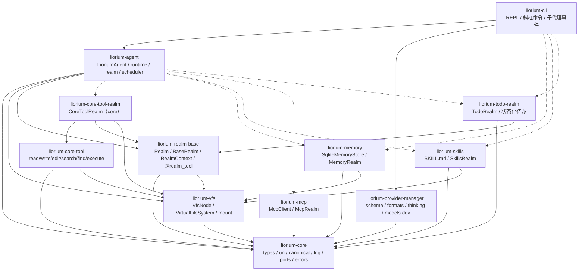
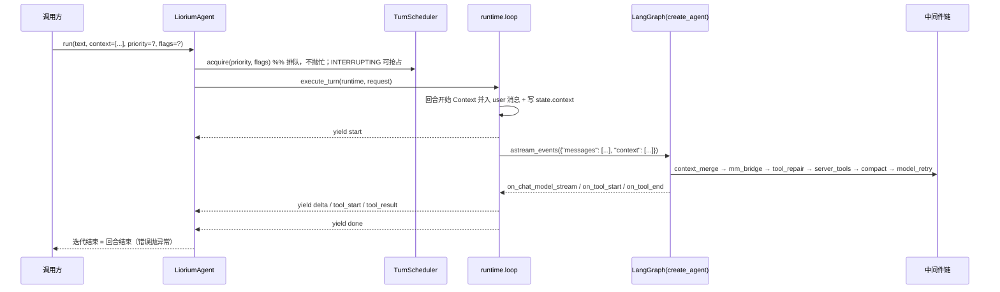
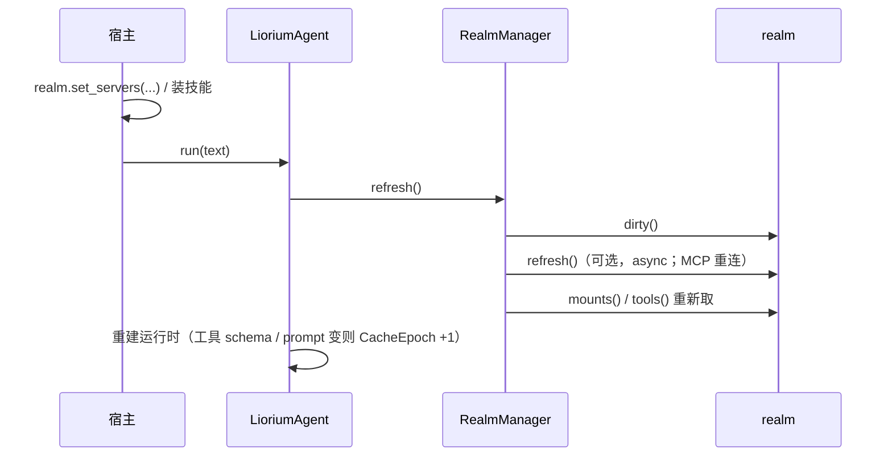

# Liorium 架构（实现视角）

> 决策记录在 `docs/plans/2026-11-04-liorium-agent-core.md`（唯一真相）。
> 本文只描述**当前代码怎么组织的**，方便第二个宿主接进来。

## 1. 包与依赖方向



`liorium-cli` 是官方宿主：装配 Agent、渲染事件、订阅 `SubagentRealm` 的 ``events()``
做 `/subagent`。宿主的并发/展示策略留在 CLI 里，不回流到库。

`liorium-provider-manager` 是宿主侧的 Provider 管理库：配置 schema、四种 API 格式、
思考能力/参数、`/models` 自动发现、models.dev 目录与模型构建。它只依赖 `liorium-core`，
不 import `liorium.agent`/`liorium.cli`；默认配置路径与交互向导由宿主提供。

`tests/test_architecture.py` 用 AST 守这条线：core 只依赖标准库；任何包不许 import
旧后端模块或旧插件系统；能力包之间互不依赖；裸 `asyncio.create_task` 只允许在
`liorium/realm_base/base.py`（`RealmTaskScope`）与 `cli/subagents.py`（CLI 宿主自己托管的
事件监控任务）。

> 2026-11-06 决策：能力包（`liorium-core-tool` / `liorium-memory` / `liorium-skills` /
> `liorium-mcp`）**可以** import `liorium.agent` 的 realm 契约（取消反向依赖禁令，
> 当前尚无包实际使用）；能力包之间仍互不依赖。`Realm.mounts()` 的返回类型是 `VfsMount`
> （计划 §3.3），所以它们仍需要 `liorium-vfs`。

`liorium-realm-base`（2026-11-07）是 realm 的**契约与写作 API**：`Realm` / `BaseRealm` /
`RealmContext` / `JsonStateStore` / `TurnInfo` / `@realm_tool`。它只依赖 `core` + `vfs`，
模块级不 import 任何 `langchain*` / `langgraph*`（守卫 `test_realm_base_stays_light`），
所以第三方 realm 作者不必为了写一个 realm 装下整个 Agent 运行时。`liorium-agent` 依赖它并
re-export 旧名字（`from liorium.agent import BaseRealm` 仍可用，且是同一个对象）。

`liorium-todo-realm` 是**只有 realm 的能力包**：只依赖 `core` + `realm_base`（连
`liorium.agent` / `liorium-vfs` 都不 import），提供 `todo` / `todo_list` 两个工具、四个状态
（`pending` / `processing` / `blocked` / `finished`），并用第五拍每 50 回合提醒一次未完成事项。

`liorium-core-tool-realm`（2026-11-08）是六个核心工具的 realm 壳，**`liorium-agent` 不再依赖
`liorium-core-tool`**：工具实现留在 `liorium-core-tool`，装配成 `RealmSpec(id="core")` 才生效。
于是「Agent 自带什么工具」这个问题消失了 —— `Agent._prepare_runtime()` 里只有
`tools = realms.tools()`，零工具也是合法装配。

**realm 实例作用域**（2026-11-08）：`instance_scope="tree"` 的 realm（memory / skills / mcp /
subagents）整棵树一份实例；子 Agent 只借用它的 `tools()`，不重复挂载、不重复消费周期上下文、
不重复生效中间件与提示词；`"agent"` 的 realm（core / todo）每个 Agent 一份、状态在各自 inbox 下。
框架在启动期拒绝「`agent` 级 realm 返回挂载点」，因此同一路径不可能有两套状态
（详见 [design/realm-scope.md](design/realm-scope.md)）。

## 2. 一个回合发生了什么



- 事件只有 9 种；`run()` 是唯一出口，终止用异常（`TurnInterrupted` / `TurnDropped` / `TurnError`）。
- `inject()` 只入队；`context_merge` 在**下一个模型调用前**把它物化成独立 user 消息（安全点）。
- 第五拍：拿到执行位后问一次 `realms.context_for_turn(TurnInfo)`；到期且返回非空才排队，
  同样落在安全点，成为独立 `<context>` 消息（不重写历史前缀）。
- `interrupt()` 取消本回合的托管任务与模型流；历史里被打断的半条消息保留，由 `tool_repair` 补占位。

## 3. 模块地图（`liorium-agent`）

| 模块 | 职责 |
|---|---|
| `spec.py` | `AgentSpec` / `RealmSpec` / `Limits` / `BootSpec` / `Profile`（语法糖）；结构指纹（排除 id/inbox/boot） |
| `agent.py` | `LioriumAgent`：`start/close/run/inject/interrupt/apply/reset_dialog/status` |
| `context.py` | `ContextChannel`：待物化队列 + 审计记录 |
| `status.py` | `AgentStatus` / `ApplyResult` / `CacheEpoch` |
| `realm/base.py` | **re-export**（实体在 `liorium.realm_base`）：`Realm` 协议、`RealmContext`（`vfs/state/params/inbox/conversation/spawn/log`）、`JsonStateStore`、`RealmTaskScope`、`TurnInfo` |
| `realm/manager.py` | 装配、`requires` 拓扑排序、start/stop、工具名冲突、失败降级、挂载回滚、dirty 刷新、conversation scope、第五拍（`context_for_turn` + 相位落盘） |
| `realm/subagent.py` | `SubagentRealm`：`newSubagent` / `invokeSubagent` / `wait_for_subagent` / `stopSubagent` / `removeSubagent` / `listSubagents`，`subagents://` 投影，名册与正文落盘（[`design/subagent-state.md`](design/subagent-state.md)） |
| `runtime/loop.py` | `execute_turn`：拼 input、跑图、翻译事件、`max_turns` 保护 |
| `runtime/stream.py` | LangGraph 事件 → Liorium 事件（四种 API 格式；`call_id` = run_id） |
| `runtime/state.py` | `LioriumState`（`messages` + `context` channel） |
| `runtime/scheduler.py` | 单执行位 + 调用级优先级 + FIFO + 三个标志（`INTERRUPTING` / `EXCLUSIVE` / `DROPPABLE`），取消不泄漏 |
| `runtime/prompt.py` | 身份 → 规则 → realm 片段 → 技能清单 → 尾注（顺序固定） |
| `runtime/checkpoint.py` | `AsyncSqliteSaver` 生命周期、system 消息植入、`reset_dialog` |
| `runtime/tools.py` | 工具输出拦截（OutputStore + artifact 引用） |
| `runtime/output_store.py` | `artifact://` 完整内容存储（60000 字符 / 300 行摘要） |
| `runtime/repair.py` | 纯函数：悬空 tool_call 修复（压缩与 tool_repair 共用） |
| `runtime/usage.py` | API 上报 token 归一化（Anthropic/OpenAI/Gemini 口径） |
| `runtime/middleware/` | 基座链（顺序固定）：context_merge → mm_bridge → tool_repair → server_tools → compact → model_retry |

## 4. 扩展点（realm）

一个能力 = **工具 + VFS 挂载 + 状态 + `prompt_fragment()`**，外加一条可选的动态节拍
（第五拍：`context_every` + `context_items()`，见 §4.3）：

```python
from liorium.realm_base import BaseRealm, RealmContext, realm_tool
from liorium.vfs import VfsMount, VirtualFileSystem


class WeatherRealm(BaseRealm):
    id = "weather"
    requires = []

    @realm_tool                          # 工具（schema 变化 ⇒ CacheEpoch +1）
    async def weather_lookup(self, city: str) -> str:
        """查一个城市的当前天气。"""
        return ...

    def prompt_fragment(self) -> str:    # 用法说明随包走（跨工具工作流）
        return "问穿衣/出行建议时，先查天气。"

    def mounts(self):                    # /weather ⇔ weather://
        fs = VirtualFileSystem(owner_id="weather")
        return {"/weather": VfsMount(prefix="/weather", vfs=fs, readonly=True)}

    async def start(self, ctx: RealmContext):
        ctx.spawn(self._prefetch_hourly())   # 托管后台任务，禁止裸 create_task

    async def stop(self, ctx: RealmContext):
        ...


agent = LioriumAgent(
    spec=AgentSpec(id="my-agent", inbox_dir=Path("agents/my-agent"), model="deepseek::chat",
                   prompt_sources=("AGENT.md", "ROLE.md"), realms=[RealmSpec(id="weather")],
                   limits=Limits(context_window=200_000, max_turns=100)),
    model_factory=make_chat_model,
    realm_factories={"weather": lambda spec: WeatherRealm()},
)
```

- `requires` 拓扑排序；工具名冲突直接 `failed`（带冲突详情），不静默跳过。
- realm 起不来 ⇒ 该 realm `failed`、其工具与挂载移除、其它 realm 照常（降级但可用）。
- `apply(spec)` 只重建指纹变化的部件；失败保留旧部件并返回 `ApplyResult.failed`。

### 4.1 运行期刷新（v1.1：realm 自报 dirty）

`RealmSpec.params` 之外的变化（MCP 发现了新工具、调用方装了技能）不进 spec 指纹，
由 realm 自己记账，Agent 在**回合边界**（拿到执行位之后）统一处理：



realm 可选实现三个钩子（`BaseRealm` 有默认空实现）：

| 钩子 | 语义 |
|---|---|
| `dirty() -> bool` | 真相源变了、需要刷新 |
| `mark_dirty()` / `clear_dirty()` | 宿主标记 / 刷新后清账 |
| `async refresh()` | 刷新前重连（MCP）；失败按 §C5 降级 |
| `skills() -> list[str]` | 预载进 prompt「技能清单」段 |

- 刷新失败 ⇒ 该 realm 标 `failed`、撤工具与挂载，其它 realm 照常。
- `state_scope="conversation"` 的 realm 状态按 thread 分桶，`reset_dialog()` 时清空；
  `agent` scope 跨对话保留（计划 §C6 / §3.3）。
- `Profile`（`AgentSpec.with_profile`）只是"一组 realm + prompt + toolset"的语法糖，
  合并结果进指纹，和手写同一组声明等价。

## 4.2 realm 能力包（v1.1）

| 包 | 模块 | 能力面 |
|---|---|---|
| `liorium-memory` | `store.py`（schema 与旧 `memory.sqlite` 一致）、`fts.py`、`vectors.py`、`embeddings.py`、`search.py`、`indexer.py`、`graph.py`、`extract.py`、`migrate.py`、`realm.py`、`tools.py` | `memories://` 懒加载投影 + 混合检索（FTS5/向量/图谱 RRF）+ 实体抽取；写走 `write_handler` / `create_handler`，读走 `provider`（详见 [MEMORY](MEMORY.md)） |
| `liorium-skills` | `catalog.py`（`SKILL.md` 发现 + mtime 指纹）、`frontmatter.py`、`realm.py`、`tools.py` | `skills://` 只读挂载 + `list_skills` + prompt 技能清单 |
| `liorium-mcp` | `client.py`（stdio/sse/streamable-http，SDK 延迟导入）、`schema.py`（JSON Schema→pydantic）、`realm.py`、`tools.py` | 运行时发现工具（`<server>_<tool>`）+ `set_servers`/`mark_dirty` 重连 |
| `liorium-todo-realm` | `model.py`（状态机 + 渲染）、`realm.py` | `todo`（add/update/remove）/ `todo_list` + 每 50 回合的未完成清单提醒（只在有 `pending`/`processing` 时） |

**投影目录的写入**：`VfsNode.create_handler`（v1.1 新增）让"本树里还不存在的路径"交给
目录节点处理（例如 memory 写进 SQLite），而不是在 VFS 里凭空建一个临时的、重启即丢的节点；
handler 返回的字符串走 ACK 通道（`↳ ack`）。

## 4.3 周期上下文（第五拍，2026-11-07）

前面四条描述的是"这个能力提供什么"，只在装配和刷新时读一次。第五拍补的是**运行期**：
realm 按回合节奏说一句"现在有这些事"。

```python
class TodoRealm(BaseRealm):
    context_every = 50      # 每 50 个 run() 给一次机会；0 = 不参与（默认）
    context_first = True    # 第 1 回合先问一次，再进入 50 的节奏

    def context_items(self, turn: TurnInfo):     # 可 sync 可 async
        if not self._open_items():
            return None      # 返回空 = 不消费周期，下一回合继续问
        return ContextItem(source="realm:todo", text=render(self._open_items()))
```

| 规则 | 行为 |
|---|---|
| 计时 | 每个 origin 匹配的回合 `due -= 1`；归零那一回合才调用 |
| 返回空 | 不消费周期（`due` 停在 0）—— 空的待办清单不会白等 50 轮 |
| 返回非空 | 相位重置为 N 并写进 realm 自己的 state（`__context_due__` 保留键）⇒ 跨重启保留 |
| 异常 | 记 error、只跳过这个 realm、下一回合重试；不改 `record.state` |
| 落点 | `ContextChannel.queue()` → `context_merge` 在下一个安全点物化成独立 `<context>` user 消息 |

为什么不用 `prompt_fragment()`：它属于 `CacheEpoch` 的一部分，改它要重写整段历史
（前缀缓存全失效）；注入消息在历史**末尾**，前面的前缀照常命中缓存。

## 5. 设计取舍（与既有实现的差异）

| 现状 | Liorium |
|---|---|
| `plugins/system` + 旧插件系统的 hook | 只有 realm 一种扩展机制（插件由宿主翻译） |
| `rebuild_runtime(reset_dialog, no_initial_chat)` 55 处调用 | `start/close/run/apply/reset_dialog` 4 个显式操作 |
| `invoke_agent_locked` + 队列 + `_StreamState` | `run()` 单消费者生成器；终止=迭代结束 |
| `get_output_store()` 进程单例 | 构造注入 `OutputStore`（每个 Agent 一份） |
| 全局 `state.PROMPT` | `AgentSpec.prompt_sources`（库不读产品配置） |
| `skill://` `sourceCode://` `img_source://` | `skills://` `code://`（`screen://`/`camera://` 由产品侧 realm 提供） |
