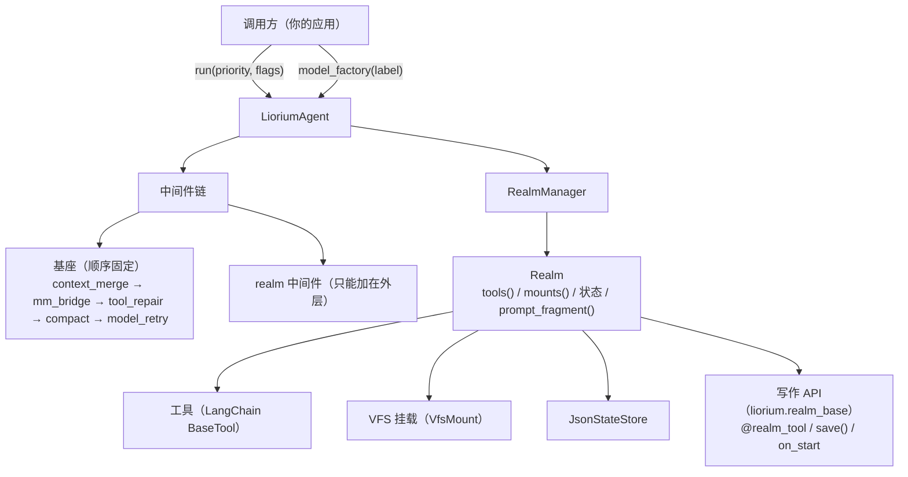
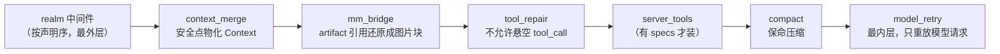

# Liorium 扩展指南

Liorium 只有**一个**能力扩展机制：realm。中间件、调度参数、模型工厂、工具都是围绕它
的固定插槽。本文按「写什么 → 放哪里 → 有什么约束」组织，每个示例都能跑。



| 想加的东西 | 放在哪 | 关键约束 |
|---|---|---|
| 一种能力（读写外部系统、带自己的工具/数据） | `Realm` 子类 | 优先 `from liorium.realm_base import BaseRealm`（只依赖 core + vfs，不背 langchain）；也可以 import `liorium.agent`（re-export 同一批名字）；能力包之间互不依赖 |
| 请求/响应级的横切逻辑 | `Realm.middleware()` 返回的 `AgentMiddleware` | 只能追加在基座**外层**；顺序不可重排 |
| 优先级 / 抢占 / 拥塞丢弃 | `run(priority=..., flags=...)` | 库只保证**同一个 Agent** 内排队；跨 Agent 并发由调用方 semaphore 包住 |
| 模型实例的构造与缓存 | `model_factory` | `(label) -> BaseChatModel`；实例不进 spec |
| 新工具 | `Realm.tools()` 返回 `@tool` | 名字全局唯一；输出会被 `OutputStore` 包装 |

---

## 1. 写一个自定义 Realm

一个 realm = **工具 + VFS 挂载 + 状态 + `prompt_fragment()`**。下面是最小可运行版本
（天气查询：只读 `weather://` 挂载 + 一个工具 + 计数状态 + dirty 刷新）：

```python
# custom_realm.py
import asyncio
from pathlib import Path
from typing import Any, Iterator, Sequence

from langchain_core.callbacks import CallbackManagerForLLMRun
from langchain_core.language_models.chat_models import BaseChatModel
from langchain_core.messages import AIMessage, AIMessageChunk, BaseMessage
from langchain_core.outputs import ChatGeneration, ChatGenerationChunk, ChatResult
from langchain_core.tools import tool

from liorium.agent import AgentSpec, BaseRealm, Limits, RealmSpec, LioriumAgent
from liorium.core.types import Text
from liorium.vfs import VirtualFileSystem, VfsMount, VfsNode


class EchoModel(BaseChatModel):
    """离线假模型（真实场景换成你的 ChatModel）。"""

    @property
    def _llm_type(self) -> str:
        return "liorium-echo"

    def bind_tools(self, tools: Sequence[Any], **kwargs: Any) -> "EchoModel":
        return self

    def _reply(self, messages: Sequence[BaseMessage]) -> str:
        last = next((m for m in reversed(messages) if m.type == "human"), None)
        return f"收到：{last.content}" if last is not None else "收到。"

    def _generate(self, messages, stop=None, run_manager=None, **kwargs) -> ChatResult:
        return ChatResult(
            generations=[ChatGeneration(message=AIMessage(content=self._reply(messages)))]
        )

    def _stream(self, messages, stop=None, run_manager=None, **kwargs) -> Iterator[ChatGenerationChunk]:
        text = self._reply(messages)
        for i in range(0, len(text), 4):
            yield ChatGenerationChunk(message=AIMessageChunk(content=text[i : i + 4]))


class WeatherRealm(BaseRealm):
    """最小可用 realm：只读挂载 + 一个工具 + 计数状态 + dirty 刷新。"""

    id = "weather"
    requires: list[str] = []
    state_scope = "agent"          # "agent" 跨对话保留；"conversation" 按 thread 分桶

    def __init__(self, spec: Any = None) -> None:
        self.params = dict(getattr(spec, "params", {}) or {})
        self.rows = {"beijing": "晴 26C", "shanghai": "小雨 21C"}
        self.queries = 0
        self._vfs: VirtualFileSystem | None = None
        self._tools: list[Any] | None = None
        self._dirty = False

    # -- 生命周期 -------------------------------------------------------
    async def start(self, ctx) -> None:
        self._vfs = self._build_vfs()
        # realm 状态：可 JSON 化，落在 <inbox>/realm_state/weather.json
        await ctx.state.update_many({"rows": len(self.rows), "queries": self.queries})

    async def stop(self, ctx) -> None:
        self._vfs = None
        self._tools = None

    # -- 四件套 ---------------------------------------------------------
    def mounts(self) -> dict[str, VfsMount]:
        assert self._vfs is not None
        return {
            "/weather": VfsMount(
                prefix="/weather", vfs=self._vfs, readonly=True, description="weather"
            )
        }

    def prompt_fragment(self) -> str:
        return (
            "天气（`weather://`，只读）：`read weather://<city>` 查当前天气；"
            "需要结构化结果时用 `weather_lookup`。"
        )

    def tools(self) -> list[Any]:
        if self._tools is None:
            realm = self

            @tool
            async def weather_lookup(city: str) -> str:
                """查一个城市的当前天气。"""
                realm.queries += 1
                return realm.rows.get(city.strip().lower(), f"没有 {city} 的数据")

            self._tools = [weather_lookup]
        return list(self._tools)

    def middleware(self) -> list[Any]:
        return []

    # -- v1.1 可选钩子：真相源变了 --------------------------------------
    def dirty(self) -> bool:
        return self._dirty

    def mark_dirty(self, flag: bool = True) -> None:
        self._dirty = bool(flag)

    def clear_dirty(self) -> None:
        self._dirty = False

    async def refresh(self) -> None:
        """重连 / 重建投影（在重挂载之前执行）。"""
        self._vfs = self._build_vfs()

    # -- 内部 -----------------------------------------------------------
    def _build_vfs(self) -> VirtualFileSystem:
        fs = VirtualFileSystem(owner_id="weather")
        for city, report in self.rows.items():
            fs.root.add_child(VfsNode(name=city, content=Text(report), writable=False))
        return fs


def make_realm(spec: Any) -> WeatherRealm:
    return WeatherRealm(spec)


async def main() -> None:
    inbox = Path(".liorium-custom-realm")
    inbox.mkdir(exist_ok=True)
    (inbox / "AGENT.md").write_text("你是天气助手。", encoding="utf-8")

    agent = LioriumAgent(
        spec=AgentSpec(
            id="weather-demo",
            inbox_dir=inbox,
            model="local::echo",
            prompt_sources=("AGENT.md",),
            realms=[RealmSpec(id="weather", params={"unit": "c"})],
            limits=Limits(context_window=0, max_turns=4),
        ),
        model_factory=lambda label: EchoModel(),
        realm_factories={"weather": make_realm},
    )
    await agent.start()
    try:
        print("工具:", [tool.name for tool in agent.tools])
        print("挂载:", await agent.vfs.read_text("/weather/beijing"))
        print("状态文件:", (inbox / "realm_state" / "weather.json").is_file())
        print("realm:", [(r.id, r.state, r.mounts) for r in agent.status().realms])

        async for _event in agent.run("北京天气如何"):
            pass

        # 宿主知道真相源变了：主动刷新（不必等下一个回合边界）
        realm = agent.realms.record("weather").instance
        realm.mark_dirty()
        print("刷新:", await agent.refresh_realms(force=False))
        print("epoch:", agent.epoch.value)
    finally:
        await agent.close()


asyncio.run(main())
```

注册方式：`AgentSpec.realms=[RealmSpec(...)]` + `realm_factories={"<id>": 工厂}`。
工厂签名是 `(RealmSpec) -> Realm`，类的 `__init__(self, spec=None)` 正好能直接当工厂用。

### 1.1 Realm 契约

| 成员 | 必须 | 语义 |
|---|---|---|
| `id` | 是 | 必须等于 `RealmSpec.id`（不一致 `RealmError`） |
| `requires` | 否 | 依赖的 realm id；`RealmManager` 拓扑排序，成环/缺依赖 `RealmDependencyError` |
| `state_scope` | 否 | `"agent"`（默认，跨对话）或 `"conversation"`（按 thread 分桶，`reset_dialog()` 清空）；其它值 `RealmError` |
| `instance_scope` | 否 | `"agent"`（默认：每个 Agent 一份、状态在各自 inbox、**不许**返回挂载点）或 `"tree"`（整棵树一份实例，子 Agent 只借工具）；见 [design/realm-scope.md](design/realm-scope.md) |
| `tools()` | 否 | 返回 LangChain 工具；默认实现收集 `@realm_tool` 方法（§1.3）；同名工具与别的 realm/基座冲突 ⇒ **整个装配报 `ToolNameConflictError`** |
| `mounts()` | 否 | 返回 `dict[prefix, VfsMount]`；非 `VfsMount` 抛 `RealmError`；挂载冲突会回滚已挂的部分 |
| `prompt_fragment()` | 否 | 进 system prompt 的「realm 片段」段（按启动顺序，`<!-- realm:<id> -->` 包裹） |
| `middleware()` | 否 | 追加到基座**外层**的中间件（顺序不可重排） |
| `start(ctx)` / `stop(ctx)` | 否 | 默认实现挂 `self.ctx` 并调 `on_start()` / `on_stop()`；起不来 ⇒ 该 realm 标 `failed`，撤工具与挂载，其它 realm 照常（降级但可用） |
| `dirty()` / `mark_dirty()` / `clear_dirty()` / `async refresh()` | 否 | v1.1 运行期刷新；Agent 在回合边界（或 `refresh_realms()`）统一处理 |
| `skills()` | 否 | 预载进 prompt「技能清单」段的条目 |
| `context_every` / `context_first` / `context_origins` | 否 | 第五拍节奏（§1.4）：每 N 回合问一次 / 第 1 回合先问 / 只对哪些 `origin` 计时 |
| `context_items(turn)` | 否 | 第五拍：返回 `None` / `str` / `ContextItem` / 序列；返回空**不消费周期** |

### 1.2 `RealmContext` 能拿到什么

| 成员 | 用途 |
|---|---|
| `ctx.vfs` | 本 Agent 的 `VirtualFileSystem`（读别的挂载点、做投影） |
| `ctx.state` | `JsonStateStore`：`async get/set/delete/all/update_many`，同步 `load()/flush()`；值必须可 JSON 化 |
| `ctx.params` | `RealmSpec.params` 的副本（已校验可指纹化） |
| `ctx.inbox_dir` | Agent 根目录（能力包用它定位 `<inbox>/memory`、`<inbox>/skill.d`） |
| `ctx.workspace_root` | 裸路径基准（`AgentSpec.effective_workspace_root`），可能与 `inbox_dir` 不同 |
| `ctx.artifacts` | `ArtifactStore` 端口（Agent 的 `OutputStore`）；工具长输出回读用 |
| `ctx.agent_spec` | 装配进 Agent 时的 `AgentSpec`（只读；`core` realm 用它读 `toolsets`） |
| `ctx.conversation_id` | `state_scope="conversation"` 的分桶键 |
| `ctx.spawn(coro, name=...)` | **唯一**允许的后台任务入口；`stop()` 时统一取消 |
| `ctx.inject(text, source=..., meta=...)` | 推一条 Context 到下一个安全点（同步、永不打断）；与第五拍的"拉"共用同一条管道 |
| `ctx.agent_id` / `ctx.realm_id` / `ctx.log` | 标识与 logger |

### 1.3 写作 API：把脚手架删掉（2026-11-07）

`liorium-realm-base` 提供一套可选糖，**只减样板、不改语义**：

| 糖 | 省掉什么 |
|---|---|
| `BaseRealm.__init__(spec)` | 手写 `__init__` 解析 `params`；类本身就能当 `(spec) -> Realm` 工厂 |
| `on_start()` / `on_stop()` | 手写 `start/stop` 只为存 `ctx` |
| `self.state` / `await self.save(**values)` | 每次 `ctx.state.set(...)` 之后还要记得 `flush()` |
| `@realm_tool` + 默认 `tools()` | 手写 `tools()` 里那一串 `@tool` 闭包 |

同一个 WeatherRealm，用糖之后（业务代码 20 行，没有空方法）：

```python
from liorium.realm_base import BaseRealm, realm_tool
from liorium.vfs import VfsMount, VirtualFileSystem


class WeatherRealm(BaseRealm):
    id = "weather"

    async def on_start(self) -> None:
        self.rows = await self.state.get("rows", {"beijing": "晴 26C"})

    @realm_tool
    async def weather_lookup(self, city: str) -> str:
        """查一个城市的当前天气。"""
        return self.rows.get(city.strip().lower(), f"没有 {city} 的数据")

    def prompt_fragment(self) -> str:
        return "天气（`weather://`，只读）：用 `weather_lookup` 查当前天气。"

    def mounts(self):
        fs = VirtualFileSystem(owner_id="weather")
        return {"/weather": VfsMount(prefix="/weather", vfs=fs, readonly=True)}
```

边界与约定：

- `@realm_tool` 只打标记；`tools()` 默认实现按**类定义顺序**收集，子类覆盖父类同名方法只留子类那份。
  **自己重写 `tools()` 就完全绕过糖**，老 realm 零改动；
- 工具名默认取方法名、描述默认取 docstring；要指定就 `@realm_tool(name=..., description=..., return_direct=True)`
  （其余关键字原样转给 `langchain_core.tools.tool`）；
- `save()` 一定 `flush()` —— 这是它存在的主要理由（`JsonStateStore.set` 只标 dirty，不 flush 等于没存）；
- **内存态不等于状态**：构造时算出来的 `self.items` 之类，重启后没人给你重算。要么每次改动就
  `save()`，并在 `on_start()` 里读回；要么像 `SubagentRealm` 那样把大正文放文件、名册放 state
  （见 [`design/subagent-state.md`](design/subagent-state.md)）；
- 糖要在 `tools()` 里构建工具，所以需要 `langchain-core`：装 `liorium-realm-base[tools]`
  （`liorium-agent` 已经带了）。**只做挂载/状态的 realm 不必装**，`import liorium.realm_base` 不碰 langchain；
- 不用糖也完全合法：`Realm` 是鸭子类型协议，`liorium-memory/skills/mcp` 三个 realm 就是自己实现的。

### 1.4 第五拍：按回合节奏注入 Context（2026-11-07）

四件套描述"这个能力提供什么"，只在装配/刷新时读一次。第五拍补的是运行期：
realm 每 N 个回合说一句"现在有这些事"。框架管**什么时候**，realm 只管**是什么**。

```python
from liorium.realm_base import BaseRealm, TurnInfo, realm_tool


class TodoRealm(BaseRealm):
    id = "todo"
    state_scope = "agent"
    context_every = 50      # 每 50 个 run() 给一次机会（0 = 不参与）
    context_first = True    # 第 1 回合先问一次，再进入 50 的节奏

    def context_items(self, turn: TurnInfo):
        pending = [item for item in self.items if item["state"] in ("pending", "processing")]
        if not pending:
            return None     # ← 返回空 = 不消费周期：下一回合继续问
        body = "\n".join(f"- [{item['state']}] {item['text']}" for item in pending)
        return f"待办提醒：\n{body}\n\n请按进度用 `todo` 更新状态。"
```

| 规则 | 行为 |
|---|---|
| `context_every = 0` | 一次都不问（默认；现有能力包零成本） |
| 计时 | 每个 origin 匹配的回合 `due -= 1`；归零那一回合调用 |
| 返回空 | 不消费周期 —— 清单空着不浪费额度，内容一出现立刻注入 |
| 返回非空 | 相位重置为 N 并写进 realm 自己的 state（保留键 `__context_due__`）⇒ 跨重启保留 |
| 落点 | 安全点物化成独立 `<context source="realm:<id>">` user 消息；前面的历史前缀照常命中缓存 |
| 参数 | `RealmSpec.params["context_every"]` / `["context_first"]` 覆盖类属性 |

三条必须知道的坑：

1. **必须廉价**：`context_items()` 在持有执行位时执行，只读内存/状态；检索、网络、LLM
   一律放 `ctx.spawn(...)` + `ctx.inject(...)`（推送侧，永不打断）；
2. **返回空 ≠ 出错**：空字符串 / 空列表 / `None` 都表示"这回合没内容"，不要让框架跳过整个周期；
3. **一个节奏一个 realm**：要「待办每 50 轮 + 日程每 10 轮」就拆成两个 realm（与 C2 一致），
   不在 API 里塞 `schedules=[...]`。

现成例子见 [`liorium-todo-realm`](../packages/liorium-todo-realm/README.md)：`context_every=50`、
只在有 `pending`/`processing` 时提醒、注入正文里带"按状态更新"的行为约束。

---

## 2. 写一个 Middleware

基座链的顺序由库固定（`runtime/middleware/__init__.py::BASE_ORDER`）：



规则（违反即破坏正确性前提）：

1. **realm 只能追加在外层**：`build_chain()` 把 `realm_middlewares` 放在最前面，
   任何"重排基座"的写法都没有入口；
2. `model_retry` 必须最内层（重试只该重放模型请求，不该重放工具与压缩）；
3. `tool_repair` 必须永远打开（否则一次中断就能让下一回合的请求非法）；
4. 中间件是普通的 `langchain.agents.middleware.AgentMiddleware`，可以持有自己的状态
   （realm 实例持有它，重建运行时不会丢）。

```python
# 接第 1 节的 WeatherRealm
from langchain.agents.middleware import AgentMiddleware


class CountMiddleware(AgentMiddleware):
    """统计本 Agent 的模型调用次数（只读，不改请求）。"""

    def __init__(self) -> None:
        super().__init__()
        self.model_calls = 0

    def before_model(self, state, runtime):
        self.model_calls += 1
        return None       # 返回 dict 才会写 state；这里只做观察


class WeatherRealmWithCounter(WeatherRealm):
    def __init__(self, spec=None) -> None:
        super().__init__(spec)
        self.counter = CountMiddleware()

    def middleware(self):
        return [self.counter]
```

把工厂换成 `WeatherRealmWithCounter` 后，`agent.realms.record("weather").instance.counter.model_calls`
就是本回合的模型调用次数。异步钩子（`abefore_model` / `awrap_model_call`）同样可用。

> 不要用中间件做「工具注册」「realm 装配」「并发上限」——那是 realm / 调度参数 /
> 调用方 semaphore 的职责。

---

## 3. 调度：优先级与三个标志

同一个 Agent 只有一个执行位：并发 `run()` 自动排队（不抛忙）。轻重缓急用**调用级**
参数表达，而不是改 spec：

```python
from liorium.agent import FLAG

# 用户插话：优先级更高，允许抢正在跑的后台回合
async for event in agent.run("先回答我", priority=5, flags=FLAG.INTERRUPTING):
    ...

# 后台触发器：晚了就没意义，拥塞时可以直接丢
async for event in agent.run("确认一下日程", priority=-1, flags=FLAG.DROPPABLE):
    ...

# 一次性审计：别被任何人打断
async for event in agent.run("跑完整检查", priority=0, flags=FLAG.EXCLUSIVE):
    ...
```

| 参数 | 语义 |
|---|---|
| `priority: int` | **越大越优先**；同档 FIFO。`None` 用 `self.priority`（构造参数，默认 0；子代理父 -1） |
| `FLAG.INTERRUPTING` | 让步进：优先级**严格更高**且对方不是 `EXCLUSIVE` 时，取消正在跑的回合；被抢占方抛 `TurnInterrupted(reason="preempted")` |
| `FLAG.EXCLUSIVE` | 拒绝被抢占（更高优先级的 `INTERRUPTING` 只能排队） |
| `FLAG.DROPPABLE` | 排队已满（`queue_depth() >= QUEUE_MAX`，默认 50）时立即抛 `TurnDropped`，不开始执行 |

**跨 Agent 的并发不归库管**：同一时刻最多几个 Agent 在跑，是调用方的产品策略，
最典型的就是 `async with semaphore:` 包住整个 `async for`：

```python
semaphore = asyncio.Semaphore(2)

async def drain(agent, text):
    async with semaphore:
        async for event in agent.run(text):
            ...
```

调度语义与抢占时序见 [`design/scheduler.md`](design/scheduler.md)。

---

## 4. 写一个 model_factory

契约只有一条：`(label: str) -> BaseChatModel`。`label` 就是 `AgentSpec.model`，是**不透明**
字符串（例如 `"deepseek::chat"`），库只把它放进指纹和日志。

```python
from typing import Any


def make_chat_model(label: str) -> Any:
    provider, model = label.split("::", 1)
    from langchain_openai import ChatOpenAI

    return ChatOpenAI(model=model, temperature=0.3)   # 端点 / key 由宿主环境提供
```

规则：

- **不要**把模型实例放进 `AgentSpec` / `RealmSpec.params`——spec 必须能被
  `fingerprint()` 序列化，实例会直接 `TypeError`；
- 同一个 label 可以复用实例（宿主自己缓存）；`apply()` 改 `model` 会重新调工厂；
- 假模型必须实现 `bind_tools(tools, **kwargs)`（`create_agent` 建图时会调；不实现会
  `NotImplementedError`）；
- 不实现流式的模型也能用：`on_chat_model_end` 会补一条 `delta`（`runtime/stream.py`）。

---

## 5. 写一个工具并注册

工具是普通的 LangChain `BaseTool`，注册点只有一个：**某个 realm 的 `tools()`**。

```python
from langchain_core.tools import tool

from liorium.agent import BaseRealm


@tool
async def word_count(path: str) -> str:
    """统计一个文件的词数（示例工具）。"""
    from pathlib import Path

    text = Path(path).read_text(encoding="utf-8")
    return f"{len(text.split())} words"


class WordCountRealm(BaseRealm):
    id = "wordcount"
    requires: list[str] = []
    state_scope = "agent"

    def tools(self):
        return [word_count]

    def prompt_fragment(self) -> str:
        return "需要字数统计时用 `word_count`。"
```

装配：`realms=[RealmSpec(id="wordcount")]` + `realm_factories={"wordcount": WordCountRealm}`。

注意：

- **工具名必须全局唯一**（所有 realm 之间）：冲突 ⇒ `ToolNameConflictError`，
  不会静默跳过；
- `AgentSpec.toolsets["default"]` 只筛**六个核心工具**（由 `core` realm 读取，
  `build_core_tools(names=...)`），不会隐藏 realm 工具；未知核心工具名在装配时 `ValueError`；
- **`instance_scope` 要先想清楚**：默认 `"agent"` = 每个 Agent（含子代理）一份，状态落在
  各自 `inbox/realm_state/` 下；一旦你的 `mounts()` 非空，就必须声明 `"tree"`
  （整棵树共享一份实例、一次挂载、一个状态文件），否则启动期 `RealmError` ——
  见 [design/realm-scope.md](design/realm-scope.md)；
- 工具返回 `str` / `dict` / `list` 都可以：Agent 的包装层把长结果（超过
  `limits.max_tool_output_chars` 且含换行）存进 `OutputStore`，模型只看到摘要 +
  artifact 引用；工具抛异常会变成 `工具执行出错\n[完整输出: artifact://<id>]`；
- 需要多模态结果时返回 `{"kind": "multimodal_tool_result", "text": ..., "images": [...]}`
  （`read` 的图片路径就走这个协议，`mm_bridge` 负责还原）。

---

## 6. 常见坑

| 坑 | 现象 | 正确做法 |
|---|---|---|
| `RealmSpec.params` 里塞模型/回调/连接 | `SpecError: params 不可序列化` | 实例走工厂闭包（`realm_factories={"mcp": lambda spec: McpRealm(spec, client_factory=...)})` |
| 裸 `asyncio.create_task` | 架构守卫失败；任务在 `stop()` 后泄漏 | 一律 `ctx.spawn(coro)`（`RealmTaskScope` 是唯一白名单） |
| `mounts()` 返回 `dict[str, VfsNode]` | `RealmError: 返回了非 VfsMount` | 返回 `VfsMount(prefix=..., vfs=...)` 或 `VfsMount(prefix=..., node=...)` |
| 在 `child_provider` 里写 `async def` | `VfsError: child_provider 必须是同步函数` | 懒加载 provider 必须同步；异步内容放 `provider`（节点内容） |
| 用 `vfs.write()` 调 async `write_handler` | `VfsError: write_handler 是异步的，请使用 write_async` | 同步 handler 用 `write`；异步 handler 用 `write_async` |
| 在 VFS 里"顺便"建投影节点 | 重启即丢、`search` 读到幽灵数据 | 投影只由 realm 生成；realm 状态投影置 `should_be_included_in_search=False` |
| 用 `dirty()` 做重活 | 每个回合边界都会被调一次 | `dirty()` 只做廉价比对（mtime / revision）；重活在 `refresh()` |
| 期望 `apply()` 改 `id` / `inbox_dir` | `SpecError: 身份不可变` | 身份不进指纹；换身份 = 新建 Agent |
| 期望 `limits` 变化让 `CacheEpoch +1` | epoch 不动 | epoch 只看工具 schema + system prompt；这是记账，不是缓存失效信号 |
| 在 realm 里缓存全量投影 | 库变大后内存爆炸、外部写入看不到 | 用 `child_provider` / `children_provider` 懒加载（`liorium-memory` P0 的做法） |

## 7. 测试与调试

```powershell
# 单包测试
.\.venv\Scripts\python.exe -m pytest -q -p no:cacheprovider packages/liorium-agent/tests

# 架构守卫（依赖方向 / 禁词 / 命名空间包 / 裸 create_task）
.\.venv\Scripts\python.exe -m pytest -q -p no:cacheprovider tests/test_architecture.py

# 真模型端到端（默认跳过；需要 OPENCODE_GO_KEY 等环境变量）
.\.venv\Scripts\python.exe -m pytest -q -p no:cacheprovider -m live
```

- 假模型与工作区夹具在 `tests/liorium_testkit.py`（`ScriptedChatModel`、`write_workspace`），
  跨包测试共用；pytest 根 `conftest.py` 负责路径注入；
- 打印 `agent.status()` 能看到每个 realm 的 `state` / `error` / `tools` / `mounts`，
  这是排查"能力装上了但没生效"的第一站；
- 日志走 `liorium.*` 命名空间：`liorium.core.log.configure(level="DEBUG")` 或环境变量
  `LIORIUM_LOG_LEVEL`。
