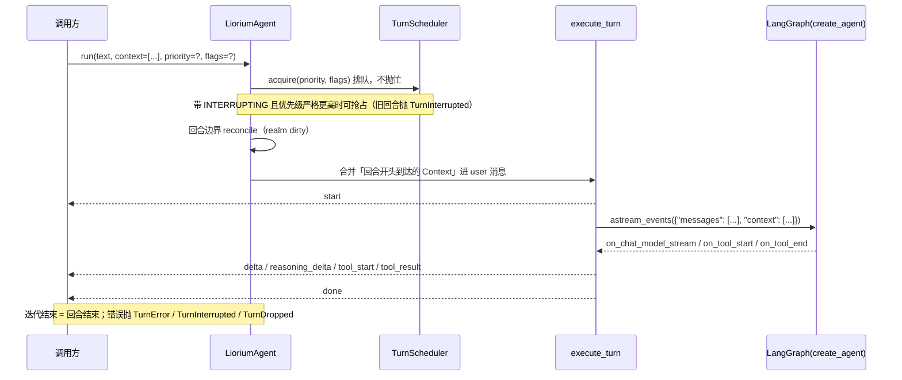

# Liorium 使用指南：从零到跑起来

> 本文的每个代码块都能直接运行。第 2 节的 `EchoModel` 是离线假模型，后面几节复用它，
> 所以**把整节代码放进同一个文件**（或把 `EchoModel` 留在文件顶部）即可。
> 需要真实模型时看第 3 节。所有签名与默认值以源码为准，详见 [API](API.md)。

## 1. 安装

```powershell
git clone https://github.com/liwusen/liorium-framework.git
cd liorium-framework
# 建 .venv 并安装 12 个模块（可编辑模式）+ 全部 extra
uv sync --all-packages --all-extras

# 本机 PyPI 慢时用离线模式（依赖已缓存过才行）
uv sync --all-packages --all-extras --offline

# 验证：全量测试（含架构守卫）
.\.venv\Scripts\python.exe -m pytest -q -p no:cacheprovider
```

Python 3.11+。开发期 12 个模块各自是可编辑安装的**命名空间包**：每个模块只有
`packages/<包>/src/liorium/<sub>/__init__.py`，那些 `src/liorium/` 下没有 `__init__.py`
（`tests/test_architecture.py` 会检查）；发布版则合并成**一个** `liorium` 发行版
（`pip install "liorium[all]"`），导入前缀与下表完全一致。

从 PyPI 安装（不克隆仓库）：

```powershell
pip install "liorium[all]"      # 全家桶；只要框架运行时用 pip install liorium
liorium-cli --help
```

| 模块（开发期 workspace 包） | 导入前缀 | 职责 |
|---|---|---|
| `liorium-core` | `liorium.core` | 类型 / URI / 指纹 / 日志 / 异常 / 端口（零第三方依赖） |
| `liorium-vfs` | `liorium.vfs` | `VirtualFileSystem` / `VfsNode` / 挂载（零第三方依赖） |
| `liorium-realm-base` | `liorium.realm_base` | realm 契约与写作 API：`BaseRealm` / `RealmContext` / `@realm_tool` |
| `liorium-core-tool` | `liorium.core_tool` | `read` / `write` / `edit` / `search` / `find` / `execute`（工具实现 + `ToolRuntime`） |
| `liorium-core-tool-realm` | `liorium.core_tool_realm` | 六个核心工具的 realm 壳：`RealmSpec(id="core")` 才装（extra `[core]`） |
| `liorium-agent` | `liorium.agent` | Agent 运行时、realm、中间件、调度、checkpoint |
| `liorium-memory` | `liorium.memory` | `memories://` 投影 + 混合检索 + 实体图谱（extra `[memory]`） |
| `liorium-skills` | `liorium.skills` | `skills://` 只读挂载 + `list_skills`（extra `[skills]`） |
| `liorium-mcp` | `liorium.mcp` | 运行时发现 MCP 工具（extra `[mcp]`） |
| `liorium-todo-realm` | `liorium.todo_realm` | 状态化待办 `todo` / `todo_list` + 每 50 回合提醒（extra `[todo]`） |
| `liorium-provider-manager` | `liorium.provider` | Provider schema / 四种 API 格式 / 思考 / 模型构建 |
| `liorium-cli` | `liorium.cli` | 官方命令行 Agent（`liorium-cli` / `python -m liorium.cli`） |

想先要一个能对话的成品，直接跑 CLI（真实模型、core 工具、记忆、技能、待办、子代理 ——
工具全部由 realm 提供，Agent 本身不带工具）：

```powershell
# 仓库内开发用模块入口（root 是虚拟 workspace，不装 console script）
# 1) 先配置 provider（交互式；也可以 setup providers add … 一条命令写进去）
.\.venv\Scripts\python.exe -m liorium.cli setup

# 2) 再对话
.\.venv\Scripts\python.exe -m liorium.cli --help
.\.venv\Scripts\python.exe -m liorium.cli -p "统计仓库里有多少个 .py 文件"

# pip 安装后才有 liorium-cli 命令：
#   liorium-cli setup
#   liorium-cli -p "统计仓库里有多少个 .py 文件"
```

配置落在 `~/.liorium/`：`providers.json`（provider + 密钥，0600）与 `config.json`
（非密钥设置：默认模型 / 思考 / 记忆 / 技能 / UI）。两个文件都可以不存在——新机器第一次
运行会建空骨架并进入「未配置」模式，`/setup` 或 `liorium-cli setup` 随时补配置；
`liorium-cli setup show|doctor|memory …` 见
[liorium-cli README](../packages/liorium-cli/README.md)。

## 2. 最小 Agent（离线可跑）

一个 Agent = `AgentSpec`（可序列化的装配）+ `model_factory`（把 `provider::model`
标签变成 LangChain ChatModel 实例）。`start()` **不调模型**，第一次模型调用发生在 `run()`。

```python
# minimal_agent.py
import asyncio
from pathlib import Path
from typing import Any, Iterator, Sequence

from langchain_core.callbacks import CallbackManagerForLLMRun
from langchain_core.language_models.chat_models import BaseChatModel
from langchain_core.messages import AIMessage, AIMessageChunk, BaseMessage
from langchain_core.outputs import ChatGeneration, ChatGenerationChunk, ChatResult

from liorium.agent import AgentSpec, Limits, LioriumAgent


class EchoModel(BaseChatModel):
    """离线假模型：把最后一条用户消息原样吐回来。"""

    @property
    def _llm_type(self) -> str:
        return "liorium-echo"

    def bind_tools(self, tools: Sequence[Any], **kwargs: Any) -> "EchoModel":
        # create_agent 建图时一定会调它；假模型没有工具，原样返回
        return self

    def _reply(self, messages: Sequence[BaseMessage]) -> str:
        last = next((m for m in reversed(messages) if m.type == "human"), None)
        return f"收到：{last.content}" if last is not None else "收到。"

    def _generate(
        self,
        messages: list[BaseMessage],
        stop: list[str] | None = None,
        run_manager: CallbackManagerForLLMRun | None = None,
        **kwargs: Any,
    ) -> ChatResult:
        return ChatResult(
            generations=[ChatGeneration(message=AIMessage(content=self._reply(messages)))]
        )

    def _stream(
        self,
        messages: list[BaseMessage],
        stop: list[str] | None = None,
        run_manager: CallbackManagerForLLMRun | None = None,
        **kwargs: Any,
    ) -> Iterator[ChatGenerationChunk]:
        text = self._reply(messages)
        for i in range(0, len(text), 4):
            yield ChatGenerationChunk(message=AIMessageChunk(content=text[i : i + 4]))


async def main() -> None:
    inbox = Path(".liorium-demo")
    inbox.mkdir(exist_ok=True)
    (inbox / "AGENT.md").write_text("你是 Liorium 的演示 Agent。", encoding="utf-8")

    agent = LioriumAgent(
        spec=AgentSpec(
            id="demo",
            inbox_dir=inbox,
            model="local::echo",
            prompt_sources=("AGENT.md",),
            limits=Limits(context_window=8000, max_turns=4),
        ),
        model_factory=lambda label: EchoModel(),
    )
    await agent.start()          # 起 realm / 开 checkpoint / 建图；不调模型
    try:
        async for event in agent.run("你好，Liorium"):
            print(event.to_dict())   # 扁平形态：{"type": ..., **payload}
    finally:
        await agent.close()          # 幂等


if __name__ == "__main__":
    asyncio.run(main())
```

输出（每个 delta 是一条流式分片）：

```text
{'type': 'start', 'turn_id': 'demo#1'}
{'type': 'delta', 'content': '收到：你'}
{'type': 'delta', 'content': '好，Ve'}
{'type': 'delta', 'content': 'sper'}
{'type': 'done', 'turn_id': 'demo#1'}
```

> 假模型不上报 token 用量，所以 `context_window > 0` 时日志里会多一条
> 「模型未上报 token 用量……自动压缩不会触发」的告警（只告警一次）。真实网关打开
> `stream_options.include_usage` 即可；这只是告警，不影响回合。

`AgentSpec` 的字段（全部有默认值，除前三个）：

| 字段 | 类型 / 默认值 | 说明 |
|---|---|---|
| `id` | `str`（必填） | 身份，`apply()` 时不可变；也进 `turn_id` 前缀（`demo#1`） |
| `inbox_dir` | `Path`（必填） | Agent 根目录：prompt 文件、checkpoint、realm 状态、artifact 的默认位置；**身份的一部分**，不可 `apply` 改 |
| `model` | `str`（必填） | 不透明标签（`provider::model`），只进指纹与日志；实例由 `model_factory` 提供 |
| `prompt_sources` | `tuple[str, ...] = ()` | prompt 文件，按序拼接；相对路径相对于 `inbox_dir`；文件缺失在 `start()` 报 `SpecError` |
| `realms` | `tuple[RealmSpec, ...] = ()` | realm 声明（见 [EXTENDING](EXTENDING.md)） |
| `toolsets` | `Mapping[str, tuple[str, ...]] = {}` | 由 `core` realm 读取：`"default"` 键筛六个核心工具名；未知名字抛 `ValueError`（Agent 自己不解释它） |
| `limits` | `Limits()` | 阈值，见第 9 节 |
| `boot` | `BootSpec \| None = None` | 首次引导语；**库不自动执行**，宿主自己决定要不要 `run(boot.message)` |
| `workspace_root` | `Path \| None = None` | 裸路径的基准；`None` 时等于 `inbox_dir` |

## 3. 接真实模型

`model_factory` 的唯一契约：`(label: str) -> BaseChatModel`。实例化、重试、缓存都是宿主的事；
模型实例**不进** `AgentSpec`（spec 必须可 JSON 指纹化）。

```python
import os
from typing import Any


def make_chat_model(label: str) -> Any:
    """``provider::model`` → LangChain ChatModel（这里用 OpenAI 兼容端点）。"""
    _provider, model = label.split("::", 1)
    from langchain_openai import ChatOpenAI

    return ChatOpenAI(
        model=model,
        base_url=os.environ["LIORIUM_BASE_URL"],
        api_key=os.environ["LIORIUM_API_KEY"],
        temperature=0.3,
    )
```

```powershell
uv pip install "liorium[openai]"      # 或 uv sync --all-extras 已经装好
$env:LIORIUM_BASE_URL = "https://api.deepseek.com"
$env:LIORIUM_API_KEY  = "<key>"
.\.venv\Scripts\python.exe minimal_agent.py
```

`liorium-cli` 的 `liorium/cli/providers.py` 是一份更完整的实现：按 provider
解析配置、按标签缓存实例、透传 OpenCode 的额外请求头。

## 4. 消息与事件

`run()` 返回的生成器是**唯一**事件出口，只产出 **9 种 Agent 事件**（2026-11-08 起没有
「宿主事件」：等待期间零事件，中断/丢弃/失败用异常表达）。
`tests/test_event_contract.py` 是这份契约的金样。

| type | payload | 含义 |
|---|---|---|
| `start` | `turn_id` | 回合开始；`turn_id` 形如 `<agent_id>#<序号>` |
| `delta` | `content` | 正文增量（空串不发） |
| `reasoning_delta` | `content` | 思考增量（OpenAI Chat 的 `reasoning_content` / Responses、Anthropic、Gemini 的 thinking 块） |
| `tool_start` | `tool_name` / `args` / `call_id` | 工具开始；`call_id` 取 LangGraph 的 `run_id` |
| `tool_result` | `tool_name` / `output` / `call_id` | 工具结果；与 `tool_start` 的 `call_id` 成对 |
| `compact_start` | 无 | 压缩开始（压缩调用的事件被分流，绝不进正文 `delta`） |
| `compact_delta` | `content` | 摘要文本（一次压缩只发一条，不是流式分片） |
| `compact_done` | `ok`（失败时另有 `error`） | 压缩结束；`ok=False` 表示失败（不改 checkpoint，回合继续） |
| `done` | `turn_id` | 回合正常结束；与 `start` 的 `turn_id` 相同 |

终止不是事件：

| 异常 | 语义 | 字段 |
|---|---|---|
| `TurnInterrupted` | 被 `interrupt()` 叫停或被更高优先级回合抢占；**不会**有 `done` | `reason`（抢占时 `"preempted"`） |
| `TurnDropped` | 排队拥塞被丢弃（`FLAG.DROPPABLE`）；从未开始执行 | `reason` |
| `TurnError` | 回合执行失败（模型 / 工具 / 图） | `message`、`cause` |

```python
from liorium.core.types import Event

print(Event("delta", {"content": "hi"}).to_dict())   # {'type': 'delta', 'content': 'hi'}
try:
    Event("notify", {})
except ValueError as exc:
    print("未知类型被拒绝:", exc)                     # 未知事件类型: 'notify'
```

约束（违反即前端错乱）：

- `Event` 构造时校验类型，未知类型直接 `ValueError`；
- 库只在 `run()` 上提供一条事件流，没有第二条订阅通道；
- `agent_id` 由调用方自己拼（库不打标）。

## 5. 一个回合发生了什么



要点：

- **执行位在 Agent 内部**：同一 Agent 的并发 `run()` 由 `TurnScheduler` 排队
  （优先级 + FIFO + 三个标志），同进程多个 Agent 的并发由调用方自己控制（第 10 节）。
- **`interrupt()` 取消本回合**的托管任务与模型流；历史里被打断的半条消息保留，悬空
  `tool_call` 由 `tool_repair` 中间件补占位，不会让下一回合的模型请求非法。
- 压缩只在 `limits.context_window > 0` 时装配（否则没有阈值可用）。

## 6. 工具调用

模型返回 `tool_calls` 就会真的执行工具（`read` / `write` / `edit` / `search` / `find` / `execute`
由 `core` realm = `liorium-core-tool-realm` 提供；**Agent 自己不带工具**，所以下面显式装配它）。
用脚本化假模型演示 `tool_start` / `tool_result`：

```python
# 独立文件即可运行：脚本化假模型，按顺序返回固定响应
import asyncio
from pathlib import Path
from typing import Any, Iterator, Sequence

from langchain_core.callbacks import CallbackManagerForLLMRun
from langchain_core.language_models.chat_models import BaseChatModel
from langchain_core.messages import AIMessage, AIMessageChunk, BaseMessage
from langchain_core.outputs import ChatGeneration, ChatGenerationChunk, ChatResult

from liorium.agent import AgentSpec, Limits, RealmSpec, LioriumAgent
from liorium.core_tool_realm import CoreToolRealm


class ScriptedModel(BaseChatModel):
    """按顺序返回固定响应；带 tool_calls 的 AIMessage 会真的触发工具执行。"""

    responses: list[Any] = []
    calls: list[Any] = []

    @property
    def _llm_type(self) -> str:
        return "liorium-scripted"

    def bind_tools(self, tools: Sequence[Any], **kwargs: Any) -> "ScriptedModel":
        return self

    def _next(self) -> Any:
        index = len(self.calls) - 1
        return self.responses[index] if index < len(self.responses) else self.responses[-1]

    def _generate(self, messages, stop=None, run_manager=None, **kwargs) -> ChatResult:
        self.calls.append(messages)
        item = self._next()
        message = item if isinstance(item, AIMessage) else AIMessage(content=str(item))
        return ChatResult(generations=[ChatGeneration(message=message)])

    def _stream(self, messages, stop=None, run_manager=None, **kwargs) -> Iterator[ChatGenerationChunk]:
        self.calls.append(messages)
        item = self._next()
        if isinstance(item, AIMessage):
            if item.content:
                yield ChatGenerationChunk(message=AIMessageChunk(content=str(item.content)))
            if item.tool_calls:
                yield ChatGenerationChunk(
                    message=AIMessageChunk(content="", tool_calls=item.tool_calls)
                )
            return
        yield ChatGenerationChunk(message=AIMessageChunk(content=str(item)))


async def main() -> None:
    workspace = Path(".liorium-demo-tool")
    workspace.mkdir(exist_ok=True)
    (workspace / "AGENT.md").write_text("你是演示 Agent。", encoding="utf-8")
    (workspace / "notes.txt").write_text("第一行\n第二行\n", encoding="utf-8")

    tool_call = AIMessage(
        content="",
        tool_calls=[
            {"name": "read", "args": {"uri": "notes.txt"}, "id": "call_1", "type": "tool_call"}
        ],
    )
    agent = LioriumAgent(
        spec=AgentSpec(
            id="demo-tool",
            inbox_dir=workspace,
            model="local::scripted",
            prompt_sources=("AGENT.md",),
            realms=(RealmSpec(id="core"),),  # ← 六个核心工具来自这个 realm
            limits=Limits(context_window=8000, max_turns=4),
            workspace_root=workspace,
        ),
        model_factory=lambda label: ScriptedModel(responses=[tool_call, "读到了两行。"]),
        realm_factories={"core": CoreToolRealm},
    )
    await agent.start()
    try:
        async for event in agent.run("看看 notes.txt"):
            print(event.to_dict())
    finally:
        await agent.close()


asyncio.run(main())
```

输出：

```text
{'type': 'start', 'turn_id': 'demo-tool#1'}
{'type': 'tool_start', 'tool_name': 'read', 'args': {'uri': 'notes.txt'}, 'call_id': '…'}
{'type': 'tool_result', 'tool_name': 'read', 'output': '第一行\n第二行\n', 'call_id': '…'}
{'type': 'delta', 'content': '读到了两行。'}
{'type': 'done', 'turn_id': 'demo-tool#1'}
```

工具返回值先去 `OutputStore`：短且单行的结果原样返回；长结果存成 artifact，模型侧只看到
摘要 + `[完整输出: artifact://<id>]` 引用（`Limits.max_tool_output_chars` 控制「短」的门槛）。

## 7. 中断与恢复

叫停 = `interrupt()` + **一个新的 `run()`**（两个回合）。`interrupt()` 返回是否真的取消了
一个进行中的回合；空闲时返回 `False`。

```python
# 接第 2 节的 EchoModel
import asyncio
from pathlib import Path

from liorium.agent import AgentSpec, Limits, LioriumAgent
from liorium.core.errors import TurnInterrupted


async def main() -> None:
    inbox = Path(".liorium-demo-interrupt")
    inbox.mkdir(exist_ok=True)
    (inbox / "AGENT.md").write_text("你是演示 Agent。", encoding="utf-8")
    agent = LioriumAgent(
        spec=AgentSpec(
            id="demo-interrupt",
            inbox_dir=inbox,
            model="local::echo",
            prompt_sources=("AGENT.md",),
            limits=Limits(context_window=0, max_turns=4),
        ),
        model_factory=lambda label: EchoModel(),
    )
    await agent.start()
    try:
        try:
            async for event in agent.run("说点什么"):
                print(event.to_dict())
                if event.type == "start":
                    print("interrupt ->", await agent.interrupt(reason="user_stop"))
        except TurnInterrupted as exc:
            print("回合被中断:", exc.reason)

        async for event in agent.run("继续"):
            if event.type == "done":
                print("第二个回合结束:", event.get("turn_id"))
    finally:
        await agent.close()


asyncio.run(main())
```

语义：

- 中断后**不会**收到 `done`，也不会有 `interrupted` / `error` 事件（终止用异常表达）；
- 被打断的半条 AI 消息留在历史里，悬空 `tool_call` 由 `tool_repair` 补占位；
- 下一次 `run()` 是**新回合**，`turn_id` 序号 +1；
- `close()` 内部也会 `interrupt(reason="agent_close")`。

## 8. 运行中注入 ContextItem

`inject()` **永不打断**当前工作。Context 按到达时机有两种物化形态：

1. 回合开始前到达 → **并入**该回合的 user 消息（`<context source="…" at="HH:MM">…</context>`）；
2. 回合进行中到达 → 在下一个安全点（下一次模型调用前，例如工具结果之后）物化成
   **独立** user 消息，绝不插进 `AIMessage(tool_calls)` 与 `ToolMessage` 之间。

下面这段同时演示两种形态（复用第 6 节的 `ScriptedModel`）：

```python
# 接第 6 节的 ScriptedModel
import asyncio
from pathlib import Path

from langchain_core.messages import AIMessage

from liorium.agent import AgentSpec, Limits, LioriumAgent
from liorium.core.types import ContextItem


async def main() -> None:
    workspace = Path(".liorium-demo-inject")
    workspace.mkdir(exist_ok=True)
    (workspace / "AGENT.md").write_text("你是演示 Agent。", encoding="utf-8")
    (workspace / "notes.txt").write_text("第一行\n第二行\n", encoding="utf-8")

    tool_call = AIMessage(
        content="",
        tool_calls=[
            {"name": "read", "args": {"uri": "notes.txt"}, "id": "call_1", "type": "tool_call"}
        ],
    )
    agent = LioriumAgent(
        spec=AgentSpec(
            id="demo-inject",
            inbox_dir=workspace,
            model="local::scripted",
            prompt_sources=("AGENT.md",),
            limits=Limits(context_window=0, max_turns=4),
        ),
        model_factory=lambda label: ScriptedModel(responses=[tool_call, "读到了两行。"]),
    )
    await agent.start()
    try:
        # 形态①：run() 之前入队 → 并入本回合 user 消息
        await agent.inject([ContextItem(source="trigger:weather", text="外面开始下雨了")])
        async for event in agent.run("看看 notes.txt"):
            print(event.type, end=" ")
            if event.type == "tool_start":
                # 形态②：回合进行中入队 → 下一次模型调用前独立成一条 user 消息
                await agent.inject([ContextItem(source="subagent:r1", text="子代理已完成")])
        print()

        snapshot = await agent.graph.aget_state(
            {"configurable": {"thread_id": agent.thread_id}}
        )
        for message in snapshot.values["messages"]:
            print(message.type, "|", str(message.content)[:50].replace("\n", " "))

        print("审计记录:", [(r["source"], r["turn_id"]) for r in agent.context_channel.history()])
        print("待物化:", agent.status().pending_context)
    finally:
        await agent.close()


asyncio.run(main())
```

期望形状：第一条 `human` 里带着 `trigger:weather` 的 context 块；`tool` 消息之后、模型第二次
调用之前，出现一条独立的 `human`（`<context source="subagent:r1" …>`）。`pending_context` 回到 0，
`context_channel.history()` 里两条记录都带本回合的 `turn_id`。

要点：

- `ContextItem(source, text, meta={}, interrupt=False)`：`source` 形如
  `memory:recall` / `subagent:research-1` / `trigger:desktop`；`interrupt` 字段当前**只被记录、不生效**；
- 原文另存 `state.context` 审计通道（纯 JSON），不进模型请求；
- 如果本回合之后没有下一次模型调用，条目会留在队列里，等下一次 `run()` 的回合开头并入
  （形态①）——这是 `tests/test_turn_loop.py::test_pending_context_becomes_separate_user_message_before_next_model_call`
  覆盖的边界。

## 9. 压缩与成本控制

压缩中间件只在 `Limits.context_window > 0` 时装配。触发判据**只认 API 上报的 token 用量**：
拿不到上报值就不压缩，并在日志里告警一次（不用字符数 / 消息条数本地估算）。

| 字段 | 默认值 | 语义 |
|---|---|---|
| `max_turns` | `500` | 单回合模型调用次数上限；超过抛 `TurnError`（防死循环） |
| `recursion_limit` | `100` | LangGraph 图递归上限（每回合的 config） |
| `context_window` | `0` | 模型上下文窗口（token）；`0` = 未知 ⇒ **不装压缩**，只能用 API 上报值判定 |
| `compact_threshold_ratio` | `0.8` | 上报占用 ≥ `context_window * ratio` 触发压缩（必须在 `(0, 1]`） |
| `compact_keep_rounds` | `3` | 压缩后保留最近几轮；**上限不是下限**（轮数不足时退化为只留最后一轮） |
| `compact_max_output_tokens` | `4000` | 摘要输出上限；**只有** `compact_cost_control=True` 才施加（0 = 不设） |
| `compact_cost_control` | `False` | 打开后才裁剪输入 + 设输出上限；代价是前缀缓存命中率 |
| `compact_max_input_tokens` | `0` | 成本控制下的输入上限；`0` = 不设 |
| `max_tool_output_chars` | `120` | 工具输出「短」的门槛：长度不超过它**且**不含换行才不进 artifact |
| `max_subagent_depth` | `2` | 子代理递归深度上限（`SubagentRealm` 的默认 `max_depth`） |

```python
from liorium.agent import Limits

limits = Limits(
    context_window=128_000,   # 有窗口才会装配压缩
    compact_threshold_ratio=0.8,
    compact_keep_rounds=3,
    max_turns=60,
)
print(limits)
```

- 压缩失败**不改 checkpoint**（压缩不可逆，写回等于永久丢历史），本回合继续，`compact_done.ok=False`；
- 摘要段用固定标记包在 system 里，下次压缩先剥旧再写新，所以 system 不会无限增长；
- 想省钱：把 `context_window` 填对，必要时打开 `compact_cost_control` 并设
  `compact_max_input_tokens`；不要指望「字符数估算」——库不做这件事。

## 10. 多 Agent 并发（调用方策略）

**库本身没有「并发上限」这个概念**：`LioriumAgent` 的 `TurnScheduler` 只保证同一个 Agent
内部排队。同一时刻允许几个 Agent 在跑，是**调用方**用 `asyncio.Semaphore` 包住
`async for` 的策略（2026-11-08 起没有宿主许可位）。

```python
# 接第 2 节的 EchoModel
import asyncio
from pathlib import Path

from liorium.agent import AgentSpec, Limits, LioriumAgent


def make_agent(inbox: Path) -> LioriumAgent:
    inbox.mkdir(parents=True, exist_ok=True)
    (inbox / "AGENT.md").write_text("你是演示 Agent。", encoding="utf-8")
    return LioriumAgent(
        spec=AgentSpec(
            id=inbox.name,
            inbox_dir=inbox,
            model="local::echo",
            prompt_sources=("AGENT.md",),
            limits=Limits(context_window=0, max_turns=4),
        ),
        model_factory=lambda label: EchoModel(),
    )


async def main() -> None:
    semaphore = asyncio.Semaphore(1)          # 同一时刻只允许 1 个 Agent 说话
    root = Path(".liorium-demo-multi")
    agents = [make_agent(root / name) for name in ("planner", "writer")]
    await asyncio.gather(*(agent.start() for agent in agents))

    outputs: dict[str, str] = {}

    async def drain(agent: LioriumAgent) -> None:
        chunks: list[str] = []
        async with semaphore:                  # 整个回合（含工具）占一个名额
            async for event in agent.run("用一句话介绍 Liorium"):
                if event.type == "delta":
                    chunks.append(str(event.get("content") or ""))
        outputs[agent.spec.id] = "".join(chunks)

    try:
        await asyncio.gather(*(drain(agent) for agent in agents))
    finally:
        await asyncio.gather(*(agent.close() for agent in agents))
    print(outputs)


asyncio.run(main())
```

更完整的版本见 [`examples/multi_agent.py`](../examples/multi_agent.py)（两个角色、各自
inbox / checkpoint / prompt，共享一份 provider 配置）。还要注意：

- **同一个 Agent 内部**用 `run(priority=..., flags=...)` 表达轻重缓急：
  `INTERRUPTING` 抢占正在跑的低优先级回合、`EXCLUSIVE` 拒绝被抢、`DROPPABLE` 拥塞时丢弃
  （见 [`design/scheduler.md`](design/scheduler.md)）；
- 子代理（`RealmSpec(id="subagents")`）的默认优先级比父低一档（`priority - 1`），
  但每个子 Agent 有自己的执行位：父的抢占不会跨 Agent 传播，叫停用 `stopSubagent`。

## 11. 热重载、状态与清空

```python
# 接第 2 节的 EchoModel
import asyncio
from pathlib import Path

from liorium.agent import AgentSpec, Limits, LioriumAgent


async def main() -> None:
    inbox = Path(".liorium-demo-apply")
    inbox.mkdir(exist_ok=True)
    (inbox / "AGENT.md").write_text("你是演示 Agent。", encoding="utf-8")
    spec = AgentSpec(
        id="demo-apply",
        inbox_dir=inbox,
        model="local::echo",
        prompt_sources=("AGENT.md",),
        limits=Limits(context_window=0, max_turns=4),
    )
    agent = LioriumAgent(spec=spec, model_factory=lambda label: EchoModel())
    await agent.start()
    try:
        print("epoch:", agent.epoch.value, "fp:", agent.status().spec_fingerprint[:12])

        result = await agent.apply(spec.with_limits(Limits(context_window=0, max_turns=8)))
        print("changed:", result.changed, "skipped:", result.skipped, "ok:", result.ok)
        print("epoch:", agent.epoch.value, "max_turns:", agent.spec.limits.max_turns)

        await agent.reset_dialog()            # 清空对话 + 重写 system 段；不调模型
        print("messages:", agent.status().messages, "pending:", agent.status().pending_context)
    finally:
        await agent.close()


asyncio.run(main())
```

- `apply(new_spec)`：`id` / `inbox_dir` 是身份，改了直接 `SpecError`；其余按
  `part_fingerprints()`（`model` / `prompt` / `realms` / `toolsets` / `limits`）差量重建，
  失败保留旧部件并写进 `ApplyResult.failed`（`ok` 为 `False`）。
- `CacheEpoch` **只**在工具 schema 集合或 system prompt 变化时 +1：`limits` 改 `max_turns`
  不改变工具与 prompt，所以 epoch 不变（上面输出 `epoch: 1`）。
- `refresh_realms(force=True)`：宿主**知道**真相源变了（刚装了技能、别的进程写了记忆库）时
  主动触发，不必等下一个回合边界；`force=False` 只刷新自报 `dirty()` 的 realm。
- `status()` 是快照：`agent_id` / `running` / `turn_id` / `queue_depth` / `spec_fingerprint` /
  `epoch` / `realms` / `messages` / `pending_context` / `started` / `closed`。

## 12. 挂上能力包

```python
# 接第 2 节的 EchoModel；能力包随 .venv 一起装好（`uv sync --all-extras`）
import asyncio
from pathlib import Path
from typing import Any

from liorium.agent import AgentSpec, Limits, RealmSpec, LioriumAgent
from liorium.mcp import McpRealm
from liorium.memory import MemoryRealm
from liorium.skills import SkillsRealm


def make_chat_model(label: str) -> Any:
    """真实场景换成第 3 节的实现；这里复用离线假模型。"""
    return EchoModel()


async def main() -> None:
    inbox = Path(".liorium-demo-capabilities")
    inbox.mkdir(exist_ok=True)
    (inbox / "AGENT.md").write_text("你是演示 Agent。", encoding="utf-8")

    agent = LioriumAgent(
        spec=AgentSpec(
            id="demo-capabilities",
            inbox_dir=inbox,
            model="local::echo",
            prompt_sources=("AGENT.md",),
            realms=[
                RealmSpec(id="memory"),   # <inbox>/memory/memory.sqlite + content/
                RealmSpec(id="skills"),   # <inbox>/skill.d/<slug>/SKILL.md
                RealmSpec(id="subagents"),  # 可选：子代理工具 + subagents:// 投影
            ],
            limits=Limits(context_window=0, max_turns=4),
        ),
        model_factory=make_chat_model,
        realm_factories={
            "memory": MemoryRealm,
            "skills": SkillsRealm,
        },
    )
    await agent.start()
    try:
        print("工具:", [tool.name for tool in agent.tools])
        print("realm:", [(r.id, r.state, r.mounts) for r in agent.status().realms])
        print("memories://", [node.name for node in await agent.vfs.list("/memories")])
        print("skills://", [node.name for node in await agent.vfs.list("/skills")])

        # 宿主知道真相源变了：立刻重新对齐（不必等下一个回合边界）
        print("refreshed:", await agent.refresh_realms())
    finally:
        await agent.close()


asyncio.run(main())
```

| 包 | 挂载 / 工具 | 真相源 | 默认参数 |
|---|---|---|---|
| `liorium-memory` | `/memories`（`memories://`，可写）+ `memory_search` / `memory_list` / `memory_delete` / `memory_tag` / `memory_score` / `memory_graph` / `memory_attach` | `<inbox>/memory/memory.sqlite`（与旧库同 schema）+ `content/<path>` | `params["db_path"]`、`params["content_dir"]`、`params["list_limit"]`（默认 200） |
| `liorium-skills` | `/skills`（`skills://`，只读）+ `list_skills` | `<inbox>/skill.d/<slug>/SKILL.md` | `params["skills_dir"]`、`params["max_prompt_skills"]`（默认 20） |
| `liorium-mcp` | 无挂载，工具名 `<server>_<tool>` | 运行中的 MCP server | `params["servers"]`、`params["strict"]`（默认 `False`）、`params["prefix_tools"]`（默认 `True`） |
| `subagents` | `/subagents`（`subagents://`，可写）+ 7 个子代理工具 | 子 Agent 的 inbox + `realm_state/subagents.json`（名册） | `params["default_toolsets"]`、`params["max_depth"]`、`params["max_children"]`（默认 0 = 不限） |

子代理有状态：名册与 `TASK.md` / `output.md` / `finalResult.md` 落盘，重启后 `/subagent`、
`subagents://` 仍在；上次跑到一半的标 `interrupted`，再次 `invokeSubagent` 接着它自己的
对话继续（见 [`design/subagent-state.md`](design/subagent-state.md)）。

`realm_factories` 必须覆盖 spec 里出现的每个 realm id，否则 `start()` 抛
`RealmNotFoundError`（`subagents` 例外：Agent 会自动注册工厂）。

MCP 的接线方式同样是 `RealmSpec(id="mcp", params={"servers": {...}})` +
`realm_factories={"mcp": McpRealm}`，但当前有一个缺口：`McpRealm` 还没实现
`Realm.mounts()`，经 `AgentSpec` 装配时会被 `RealmManager` 标 `failed`（降级、不影响其它
realm，`status().realms` 里能看到 `error`）。缺口见 `docs/API.md`。
接通之后，宿主改配置的接法是：`realm.set_servers(...)` 标脏 → `refresh_realms()`（立刻）
或下一次 `run()` 的回合边界自动重连。
`force=True`（默认）先给所有支持 `mark_dirty()` 的 realm 置脏；`force=False` 只刷新
自报 `dirty()` 的。工具 schema / system prompt 变了，`CacheEpoch` 才 +1。

## 13. 排查清单

| 现象 | 多半是 | 怎么办 |
|---|---|---|
| `TurnError: agent 未 start()，不能 run()` | 忘了 `await start()`，或 `close()` 之后又 `run()` | 生命周期只有 `start` → `run*` → `close`；close 不可逆 |
| `SpecError: prompt 文件不存在` | `prompt_sources` 相对 `inbox_dir` 找不到文件 | 检查 `inbox_dir` 与文件名；库不会静默跳过缺失的 prompt |
| `NotImplementedError`（假模型） | 自定义 ChatModel 没实现 `bind_tools` | `bind_tools(tools, **kwargs) -> self` |
| `ToolNameConflictError` | 两个 realm 声明了同名工具 | 改名；冲突是硬错误，不会静默跳过 |
| `status().realms[*].state == "failed"` | 该 realm 起不来（连不上 / 参数错） | 看 `RealmStatus.error`；其它 realm 照常可用（降级但可用） |
| `RealmNotFoundError` | spec 里的 realm 没有工厂 | 补 `realm_factories`，或从 `realms` 里删掉 |
| 日志：模型未上报 token 用量 | provider 没开 `stream_options.include_usage` | 自动压缩不会触发；修 provider 配置或手动压缩 |
| `realm 状态文件损坏` | `realm_state/*.json` 被改坏 | 删掉对应 JSON；状态不是真相源，重建即可 |
