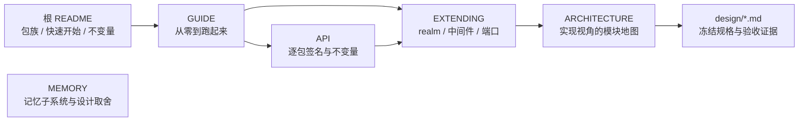

# Liorium 文档中心

Liorium 是可独立发布的 Agent 框架：`uv` workspace、12 个命名空间包（`liorium.*`），
核心概念是 **Realm**（工具 + VFS 挂载 + 状态 + prompt 片段四件套）、**CacheEpoch**
（缓存世代记账）、**`apply()` 差量热重载** 与 **回合边界 reconcile**。
本页是文档入口：先按角色选一条线，需要查签名时再进 [API](API.md)。

## 按角色读

### 使用者：把 Agent 跑起来

| 文档 | 一句话 |
|---|---|
| [根 README](../README.md) | 包族表、安装、最小 Agent 片段、CLI 用法与 10 条不变量 |
| [GUIDE](GUIDE.md) | 安装 → 最小 Agent → 事件表 → 中断/注入 → 压缩与成本 → 多 Agent 并发，每段都能直接跑 |
| [API](API.md) | 12 个包全部公开名字的签名、默认值、异常与不变量 |
| [MEMORY](MEMORY.md) | 记忆子系统：磁盘布局、旧接口映射、检索流水线、内存预算、偏差登记 |
| [PUBLISHING](PUBLISHING.md) | Trusted Publishing：12 个包如何发到 PyPI |
| [liorium-cli](../packages/liorium-cli/README.md) | 官方命令行 Agent：core 工具 + 记忆 + 技能 + 待办 + 子代理 + 流式渲染（工具全部来自 realm） |
| [liorium-provider-manager](../packages/liorium-provider-manager/README.md) | Provider 管理：schema / 四种 API 格式 / 思考 / models.dev / 模型构建 |

### 扩展者：给 Agent 加能力

| 文档 | 一句话 |
|---|---|
| [EXTENDING](EXTENDING.md) | 写自定义 Realm / Middleware / 调度参数（`priority` / `FLAG`）/ model_factory / 工具，以及常见坑 |
| [API](API.md) | 扩展点的精确签名（`RealmContext`、`RealmManager`、`FLAG`、`VfsMount` …） |
| [ARCHITECTURE](ARCHITECTURE.md) | 一个回合发生了什么、模块地图、realm 装配与 dirty 刷新流程 |
| [design/INTERFACES.md](design/INTERFACES.md) | 冻结的公共契约与文件所有权（实现者必读） |
| [examples/multi_agent.py](../examples/multi_agent.py) | 调用方并发策略：两个 Agent + 一个 semaphore |

### 维护者：改代码前先读

| 文档 | 一句话 |
|---|---|
| [ARCHITECTURE](ARCHITECTURE.md) | 包与依赖方向、模块职责表、与旧后端的差异 |
| [MEMORY](MEMORY.md) | 记忆子系统：库/索引布局、一次写入发生了什么、并发与生命周期、验收对照 |
| [design/ACCEPTANCE.md](design/ACCEPTANCE.md) | Phase 1 / v1.1 的逐条验收证据与测试数字 |
| [design/compact.md](design/compact.md)、[read-tool.md](design/read-tool.md)、[subagent.md](design/subagent.md)、[turn-loop.md](design/turn-loop.md)、[vfs-output-mw.md](design/vfs-output-mw.md) | 逐字冻结的行为规格（历史设计稿，**只读参考，不要改写**） |
| [design/realm-context.md](design/realm-context.md) | 第五拍：realm 的按回合节奏注入（`context_items()`）+ `ctx.inject()`；2026-11-07 已实现 |
| [design/scheduler.md](design/scheduler.md) | 回合调度：`run()` 独占事件流、调用级优先级、三个标志（抢占/独占/丢弃）；2026-11-08 实现 |
| [design/realm-scope.md](design/realm-scope.md) | realm 实例作用域 `instance_scope`（`agent` / `tree`）与两条强制不变式；2026-11-08 实现 |
| [design/subagent-state.md](design/subagent-state.md) | 子代理名册与正文落盘、`interrupted` 状态、重启后接着对话；2026-11-08 实现 |
| [design/INTERFACES.md](design/INTERFACES.md) | 冻结契约、硬规则、测试与验收入口 |
| [plans/2026-11-04-liorium-agent-core.md](plans/2026-11-04-liorium-agent-core.md) | 框架核心决策记录 |
| [plans/2026-11-07-liorium-provider-manager.md](plans/2026-11-07-liorium-provider-manager.md) | Provider 管理迁移与思考接入的决策记录 |
| [tests/test_architecture.py](../tests/test_architecture.py) | 架构守卫：依赖方向、禁词、命名空间包约定、禁止裸 `asyncio.create_task` |

各包的职责与最小示例见包 README：
[liorium-core](../packages/liorium-core/README.md) ·
[liorium-vfs](../packages/liorium-vfs/README.md) ·
[liorium-realm-base](../packages/liorium-realm-base/README.md) ·
[liorium-core-tool](../packages/liorium-core-tool/README.md) ·
[liorium-core-tool-realm](../packages/liorium-core-tool-realm/README.md) ·
[liorium-agent](../packages/liorium-agent/README.md) ·
[liorium-memory](../packages/liorium-memory/README.md) ·
[liorium-skills](../packages/liorium-skills/README.md) ·
[liorium-mcp](../packages/liorium-mcp/README.md) ·
[liorium-todo-realm](../packages/liorium-todo-realm/README.md) ·
[liorium-provider-manager](../packages/liorium-provider-manager/README.md) ·
[liorium-cli](../packages/liorium-cli/README.md)。

## 术语表

每条都给出**出处文件**（相对仓库根）。签名与默认值以源码为准，本文只解释语义。

| 术语 | 含义 | 出处 |
|---|---|---|
| **Realm** | 一个能力的四件套：`tools()` + `mounts()` + 状态 + `prompt_fragment()`；Agent 的唯一扩展机制，能力包之间互不依赖；能力包可以 import `liorium.agent` 或更轻的 `liorium.realm_base`（2026-11-06 起）。契约与写作 API（`@realm_tool` / `save()` / `on_start`）在 `liorium-realm-base`（2026-11-07 从 agent 搬出，agent re-export 旧名字）。 | `packages/liorium-realm-base/src/liorium/realm_base/base.py` |
| **RealmSpec** | spec 里的一个 realm 声明（`id` / `params` / `requires`）；`params` 进结构指纹，所以必须能被 canonical JSON 化。 | `packages/liorium-agent/src/liorium/agent/spec.py` |
| **CacheEpoch** | 缓存世代：**仅当** 工具 schema 集合或 system prompt 变化时 `+1`；只观测记账，不参与任何决策。 | `packages/liorium-agent/src/liorium/agent/status.py` |
| **`apply()`** | 差量热重载：按 `part_fingerprints()` 只重建变化的部件（model / prompt / realms / toolsets / limits），失败保留旧部件并写进 `ApplyResult.failed`。 | `packages/liorium-agent/src/liorium/agent/agent.py` |
| **reconcile** | 回合边界的自动对账：`_reconcile_realms()` 让 realm 自报 `dirty()` 后刷新（重挂载 / 重取工具 / 必要时重建运行时）；失败只记日志，不炸回合（降级但可用）。spec 的变更不在这里做——一律显式 `apply()`（2026-11-08 删掉 `spec_provider()` 拉模式）。 | `packages/liorium-agent/src/liorium/agent/agent.py`（`_reconcile_realms`） |
| **mount prefix** | VFS 挂载点，与 scheme 同名：`/skills` ⇔ `skills://`、`/memories` ⇔ `memories://`；`<scheme>://a/b` 等价于 `/<scheme>/a/b`，解析器不认识任何具体 scheme。 | `packages/liorium-vfs/src/liorium/vfs/node.py`、`packages/liorium-core/src/liorium/core/uri.py` |
| **state_scope** | realm 状态的生命周期：`agent` 跨对话保留（`realm_state/<id>.json`），`conversation` 按 thread 分桶（`realm_state/<id>/conversation-<thread>.json`），`reset_dialog()` 清空后者。 | `packages/liorium-agent/src/liorium/agent/realm/manager.py` |
| **artifact** | 工具输出的完整内容存储：长输出的模型侧文本换成摘要 + `artifact://<id>` 引用，原文留在 `OutputStore`（60000 字符 / 300 行摘要上限）。 | `packages/liorium-agent/src/liorium/agent/runtime/output_store.py` |
| **turn（回合）** | 一次 `run()` 的完整模型/工具循环；`start` 开头、`done` 结尾，**迭代结束即回合结束**，错误用异常而不是事件。 | `packages/liorium-agent/src/liorium/agent/runtime/loop.py` |
| **FLAG** | 一次 `run()` 的调度标志（`IntFlag`）：`INTERRUPTING`（可抢占更高优先级）/ `EXCLUSIVE`（拒绝被抢占）/ `DROPPABLE`（拥塞可丢）；默认 `NONE` = 可被抢占、不抢别人。语义见 [design/scheduler.md](design/scheduler.md)。 | `packages/liorium-agent/src/liorium/agent/runtime/scheduler.py` |
| **priority** | 调用级调度优先级（`run(priority=...)`），**越大越优先**，同档 FIFO；`None` 用 `LioriumAgent(priority=...)` 的默认值（子代理父 -1）。 | `packages/liorium-agent/src/liorium/agent/agent.py` |
| **TurnDropped** | `FLAG.DROPPABLE` 的回合在拥塞时被丢弃（从未开始执行、不产生事件）；与 `TurnInterrupted`（跑过、可能已产出部分 delta）刻意区分。 | `packages/liorium-core/src/liorium/core/errors.py` |
| **dirty / refresh** | realm 自报「真相源变了」（MCP 发现新工具、宿主装了技能）：`dirty()` / `mark_dirty()` / `clear_dirty()` + 可选 `async refresh()`；Agent 在回合边界重挂载、重取工具、必要时重建运行时。 | `packages/liorium-agent/src/liorium/agent/realm/manager.py` |
| **周期上下文（第五拍）** | realm 的「按回合节奏说话」：`context_every` / `context_first` / `context_origins` 声明节奏，`context_items(turn)` 返回 `None / str / ContextItem / 序列`。到期且返回非空才注入（相位从成功注入起算并落盘）；返回空**不消费周期**。注入在安全点物化成独立 `<context>` user 消息，不改历史前缀。 | `packages/liorium-agent/src/liorium/agent/realm/manager.py`（`context_for_turn`）、`packages/liorium-realm-base/src/liorium/realm_base/base.py` |
| **`ctx.inject()`** | 推送侧的对应物：realm 随时把一条 Context 排到下一个安全点，永不打断；后台任务先 `ctx.spawn`。没有通道时抛 `RealmError`，不静默丢。 | `packages/liorium-realm-base/src/liorium/realm_base/base.py`（`RealmContext.inject`） |
| **profile** | `Profile` 是「一组 realm + prompt + toolset」的语法糖，`AgentSpec.with_profile()` 合并进 spec，指纹覆盖合并结果，与手写等价。 | `packages/liorium-agent/src/liorium/agent/spec.py` |
| **fingerprint（结构指纹）** | canonical JSON + sha256，只覆盖结构不覆盖状态；同一结构必须产生同一指纹（重复 `apply` 零变更的前提）。 | `packages/liorium-core/src/liorium/core/canonical.py` |
| **VFS 投影** | VFS 是读模型，不是真相源：节点内容由 `provider` / `child_provider` / `children_provider` 从真相源现算，realm 状态投影必须 `should_be_included_in_search=False`。 | `packages/liorium-vfs/src/liorium/vfs/node.py` |
| **capability package（能力包）** | 提供一组工具或 realm 的包：`liorium-core-tool`（六个核心工具的实现）+ `liorium-core-tool-realm`（把它们装成 `core` realm）+ `liorium-memory` / `liorium-skills` / `liorium-mcp` / `liorium-todo-realm`（realm 能力，靠 `liorium-agent` 的可选 extra 安装，缺包时宿主降级）。 | `packages/liorium-core-tool`、`packages/liorium-core-tool-realm`、`packages/liorium-memory`、`packages/liorium-skills`、`packages/liorium-mcp`、`packages/liorium-todo-realm` |
| **toolset** | `AgentSpec.toolsets` 里的名字表；只有 `"default"` 有含义，由 `core` realm（`CoreToolRealm`）读取来筛六个核心工具名，未知名字在装配时抛 `ValueError`。Agent 自己不解释这个字段。 | `packages/liorium-core-tool-realm/src/liorium/core_tool_realm/realm.py` |
| **instance_scope（实例作用域）** | `"agent"`（默认）= 每个 Agent 一份实例、状态在各自 inbox 下、不许挂载；`"tree"` = 整棵 Agent 树一份实例（状态 / 挂载 / 连接唯一），子 Agent 只借工具。见 [design/realm-scope.md](design/realm-scope.md)。 | `packages/liorium-realm-base/src/liorium/realm_base/base.py`、`packages/liorium-agent/src/liorium/agent/realm/manager.py` |
| **checkpoint / thread** | `AsyncSqliteSaver` 的 SQLite 库（默认 `<inbox>/checkpoint.db`），表结构冻结；顶层 Agent 默认 `thread_id="main"`，因此能加载旧库继续对话；realm 状态**不放** checkpoint。 | `packages/liorium-agent/src/liorium/agent/runtime/checkpoint.py` |

## 读文档时的三个约定

1. **签名以源码为准**：本文档所有签名逐字抄自 `packages/*/src/**`，若与代码冲突，以代码为准并提 PR 改文档。
2. **冻结字面量不要改**：`↳ ack`、`[完整输出: artifact://…]`、压缩标记、占位工具结果等由 `docs/design/*.md` 逐字冻结。
3. **未实现的能力不写**：写某个能力之前先在 [API](API.md) 里确认它真的存在；与原型的差距只能出现在 [MEMORY](MEMORY.md) 的「偏差登记」里。
