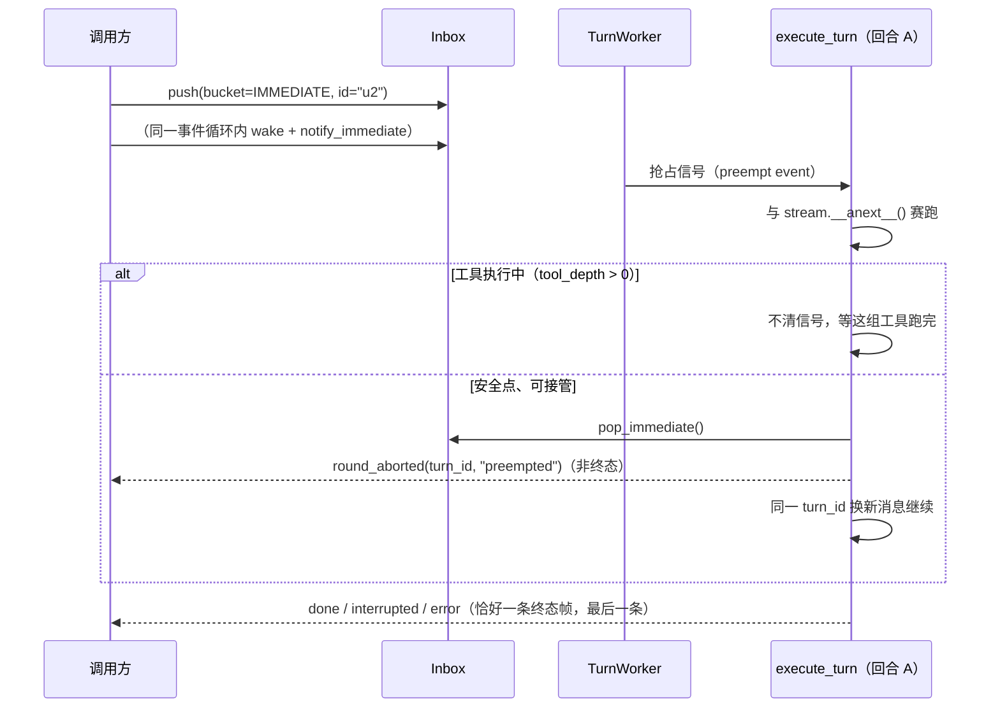

# 回合调度：单执行位（`ExecSlot`）+ bucket 队列

> **2026-11-12 起由事件流原生取代**：旧的优先级堆调度器与调用级 `priority` / 抢占标志全部删除，
> 调度变成"Inbox 的 bucket 队列 + 常驻 worker 的单执行位"。完整语义、入站字段与事件契约见
> [`event-stream.md`](event-stream.md)（权威文档）；本文只记录执行位与历史决策里仍然成立的部分。
> 签名与默认值以源码为准（`runtime/scheduler.py`、`runtime/{inbox,worker}.py`）。

## 1. 一句话

一个 Agent 只有**一个执行位**：`TurnWorker` 从 Inbox 取一条"开回合条目"、占位、跑完还位。
排队不再看 `priority`，而看条目自己的 **bucket**：`IMMEDIATE` 插到所有 `MAJOR` 之前（同档
FIFO）；`BATCHED` 在合批窗口到期后**自己开一个回合**（回合在跑就排队等它结束），`ENVIRONMENT`
永不开回合、只作为 context 搭车（回合进行中还可按 `env_interval` 节流补投一次）。谁能取消谁由
worker 裁决：
`IMMEDIATE` 可在安全点接管在途回合，`Flag.EXCLUSIVE` 拒绝被接管。

```python
stream = agent.stream(ids=["user-42"])     # ① 先构造 + 注册订阅（__aiter__ 才注册）
iterator = stream.__aiter__()
agent.push("先回答我", id="user-42", bucket=Bucket.IMMEDIATE)   # ② 再投递
async for event in iterator:               # ③ 消费到终态帧（done / interrupted / error）
    ...
```

## 2. `ExecSlot` 只表达三件事

| 能力 | 成员 | 语义 |
|---|---|---|
| 单执行位 | `occupied` / `enter(exclusive=...)` / `leave()` | 任意时刻最多一个回合在跑；`leave()` 释放 |
| 独占 | `exclusive` | 本回合拒绝被 `IMMEDIATE` 抢占（`Flag.EXCLUSIVE`）；`leave()` 后归 `False` |
| 维护队列 | `submit(fn)` / `pop_maintenance()` / `drain(exc)` / `pending_maintenance` | `apply` / `refresh_realms` / `set_realm_enabled` / `reset_dialog` 插在"当前回合之后、下一个条目之前"执行 |

排队（bucket / FIFO / 合批 / 过期）在 `runtime/inbox.py`，回合裁决在 `runtime/worker.py`。
**这里没有优先级**：`IMMEDIATE` 只是插到队首并可在安全点接管当前回合，不是"高优先级队列"。

## 3. 历史决策里仍然成立的部分

| 决策 | 现状 |
|---|---|
| 单执行位、同一 Agent 严格串行 | 仍然成立（`ExecSlot.occupied`），不并发 |
| 跨 Agent 并发由**调用方**管 | 仍然成立：库没有全局并发上限，调用方用 `asyncio.Semaphore` 包住自己的投递/消费循环 |
| 执行位不泄漏 | 仍然成立：`_run_turn` 的 `finally` 保证 `leave()`（正常 / 异常 / 取消 / `close()` 都走同一条路） |
| 维护操作不能与回合并发 | 仍然成立，且更强：维护操作**排队插队**执行，等于"回合边界"，不会和回合抢 realm 实例 |
| 等待期间不产出"排队中"事件 | 仍然成立：`start` 只在真正开跑时发；要展示积压看 `status().queue_depth` / `status().pending_by_bucket` |
| 中断不改变回合内容 | 仍然成立：被打断的半条消息留在 checkpoint，悬空 `tool_call` 由 `tool_repair` 补占位 |
| spec 变更只走显式 `apply()` | 仍然成立：没有 `spec_provider()` 拉模式 reconcile |
| 不迁 `sink` / `gate` | 仍然成立：没有第二出口、没有播放闸门（闸门在适配器侧，见 `event-stream.md` 附录 B） |

## 4. 删除的东西（2026-11-12）

| 删除项 | 原语义 | 现在 |
|---|---|---|
| 调用方驱动的回合生成器 | `async for` 驱动一个回合、迭代结束即回合结束 | `push()` + `stream()`：回合由 worker 拥有，结束 = 一条终态帧 |
| 调用级整数优先级 | 等待者之间按数字排序（子代理比父低一档） | 取消：出场顺序只由 bucket 决定（`IMMEDIATE` 优先，其余 FIFO） |
| 抢占标志位 | "我可以抢优先级更低的回合" | 取消：`Bucket.IMMEDIATE` 本身就能在安全点接管 |
| 拥塞丢弃标志 + 丢弃异常 | 排队满时抛异常、回合从未开始 | 改成 `Flag.DROPPABLE`：深度达 `QUEUE_MAX` 时丢弃并发 `input.dropped`，不抛异常 |
| 优先级堆 + 抢占回调 | 按数字排序的等待队列、同步 `on_preempt` | 取消：Inbox 的 `deque` + `peek_turn_entry()` 两档选择；抢占改为安全点接管（`turn_id` 不变） |

**不留兼容层**：没有旧入口的薄封装、没有 `priority` 参数、没有拥塞异常分支。

## 5. 现在的一次"抢占"长什么样



关键点：

1. **`IMMEDIATE` 不结束回合**：只切掉当前模型轮、补一条非终态 `round_aborted`，`turn_id` 不变。
2. **工具组不打断**：`AIMessage(tool_calls)` 与其 `ToolMessage` 必须紧邻，插 `Human` 会被
   provider 400；所以"等安全点"的真实延迟 = 最慢的那个工具。
3. **`EXCLUSIVE` 只挡 `IMMEDIATE`**：不挡 `interrupt()`，也不挡 `close()`。
4. **终态帧恰好一次**：`done` / `interrupted` / `error` 由同一处补齐，且是该回合最后一条事件。

## 6. 不变量

- 单执行位：同一 Agent 同一时刻只有一个回合在跑；
- 一条开回合条目 = 一个回合（Core 不做回合级合并）；`start.inputs` 永远是列表；
- 等待期间零事件；回合开始才有 `start`；
- 终止 = **一条终态帧**（`done` / `interrupted` / `error`），不再靠调用方捕获异常判断结束；
- 维护操作与回合不并发：插队执行，期间 worker 不取新条目；
- 中断 / 抢占不改变回合内容：部分历史留在 checkpoint，悬空 `tool_call` 由 `tool_repair` 修。

## 7. 没做什么（仍然成立）

| 能力 | 理由 |
|---|---|
| 4 档 `TurnKind`（interrupt / user / trigger / batch） | 档位是产品语义；Core 只有 bucket（何时投递）+ 两个 flag |
| `merge_key` 合并 / trigger 超限降级进 batch | Core 不做回合级合并；要"攒一批再回答"是适配器的合批缓冲 |
| 播放闸门准入 | 没有播放闸门：闸门在适配器侧（`event-stream.md` 附录 B） |
| 惰性僵死判定（`STALL_IDLE_SEC`） | 与调度正交；需要心跳埋点，留作后续 |
| `snapshot()` / owner 撤单 / 队列降级 | 先保持最小面；`close()` 一次性收摊，没有逐条 owner 撤单 |

## 8. 测试锚点

- `packages/liorium-agent/tests/test_worker.py`：FIFO、`IMMEDIATE` 四相位、`EXCLUSIVE`、
  维护插队、`reset_dialog` 清队、终态帧恰好一次、`close()` 发 `interrupted(close)`；
- `packages/liorium-agent/tests/test_inbox.py`：桶映射、同 id 原位替换、`timeout`、`DROPPABLE`；
- `packages/liorium-agent/tests/test_buckets.py`：已取代 `test_scheduler.py` / `test_turn_flags.py`
  （Agent 级 bucket/flags 行为与终态帧）；
- `tests/test_event_contract.py`：14 种事件类型金样（2026-11-14 追加 `realm`）。
