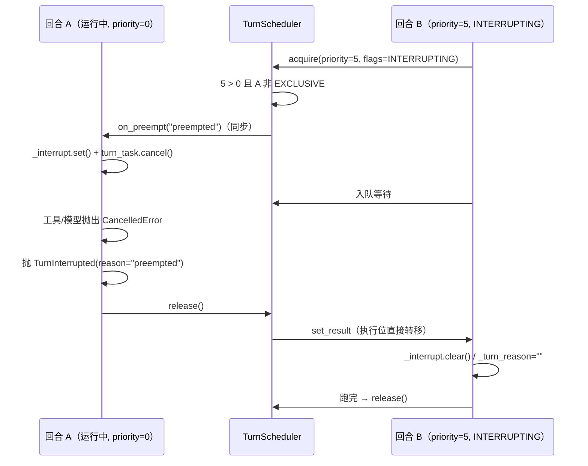

# 回合调度：`run()` 独占事件流 + 调用级优先级 + 三个标志

> 2026-11-08 实现。替代「宿主端口（`HostPort`）」：删掉两个许可位与 `spec_provider()`
> 拉模式 reconcile，`run()` 返回的生成器成为**唯一**事件出口。
> 冻结契约见 [`INTERFACES.md`](INTERFACES.md)；签名以源码为准。

## 1. 一句话

一个 Agent 只有**一个**执行位：`run()` 排队拿位、跑完还位；排队时按调用方给的
`priority` 排序，并可以用三个正交标志表达「我可以抢」「不许抢我」「堵了就把我丢了」。
`run()` 的生成器只产出**这一条消息**的事件，不向任何别的消费者扇出。

```python
from liorium.agent import FLAG

async for event in agent.run("你好", priority=3, flags=FLAG.INTERRUPTING | FLAG.DROPPABLE):
    print(event.to_dict())
```

## 2. 为什么删得掉 Host

| Host 机制 | 原来干什么 | 现在 |
|---|---|---|
| `acquire_execution()` / `release_execution()` | 调用方决定「这棵 agent 树能否调模型」（跨 Agent 限流） | 调用方自己包：`async with semaphore: async for event in agent.run(...)` |
| `acquire_output(turn_id)` | 调用方决定「能否把内容播给用户」，释放由调用方驱动（播放 ack） | 没有播报通道；生成器被迭代本身就是「对方在收」，背压天然存在 |
| `SharedHost` | 父子代理共享一个执行位，避免「父等子、子等许可」死锁 | 没有共享执行位，这类死锁结构上不存在 |
| `SimpleHost` 的 `pending` / `streaming` | 排队超过 1s 发 `pending`，拿到发 `streaming` | 等待期间**不产出事件**（`start` 只在真正开跑时发）；要展示「排队中」由调用方看 `status().queue_depth` |
| `spec_provider()` | 回合边界拉取 spec，指纹变了自动 `apply()` | 删除；spec 变更一律显式 `apply()`（库不再替调用方猜） |

`EventSink` 与 `HOST_EVENT_TYPES`（`pending` / `streaming` / `interrupted` / `error`）
失去产出方，一并删除：`Event` 只接受 9 种 Agent 事件。

## 3. 优先级

- `run(priority=...)` 是**调用级**参数；`None` 回落到 `self.priority`（构造参数，默认 0；
  子代理是父 -1）。
- **整数越大越优先**（与 Liorium 既有语义一致；既有实现是 0..3 越小越优先，这里不照抄档位）。
- 同优先级 FIFO：不饿死，也不互相打断。
- 优先级只影响**等待者之间的出场顺序**：运行中的回合不会被「优先级更高」直接挤掉，
  要挤掉必须显式 `FLAG.INTERRUPTING`（见 §4）。

## 4. 三个正交标志

| 标志 | 位 | 语义 | 既有实现对应 |
|---|---|---|---|
| `INTERRUPTING` | `1` | 可以抢占正在运行、优先级**严格更高**、且没打 `EXCLUSIVE` 的回合 | `cancel_running_kinds()` / interrupt 档 |
| `EXCLUSIVE` | `2` | 本回合拒绝被抢占；更高的 `INTERRUPTING` 只能排队 | `preemptible=False`（exclusive 档） |
| `DROPPABLE` | `4` | 排队已满（`queue_depth() >= QUEUE_MAX`，默认 50）时立即丢弃 | `droppable` |

- 默认 `FLAG.NONE` = **可被抢占**、不抢别人、拥塞时不丢。取反成 `EXCLUSIVE`（而不是
  肯定式 `PREEMPTIBLE`）是为了避免 `run(flags=FLAG.INTERRUPTING)` 顺手把自己的
  可抢占性关掉的坑。
- `INTERRUPTING | EXCLUSIVE` 可以同时给：能抢别人、自己不被抢。
- 丢弃抛 `TurnDropped(reason="congested")`：**从未开始执行**，不产生任何事件。

### 4.1 没迁的两个标志

| 既有实现标志 | 为什么不迁 |
|---|---|
| `sink`（chat / silent） | Liorium 没有第二出口：唯一 sink 就是 `run()` 的生成器，调用方想静默就别打印。给生成器加 `SILENT`（照跑但不产出事件）只会让调用方无法区分「空回合」和「静默回合」 |
| `gate`（playback / exempt） | 没有播放 / TTS 闸门，也没有「播放完的 ack」这个信号源 |

## 5. 抢占时序



关键点：

1. **不会并发**：抢占只是「取消旧回合并排队」，执行位要等旧回合 `release()` 才转移。
2. **不需要超时**：旧回合无论正常结束、异常、取消还是生成器被 `aclose()`，都会走
   `finally` 释放执行位；真的卡在吞 `CancelledError` 的代码里，等价于今天的
   `interrupt()` 卡住（不在本次范围，不迁僵死判定）。
3. **事件出口不会被抢**：`_drive_turn` 的 `finally`（解绑 emitter）在 `release()` 之前，
   新回合拿到位之后才绑定；解绑本身还是条件解绑（仍指向本回合的 `queue.put` 才清）。
4. 一次抢占只发一次信号：旧回合释放之前，后续 `INTERRUPTING` 回合只排队。回调返回
   `False`（执行位被维护操作占着、没有可打断的回合）时不算抢发生过，后来的回合还会再试。
5. 维护操作（`apply` / `refresh_realms` / `set_realm_enabled` / `reset_dialog`）持有执行位时
   `_current_turn_id is None`，抢占钩子返回 `False`，抢占者只是排队。

## 6. 不变量

- 单执行位：同一 Agent 同一时刻只有一个回合在跑。
- `locked=False` ⟹ 没有活等待者（`release()` 只在无人可唤醒时才解锁）。
- `run()` 的生成器只产出本回合事件；等待期间零事件。
- 终止 = 迭代结束；中断 / 丢弃 / 失败 = `TurnInterrupted` / `TurnDropped` / `TurnError`。
- 抢占不改变回合内容：被抢占的回合可能在 checkpoint 里留下部分历史（与 `interrupt()`
  完全同一条路径），下一次 `run()` 从当前 thread 状态继续。

## 7. 没做什么（既有实现里有、这里刻意不做）

| 能力 | 理由 |
|---|---|
| 4 档 `TurnKind`（interrupt / user / trigger / batch） | 档位是产品语义；Liorium 用调用级整数 + 三个标志表达同样的能力 |
| `merge_key` 合并 / trigger 超限降级进 batch | 需要「提交后不等待」的常驻提交方；本项目 `run()` 是调用方在等 |
| 播放闸门准入 | 没有播放闸门 |
| 惰性僵死判定（`STALL_IDLE_SEC`） | 与抢占正交；需要心跳埋点，留作后续 |
| `snapshot()` / owner 撤单 / 队列降级 | 同上：先保持最小面，等真的出现常驻提交方再加 |

## 8. 测试锚点

- `packages/liorium-agent/tests/test_scheduler.py`：优先级 / FIFO / 取消不泄漏 / 抢占信号 /
  独占 / 丢弃 / 标志位值冻结。
- `packages/liorium-agent/tests/test_turn_flags.py`：Agent 级 `run(priority, flags)` ——
  事件不串回合、排队顺序、抢占真的取消工具、`EXCLUSIVE` 不被抢、同档不抢、`TurnDropped`。
- `tests/test_event_contract.py`：9 种事件 + 宿主事件已删除。
