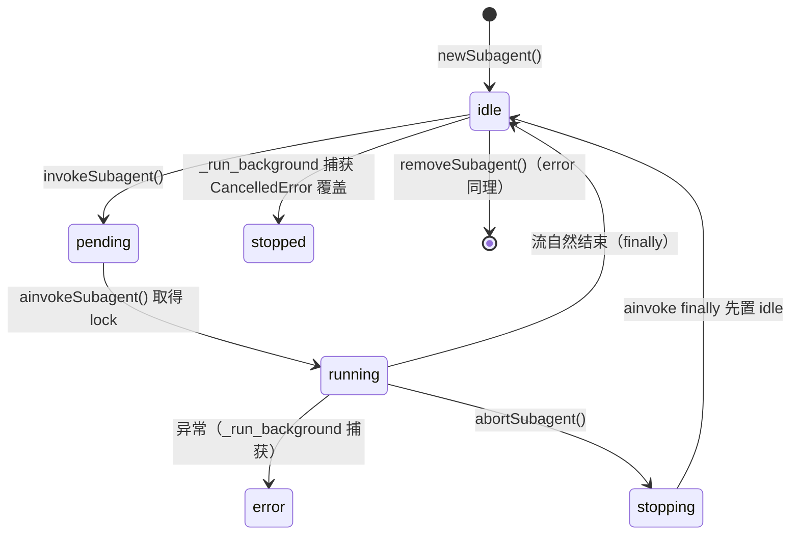

# Subagent 语义规格（Liorium 实现基线）

> 状态：行为规格（2026-11-04 冻结）。文中字符串 / 标识符属**冻结格式**，实现与测试逐字对齐。
> 计划锚点：`docs/plans/2026-11-04-liorium-agent-core.md` 的 B1 / D2 / E1 / E2 / F6 / §3.7。
> `agent/runtime/{build,rebuild,compact}.py`、`tools/{read,write,edit}.py`、
> `frontend/app.js:2421-2438`、`frontend/libs/subagent-panel.js`、三份测试。文中字符串/标识符逐字取自原型，属**冻结格式**。

## 1. 创建、启动、停止与装配

### 1.1 对象模型

`Subagent`（`@dataclass`，字段**全 camelCase**，由 `manager.py` 手工挑字段写盘，不可整体序列化）：

| 字段 | 语义 |
|---|---|
| `agent: CompiledStateGraph \| None` | `create_agent()` 产物；恢复后为 `None`，首次 invoke 惰性重建 |
| `systemPrompt: str` | **已合成**的完整提示词（含 `identityPrefix`），非入参原文 |
| `toolset: list[StructuredTool]` | = 工具组展开 + `finalResultTool` |
| `toolsetNames: list[str]` | **只含**请求的工具组名，**不含** `finalResultTool` |
| `outputStore: list` | 每 run 一项 `[输入 message, 事件...]`，**无上限** |
| `eventLog: list[dict]` | 全部事件（带 `ts`），**上限 200**（`[-200:]`） |
| `name` / `status` | `idle / pending / running / stopping / stopped / error` |
| `lastEvent` / `lastError` / `finalResult` / `updatedAt` | 最近事件（带 `ts`）/ 错误文本 / 最终结论 / `time.time()` |
| `activeTask: asyncio.Task \| None` | `invokeSubagent` 建、`_run_background` 结束置 `None` |
| `lock: asyncio.Lock` | `default_factory`，串行化 `ainvokeSubagent` |

`SubagentManager`：`subagents`、`subagentPublicToolSets`、`checkpointerPath`（默认 `":memory:"`）、`checkpointer`
(`AsyncSqliteSaver`)、`chatModel`/`chatModelSpec`、`middlewares`、`abortEvents: dict[str, Event]`、`_status_dirty`、
`_state_path`、`_restored_payload`；`identityPrefix` 默认
`"你是主 Agent 创建的 Subagent。你需要专注执行分配给你的子任务，并把输出保持为可观察、可审计的工作流。"`。

### 1.2 创建：`newSubagent()`

`newSubagent(agent_name="Unnamed Agent", toolsetsNames=None, systemPrompt="You are a helpful assistant.", middlewares=None, model=None)`。校验**先失败先抛**：①`chatModel is None` → `RuntimeError("Chat model is not configured")`；
②重名 → `ValueError(f"Subagent already exists: {agent_name}")`（不覆盖）；③`model` 非空且 `is_subagent_model_allowed(providers, model)` 为假 → `ValueError(f"Model '{model}' not in subagent_models whitelist.")`；
④工具组未知 → `ValueError(f"Unknown toolset: {toolsetName}")`；⑤`_ensure_checkpointer()`（懒建，`aiosqlite.connect(path)` + `AsyncSqliteSaver.setup()`，双检 `_checkpointer_lock`）。

装配序：checkpointer → chat model（默认或按 spec 构建）→ 工具组展开 → **追加 `finalResultTool`** → `_compose_system_prompt()` → `_compose_subagent_middlewares()` → `_create_langchain_agent()` → `Subagent(...)` → `_touch_subagent(status="idle")` → 入表 → `_status_dirty=True` → 写盘。固定形态：

```python
create_agent(model=..., tools=tools, checkpointer=checkpointer,
             system_prompt=systemPrompt, middleware=with_model_retry(middlewares))
```

### 1.3 启动：`invokeSubagent()` / `_run_background()` / `ainvokeSubagent()`

`invokeSubagent(agent_name, message, *, lockTimeout=None)` **不阻塞**，返回 `_light_status`：名字不存在 → `ValueError(f"Not a valid subagent name: {agent_name}")`；`activeTask` 未结束 → `RuntimeError(f"Agent '{agent_name}' is currently locked.")`；否则 `status="pending"`、`lastError=""`、事件 `{"type": "queued", "message": message}`，再 `create_task(_run_background(...), context=contextvars.Context())` —— **空白 context 是硬约束**：不切断 LangChain 父 run 回调继承，子代理事件会冒泡进主 Agent 的 `astream_events` 并被误标 `agent_id=main`。

`_run_background()` 消费 `ainvokeSubagent` 并丢弃事件；`CancelledError` → `status="stopped"` + 事件 `{"type":"stopped"}` 并重抛；其它异常 → `status="error"`、`lastError=str(exc)` + 事件 `{"type":"error","content":str(exc)}`。

`ainvokeSubagent(agent_name, message, lockTimeout=0)` 是 **async generator**；`lockTimeout=0`：已锁 → `RuntimeError("Agent '<n>' is currently locked.")`，否则 `acquire()`；`None`：无限等；`>0`：`wait_for(lock.acquire(), timeout)` 超时抛同一句。持锁后：`status="running"` → `config={"configurable": {"thread_id": agent_name}, "recursion_limit": 300}` → `outputStore.append([message])` → 写盘 → 事件 `{"type":"input","message":message}` → 已有 `abortEvents[name]` 则 `RuntimeError` → 新建并登记 `Event()` → `agent is None` 时惰性重建（用 `self.chatModel`/`self.chatModelSpec`，**丢失 per-subagent model**）→ 逐事件 `yield` → `outputStore[-1].append(event)` → `_append_event`（加 `ts`、更新 `lastEvent`、裁剪 `eventLog`、写盘）→ `event_copy = dict(event); event_copy["agent_id"] = f"subagent-{agent_name}"; subagent_events.publish(event_copy)`。`finally`：`abortEvents.pop` → `status not in {"error","stopped"}` 则置 `"idle"` → `activeTask=None` → 释放锁。

### 1.4 状态机（含实现真实顺序）



`stopping` **不是终态**：`ainvokeSubagent.finally` 先改回 `idle`，再由 `_run_background` 覆盖成 `stopped`，观测者可能看到 `stopping → idle → stopped`。

### 1.5 停止与删除

`abortSubagent(name)`：无 `abortEvents[name]` → `False`（幂等，未知名字也不抛）；否则 `status="stopping"` + `{"type":"stopping"}` → `abort_event.set()` → `True`。abort 只在 `_ainvokeAgent` 的 `astream_events` **事件间隙**检查（`raise asyncio.CancelledError("User interrupted")`），模型阻塞/工具执行中不立刻响应。

`removeSubagent(name)`：不存在 → `False`；否则 abort → `wait_for(task, 2.0)` → 超时 `task.cancel()` → 再 `wait_for(task, 2.0)` → 仍不退则 `log.error` 放弃等待 → `pop` 两表 → 写盘 → `True`。两段等待都必须有上限（否则永久挂住调用方）。删除**不清理** checkpoint 里 `thread_id=name` 的历史，同名重建会继承旧对话。

### 1.6 模型解析

默认：`setChatModel(await _build_chat_model(model_name=...), spec=model_name)`，`model_name` 来自 `llm.provider.get_default_subagent_model(providers)` = `subagent_models` 第一个 `is_model_spec_usable` 的 spec，否则 `providers.main_model`，都没有 → `ValueError`。`_rebuild_subagent_safely` 降级链：默认子模型 → `main_model` → 放弃 `SubagentManager`（主 Agent 保持 ready）。per-subagent：白名单 = `subagent_models` **或** 等于 `main_model`；`_pname, _ = model.split("::", 1)`，`_prov.thinking_type != "none"` → `intensity="medium"` 否则 `None`，再 `build_ReasoningChatOpenAI_from_spec(providers, spec=model, intensity=_thinking)`。`chatModel` 是**共享单实例**，只有显式传 `model` 的子代理例外。

### 1.7 工具集解析

`_build_subagent_toolsets()` 每次重建现算：`BASESET`=[`read`,`search`,`find`]、`WRITESET`=[`write`,`edit`]、`EXECUTESET`=[`execute`]、`SKILLSET`=[`listSkills`]、`MCP_<SERVER_ID大写>_SET` = 该 running MCP server 中名字以 `<server_id>_` 开头的工具（有匹配才注册）。工具按名字 `_find_tool_by_name` 从 `_registry` 取，缺失 `KeyError`。注册：`manager.newToolset(name, middleware.wrap_tools(toolset))` —— 与主 Agent **共享同一批工具对象实例**（输出被 artifact 化/摘要化，防 base64 进消息文本）。MCP 上下线在下一次 `rebuild_runtime()` 后生效。

### 1.8 Prompt 组装（四个 .md 与子代理的关系）

子代理：`_compose_system_prompt(p)` = `identityPrefix + "\n\n" + p.strip()`；`p` 空 → 只返回 `identityPrefix`；`setIdentityPrefix("")` 不清空（回退旧值）。**AGENT.md / ROLE.md / COREMEMORY.md / TASK.md 都不参与**子代理提示词。`sysPrompt` 的 `path:` 前缀由**工具层**解析（`tools/subagent.py::_resolve_system_prompt`）：`path:` 之后交给 `read.func(target)`（同步，支持 `memory://` 与普通文件），空目标 → `ValueError("sysPrompt path is empty")`。子代理唯一能读到角色文件的途径是拿到 `BASESET` 后自己 `read("agents/<name>/AGENT.md")`。

对比：主 Agent 的 `state.PROMPT` = `AGENT.md`+`ROLE.md`+`COREMEMORY.md`（`state.makeup_init_prompt`）+ 技能 YAML 清单 + 插件 prompt 后缀；`TASK.md` 从不整篇注入，只经 `agent://tool_use.md` / `agent://mc.md` 读 `## 核心工具速查` / `## Minecraft 操作系统说明` 章节；Araya 另走自己的三文件加载。三者互不复用。

### 1.9 共享矩阵

| 资源 | 父子关系 | 细节 |
|---|---|---|
| `agent://` VFS | **完全共享**（进程级单例 `_VFS_SINGLETON`） | 无 per-subagent 挂载、无隔离；`/subagents/<name>/` 只是**只读投影**，`refresh_runtime_nodes()` 每次删光重建 |
| `memory://` | **完全共享**（全局 `GraphStore`） | 无命名空间/owner 标记，任何子代理写入对所有代理可见 |
| checkpoint | **不同库、不同 thread** | 主：`AGENT_ROOT/checkpoint.db`，`THREAD_ID="main"`；子：`AGENT_ROOT/subagents.db`，`thread_id=<name>`，全部子代理共用一个 sqlite 连接，仅靠 thread 隔离；父**读不到**子代理历史 |
| system prompt | 互不影响 | 由 `create_agent(system_prompt=...)` 请求期注入，故必须存进 `subagents.json` 供重建 |
| 工具对象 | 共享实例 | 同一 `_registry` 对象 + `wrap_tools`；MCP 共享同一连接（AGENT.md：同时只能一个 Agent 用 Playwright） |
| 事件通道 | 进程级广播，非父子私有 | 见 §3；主 Agent 事件不得进入 |
| `lock` / `abortEvents` | 每子代理独立 | key 为子代理名 |

## 2. 暴露给父 Agent 的工具

全部 `@register @tool`（`tools/subagent.py`），manager 取自 `state.subagent_manager`，未就绪 → `RuntimeError("subagent manager not ready")`；返回值统一 `json.dumps(..., ensure_ascii=False)`。

| 工具名 | 参数 | 返回 |
|---|---|---|
| `newSubagent` | `name: str`、`toolset_names: list[str]`、`sysPrompt: str`、`model: str \| None = None` | `json.dumps(get_status(name))`（§2.1） |
| `invokeSubagent` | `name: str`、`message: str` | `json.dumps(_light_status)`（§2.2） |
| `wait_for_subagent` | `agent_name_list: list[str]` | `json.dumps({"items": [轻量状态...]})`；空列表 = 等全部 |
| `stopSubagent` | `name: str` | `json.dumps({"name": <原始入参>, "stopping": bool})` |
| `removeSubagent` | `name: str` | `json.dumps({"name": <原始入参>, "removed": bool})` |

`invokeSubagent` 的 payload 固定为 `{"messages":[{"role":"user","content": str(message or "").strip()}]}`。`stopSubagent`/`removeSubagent` 回包的 `name` 是**未 strip 的原始参数**，传给 manager 的才是 strip 后的。

### 2.1 / 2.2 状态结构（逐字段）

```json
{"agent_id": "subagent-<name>", "name": "<name>", "status": "idle|pending|running|stopping|stopped|error",
 "toolsets": ["BASESET"], "system_prompt_summary": "<前 240 字符>", "last_event": {...},
 "last_event_summary": "<§2.3>", "recent_events": [<eventLog 末 50 条，含 ts>],
 "last_error": "", "final_result": "", "updated_at": 1762345678.9,
 "active_task": true, "output_runs": 3, "event_count": 42}
```

`_light_status`（WS summary 与 `wait_for_subagent` 用）= `agent_id`、`name`、`status`、`toolsets`、
`system_prompt_summary`、`last_event_summary`、`final_result`、`last_error`、`event_count`（无 `recent_events`/`updated_at`/`active_task`/`output_runs`）。

### 2.3 文本格式（逐字）

`_event_summary(event)`：`delta`/`reasoning_delta` → `content[:160]`；`tool_start` → `"tool_start: <tool_name>"`；`tool_result` → `"tool_result: <tool_name>"`；其它 → `json.dumps(event, ensure_ascii=False)[:160]`。

`format_subagent_overview(name)`（`.../overview.md`）：

```
Subagent: worker
Status: running
Toolsets: BASESET, WRITESET
ActiveTask: True
UpdatedAt: 1762345678.9
LastEvent: tool_start: read
LastError: ...
FinalResult: <前 160 字>
```

后三行仅非空时出现；`Toolsets` 空写 `(none)`。`format_subagent_final_result(name)`（`.../finalResult.md`）返回 `finalResult.strip()`，空则逐字 `"(no final result)"`；名字不存在 → `ValueError(f"Not a valid subagent name: {agent_name}")`。

`format_subagent_output(name)`（`.../output.md`）：

```
# System Prompt Of Subagent(<name>)

<systemPrompt>

# Run 1:Main Agent(yourself)
(主Agent消息):<该 run 首项 messages[-1].content>
# Run 1:Subagent Output:
> 思考:<reasoning_delta 拼接>
<delta 拼接正文>
> 调用工具:<tool_name>
> 错误:<content 或 error>
> 最终结论:<content>
# Run 1:End

# Final Result

<finalResult>
```

`reasoning_delta` 缓冲后 `> 思考:`；`delta` 缓冲后原样输出；`tool_start` **只输出工具名，`args` 丢弃**；`queued`/`input`/`tool_result`/`stopping`/`stopped` 跳过；无 run → `"(no subagent output)"`。

`format_available_toolsets()`（`agent://avatoolset`，外层再加 `"# Available Toolsets For Subagents\n\n"`）：`# Available Toolsets` + 按名字排序的 `## <toolset>` 与 `- <tool>`（空组写 `- (empty)`），整体 `.strip()`。`agent://subagenting.md` 固定协议文本，列出 `agent://subagents/{name}`、`.../output`、`agent://avatoolset`（与真实节点名不一致，见 P12）；`agent://ava_subagent_models` 列 `subagent_models`（第一个为默认）与 `main_model`。

### 2.4 读取通道（父 Agent 实际取结果的路径）

`read` 处理 `agent://`：先 `get_agent_vfs(refresh=True)` 再 `refresh_runtime_nodes(vfs)`；目录 → `agent://<path>/ 内容:` + 两空格缩进子项；文件 → `read_text`，空则 `[未知 agent 资源: <path>]`；支持行选择器（`output.md:1-80`、负数 `:-35--10` = 倒数第 35 到倒数第 10 行）。

## 3. 事件广播与前端消费

### 3.1 `events.py`（60 行）机制

```python
_DEFAULT_MAXSIZE = 500
_subscribers: set[asyncio.Queue] = set()   # 模块级，与 manager 实例无关
subscribe(maxsize=500) -> Queue            # 新建队列并登记
unsubscribe(queue) -> None                 # discard，不 close、不排空
subscriber_count() -> int                  # 仅诊断
publish(event) -> None                     # 广播
```

`publish` 两条规则：①`agent_id == "main"` → `raise ValueError("Subagent 事件通道不接受主 Agent 事件")`（原在消费者侧 `assert`，会静默杀死转发任务，故前移到生产者）；②对每个订阅者 `put_nowait`，`QueueFull` 时先 `get_nowait()` 丢最旧再补最新，`QueueEmpty/QueueFull` 全吞 —— **绝不阻塞生产者**。存在理由：manager 在每次 `rebuild_runtime()` 被整体替换，而 WS 转发任务整连接只 `subscribe()` 一次；队列若挂在 manager 内部，重建后转发任务会永远监听孤儿队列（表现为"面板有时行有时不行，摘要栏照常更新"）。

### 3.2 事件类型与字段

| type | 产生点 | 字段 |
|---|---|---|
| `queued` | `invokeSubagent` | `message`（完整 payload） |
| `input` | `ainvokeSubagent` 启动 | `message` |
| `delta` / `reasoning_delta` | `on_chat_model_stream` 正文 / `extract_reasoning_text(chunk)` 非空 | `content` |
| `tool_start` | `on_tool_start` | `tool_name`、`args`（`_normalize_tool_args`）、`call_id`（`run_id`） |
| `tool_result` | `on_tool_end` | `tool_name`、`output`（dict 原样，其它 `json.dumps`）、`call_id` |
| `compact_start` / `compact_delta` / `compact_done` | `tags` 含 `COMPACT_TAG` 的模型调用 | `content`；异常收尾的 done 带 `ok:false` |
| `final_result` | `finalResultTool` | `content` |
| `error` | `_run_background` 异常 | `content` |
| `stopping` / `stopped` | `abortSubagent` / `CancelledError` | — |

`_append_event` 只给**内部副本**加 `ts`；**广播副本没有 `ts`**（只加 `agent_id`），前端自补。`queued`/`input`/`stopping`/`stopped`/`error` 只内部登记，**不进广播通道**（广播只发生在流式循环里）。

### 3.3 `agent_id` 打标与 WS 转发

子代理事件 `agent_id = f"subagent-{agent_name}"`（manager 在 publish 前注入）；摘要 `{"agent_id":"subagents","type":"subagents_summary","items": list_statuses_light()}`（manager 为 `None` 时 `items: []`）；主 Agent `{"agent_id":"main",...}` 绝不进子代理通道。`/chat` 连接建立即 `subscribe()` 并起 `_forward_subagent_events()`：`wait_for(queue.get(), timeout=0.5)` → `send_text(json.dumps(event))`，每轮再 `_push_subagents_summary_if_dirty()`（`consume_status_dirty()` 为真才发 summary）；断开 `_stop_forward_task()`：`unsubscribe` + `event.set()` + `wait_for(task, 2.0)`，超时 `cancel()`。summary 另在斜杠命令开始前、命令 `done` 前、部分流式分支轮询处发送。**连接时不主动推全量 summary**，前端初始化自行 `GET /subagents-status`。

### 3.4 前端消费

`app.js:2421-2438`（消息分派最前两步）：①`agent_id === 'subagents'` 且 `type === 'subagents_summary'` → `subagent.applySummary(msg.items)`，return；②`agentId !== 'main'` 且 `startsWith('subagent-')` → `name = agentId.slice('subagent-'.length)`、`subagent.appendEvent(name, msg)`，return（子代理事件永不进主气泡、不触发 TTS/动作）。

`subagent-panel.js`：`subagentEventCache[name]` 每名字一个数组（上限 500，超出 `splice` 最旧），相邻 `reasoning_delta`/`delta`/`compact_delta` 同类型**合并 content**（`ts` 取最新）。`setSubagentStatuses` 由 WS summary 驱动：刷新摘要栏；选中项消失则关浮窗；重渲染**必须**用 `{...next, recent_events: cache[name] || next.recent_events || []}` 合并缓存，否则轻量状态把列表清成"暂无事件"。摘要栏按 `SUBAGENT_STATUS_ORDER`（running 0 / pending 1 / stopping 2 / error 3 / idle 4 / stopped 5 / unknown 6）稳定排序，计数文案 `N 运行中 / N 排队中 / N 异常`，全空 `全部空闲`；`showSubagents === false` 整栏隐藏。状态中文映射（唯一来源）：`idle 空闲 / pending 排队中 / running 运行中 / stopping 停止中 / stopped 已停止 / error 错误 / unknown 未知`。事件→气泡条目：`reasoning_delta`→`reasoning`、`delta`→`text`、`compact_*`→单个 `compact`（`done` 标记）、`tool_start`+同 `call_id` 的 `tool_result`→折叠 `tool` 卡片，其余→`note` 行（`排队中 / 主 Agent 消息 / 错误 / 停止中 / 已停止 / 最终结果 / 其他事件`）。摘要 title：优先 `last_error`；`tool_start:` → `正在调用 X`、`tool_result:` → `已完成 X`；JSON 状态事件有限映射（`queued→等待执行`、`input→收到主 Agent 消息`、`compact_start→正在压缩上下文`、`compact_done→上下文压缩完成`、`error→执行出错`、`stopping→正在停止`、`stopped→已停止`、`final_result→已产出最终结果`）。交互：点摘要项 → `openByName`（有缓存直用，否则 `GET statusEndpoint`）；删除按钮 → `DELETE ${deleteEndpoint}/${encodeURIComponent(name)}`，成功清缓存+关浮窗+刷新。端点：`SUBAGENT_STATUS_ENDPOINT=.../subagents-status`、`SUBAGENT_DELETE_ENDPOINT=.../subagents`；GET 返回 `{"status":"ok","items": list_statuses()}`（`subagent_status_overrides` 非空时**直接返回它**，见 P15），DELETE 返回 `{"status":"ok","name","removed":true}`，未找到 `404 subagent not found: <name>`，manager 空 `503`。

## 4. 状态持久化

### 4.1 路径与时机

路径 `Path(checkpointerPath).with_name("subagents.json")`；生产为 `AGENT_ROOT/subagents.json`（`AGENT_ROOT = CONFIG_ROOT/agents/<AGENT_NAME>`）；默认 `":memory:"` 时退化为**进程 CWD 的 `subagents.json`**（P26）。写入由 `_touch_subagent`（每次状态变更、每次 `_append_event`）、`newSubagent`、`ainvokeSubagent` 启动、`finalResultTool`、`removeSubagent`、`reset_persistent_state` 触发 —— **每个流式 delta 全量重写一次**（P2）。读取：`__init__` 一次性 `_read_state_file()` 存进 `_restored_payload`（**构造时快照**），`restore_persisted_state()` 才消费，由 `_rebuild_subagent_manager` 在工具组注册之后调用。

### 4.2 Schema

```json
{"subagents": [{
  "name": "worker",
  "systemPrompt": "你是主 Agent 创建的 Subagent。...\n\n<原始 sysPrompt>",
  "toolsetNames": ["BASESET"],
  "outputStore": [[{"messages":[{"role":"user","content":"do work"}]},
                   {"type":"input","message":{...},"ts":1762345678.1},
                   {"type":"delta","content":"hello","ts":1762345678.2}]],
  "eventLog": [{"type":"delta","content":"hello","ts":1762345678.2}],
  "status": "idle",
  "lastEvent": {"type":"delta","content":"hello","ts":1762345678.2},
  "lastError": "", "finalResult": "done", "updatedAt": 1762345678.9
}]}
```

不落盘：`agent`、`toolset`、`activeTask`、`lock`、`abortEvents`、`chatModel`/`chatModelSpec`。

### 4.3 恢复流程

`aclose()` 旧 manager → `SubagentManager(checkpointerPath=AGENT_ROOT/subagents.db)` → `setChatModel(默认子模型, spec)` → `setMiddlewares(...)` → 逐个 `newToolset(...)` → `restore_persisted_state()` → 赋给 `state.subagent_manager`。`restore_persisted_state()`：跳过空 `name`；用**当前**工具组表重建 `toolset`（未知组名静默跳过）并**补回** `_build_final_result_tool(name)`；`status in {"running","pending","stopping"}` → `"stopped"`；`agent=None`；余字段原样。`agent` 在首次 `ainvokeSubagent` 用 `subagent.toolset`+`systemPrompt`+**当前默认模型**重建（`log.info("Rebuilt agent for subagent '%s'", ...)`）。`/clear` → `reset_persistent_state()`：逐个 `removeSubagent` → 清空两表 → 写空表。`DELETE /admin/agents/{name}/checkpoint` 会顺带删除该目录下 `subagents.json`。

### 4.4 runtime-only vs durable

| 内容 | 持久化 | 说明 |
|---|---|---|
| `name`/`status`/`updatedAt`/`finalResult`/`lastError` | 是 | 重启后 running→stopped |
| `systemPrompt`（已合成）/ `toolsetNames` | 是 | 重建 agent 必需；未知组名静默丢弃 |
| `eventLog`(≤200) / `lastEvent` | 是 | 面板历史取自 HTTP 全量状态 |
| `outputStore`（无上限） | 是 | `output.md` 的唯一数据源 |
| `agent`/`toolset`/`lock`/`abortEvents`/`activeTask` | 否 | 进程内 |
| checkpoint 对话历史 | 是（另一文件） | `subagents.db`，`thread_id=<name>`，父不可见 |
| per-subagent `model` spec | **否** | P4 |
| 并发/优先级/配额 | 否 | 无注册表、无上限 |

**实际结论**：`aclose()` 逐个 `removeSubagent` 且每步写盘，最后一次写盘发生在最后一个 `pop` 之后 → 文件变成 `{"subagents": []}`，而新 manager **之后**才构造读文件。于是 `rebuild_runtime()` 与正常退出都会清空 `subagents.json`，`restore_persisted_state()` 事实上几乎总恢复出空表（P1）。计划 §3.7 把该文件定性为"运行态、可丢弃"与此一致，但"恢复"能力当前并不真正可用。

## 5. 测试断言清单

### 5.1 `test_subagent_manager.py`（11 个用例）

替身：`FakeSaver`（只记 `setup_called`）、`FakeAgent`（顺序吐预置事件）；`monkeypatch` 替换 `aiosqlite.connect`/`AsyncSqliteSaver`/`create_agent`。

1. `test_new_subagent_initializes_checkpointer_lazily`：connect 收到 `":memory:"`；`checkpointer` 非空；`setup_called is True`；`create_agent` 的 `checkpointer` 参数**就是** `manager.checkpointer`；`"worker" in subagents`。（隐含：`chatModelSpec=None` 时 `build_compact_middleware` 提前返回 `None`，不触模型。）
2. `test_new_subagent_rejects_unknown_toolset`：`ValueError` 含 `"Unknown toolset"`。
3. `test_ainvoke_subagent_rejects_when_lock_is_held`：预占锁后 `await stream.__anext__()` 抛 `RuntimeError` 含 `"currently locked"` —— 校验发生在**第一个 yield 之前**。
4. `test_abort_subagent_is_idempotent`：未知名字 `False`；登记 `Event()` 后 `True` 且 `event.is_set()`。
5. `test_ainvoke_subagent_streams_and_cleans_up`：三输入事件（ai chunk `"hello"`、`on_tool_start` 带 `input='{"q":"x"}'`/`run_id="call-1"`、`on_tool_end` 带 `output={"ok":True}`）产出**精确等于** `[{"type":"delta","content":"hello"}, {"type":"tool_start","tool_name":"search","args":{"q":"x"},"call_id":"call-1"}, {"type":"tool_result","tool_name":"search","output":{"ok":True},"call_id":"call-1"}]`；结束无 `abortEvents["worker"]`、`lock.locked() is False`。
6. `test_read_agent_subagent_resources`：`agent://subagents/worker` 含 `"agent://subagents/worker/ 内容:\n  agent://subagents/worker/finalResult.md\n  agent://subagents/worker/output.md\n"`；`output.md` 含 `"# System Prompt Of Subagent(worker)"`、`"# Run 1:Main Agent(yourself)"`、`"> 思考:think..."`、`"> 调用工具:read"`、`"hello"` 且**不含** `'"uri": "foo"'`（`args` 被丢弃）；`finalResult.md` 精确 `"done"`；`agent://subagenting.md` 含 `"agent://subagents/{name}"`；`agent://avatoolset` 含 `"# Available Toolsets"`。
7. `test_subagent_routes_list_and_delete`：GET `{"status":"ok","items":[...]}` 且 `items[0]["name"]=="worker"`；DELETE **精确** `{"status":"ok","name":"worker","removed":True}`；之后 `list_statuses() == []`。
8. `test_new_subagent_tool_resolves_path_prompt`：`sysPrompt="path:memory://prompts/demo.md"` → `read.func` 以该 URI 被调，最终 `system_prompt_summary == "loaded:memory://prompts/demo.md"`（`path:` 由工具层解析且透传解析后文本）。
9. `test_invoke_subagent_tool_submits_background_job`：payload 为 `{"messages":[{"role":"user","content":"hello"}]}`，回包保留 `name`/`status`/`queued`。
10. `test_wait_for_subagent_tool_waits_for_completion`：`agent_name_list=["worker"]` 原样传 manager，回包精确 `{"items":[{"name":"worker","status":"idle"}]}`。
11. `test_negative_line_selector_parses_last_lines`：`parse("foo.md:-35--10").selector_lines == (-35, -10)`。

### 5.2 `test_subagent_event_broadcast.py`（6 个用例）

1. `test_publish_reaches_all_subscribers_and_unsubscribe_stops_delivery`：两订阅各收 1 条；`unsubscribe(q2)` 后只 `q1` 增长（2 条），按序取到 `"a"`、`"b"`。
2. `test_publish_rejects_main_agent_event`：`publish({"agent_id":"main",...})` → `ValueError`。
3. `test_subagent_manager_publishes_through_process_broadcaster`：跑一次 `"hello"` 后队列恰 1 条，`agent_id=="subagent-worker"`、`type=="delta"`、`content=="hello"`（`queued`/`input` 不广播）。
4. `test_subscription_survives_subagent_manager_rebuild`：v1、v2 两 manager 各跑一次，同一订阅收到 2 条，顺序 `("subagent-worker","before-rebuild")`、`("subagent-worker","after-rebuild")` —— 订阅与 manager 实例解耦。
5. `test_slow_subscriber_keeps_latest_event`：`subscribe(maxsize=2)` 后 publish 5 条 → `qsize()==2`，内容 `["3","4"]`。
6. `test_chat_ws_forward_survives_manager_rebuild`：真实 `chat_websocket` + `FakeWebSocket`；`accept()` 被调；换新 manager 后跑一次，0.8s 内 `send_text` 的 JSON 中存在 `agent_id=="subagent-worker"` 且 `content=="after-rebuild"` 的帧；收尾放 `WebSocketDisconnect` 后 handler 5s 内正常退出。

### 5.3 `test_vfs_handler_ack.py`（3 类共 20 例）

契约：handler 返回**非空 `str`** → 作为 ACK 返回；`None`/空串/其它类型 → 归一为 `None`。

- `TestHandlerReturnContract`（13 例）：`test_write_returns_handler_str`（`"已提交 task_1"`）、`test_write_async_handler_str`（`"async-ack"`）、`test_write_non_str_or_empty_returns_none`（参数化 `None`/`""`/`{"ok":True}`/`["a"]`/`3` 全 `None`）、`test_write_without_handler_returns_none`、`test_edit_returns_handler_str`（`"已采纳: new"`）、`test_edit_non_str_or_empty_returns_none`（`None`/`""`/`{"ok":True}`）、`test_edit_without_handler_returns_none`。
- `TestWriteToolAck`（4 例）：输出同时含 `"已写入 agent://"` 与 `"↳ 已提交 task_7（队列 1/5）"`；多行 ACK 保留 `"↳ line1\nline2"`；handler 返回 dict → 输出**不含** `"↳"`；handler 抛 `ValueError("信封不是合法 JSON")` → 含 `"写入 agent 资源出错"` 且含异常文本。
- `TestEditToolAck`（3 例）：同时注册 write/edit handler 时 `edit` 只触发 `edit_handler`（收到替换后的完整内容 `"gamma\nbeta\n"`，`write_handler` 为空），输出含 `"已编辑 agent://"` + `"↳ 已改为 gamma"`；edit handler 返回 `None` → 无 `"↳"`；无 handler 的内容节点直接替换（`read_text == "hello 既有实现"`）且无 `"↳"`。

这组是子代理**唯一 ACK 通道**的回归锁（计划 F6 点名要求新实现跑绿）。

## 6. 已知问题与重复（重写应清除）

| # | 问题 | 位置 | Liorium 处置 |
|---|---|---|---|
| P1 | `aclose()` 逐步写盘，最终把 `subagents.json` 写成空表，新 manager 之后才读 → 重建/退出**必丢**状态 | `aclose` + `build._rebuild_subagent_manager` | 状态进 realm store（C6），`close()` 不删数据 |
| P2 | 每个 delta 全量重写 JSON（含 `outputStore` 全文），O(n²) IO | `_append_event`→`_touch_subagent`→`_write_state_file` | 事件只走内存/事件流，持久化改为显式快照 |
| P3 | `outputStore` 无上限（`eventLog` 有 200），长跑内存+磁盘双膨胀 | `ainvokeSubagent` | 单一有界事件缓冲；过程落 VFS（D6） |
| P4 | per-subagent `model` 不落盘，恢复后用默认模型重建 | `_write_state_file` / 惰性重建 | 模型进 `AgentSpec.model`（§3.1） |
| P5 | 锁与状态泄漏：两处 `raise` 在 `try/finally` **之前**（`abortEvents` 已存在、agent 重建失败），此时锁已持有、`status="running"`、`input` 已写 → 该子代理**永久 locked** 到重启 | `ainvokeSubagent` | 单一 owner + `async with`；状态由 finally 收敛 |
| P6 | 双轨互斥：`invokeSubagent` 查 `activeTask`、`ainvokeSubagent` 查 `lock`，抛同一句 `"currently locked"` | 同上 | 一个 `run()` 单消费者生成器（E1） |
| P7 | 消息 helper 多份拷贝：`_is_ai_message_chunk`/`_message_content_to_text`（manager、`core.message`、`araya`）与 `_normalize_tool_args`/`_tool_value_to_text` | `manager.py:702-759`、`araya/runtime.py:738` | 收敛到 `liorium-core` 一份（B1 已点名） |
| P8 | `get_status` 与 `_light_status` 手工重复 9 个字段，易漂移 | `manager.py:310-352` | 单一 `AgentStatus` + 投影函数 |
| P9 | 事件摘要是**字符串协议**：后端产 `"tool_start: x"`/JSON 截断，前端 `startsWith` 反解 | `_event_summary` + `formatSubagentEventSummary` | 前端直接消费结构化事件 |
| P10 | `_status_dirty` 是全局单布尔：多 WS 时被先轮询者 `consume`，其余连接收不到 summary（面板"有时不刷新"） | `consume_status_dirty` + 各 WS 循环 | 每订阅者版本号/快照游标 |
| P11 | 无最终结果回传通道：父只能 `wait_for_subagent` + `read(...)` 自行拼 | 设计缺失 | `ContextItem(source="subagent:<name>")` 指针回传（D5/D6） |
| P12 | 文档与节点名不一致：AGENT.md/TASK.md/`_subagenting_doc` 写 `.../output`、`.../finalResult`，真实节点是 `output.md`/`finalResult.md` → `[未知 agent 资源: ...]` | 旧 VFS 运行时、模板 md | 挂载点统一 `subagents://<name>/{overview,output,finalResult}` |
| P13 | `refresh_runtime_nodes` 每次 `agent://` 读写先删光 `/subagents/*` 再重建（`_read_agent` 甚至刷两次）→ 双倍开销、节点不可写、并发刷新竞争 | 旧 VFS 运行时、`read.py:345` | VFS 是读模型（D1/D2）：投影节点惰性求值 |
| P14 | `_read_task_section` 两份实现（`read.py` 与旧 VFS 运行时） | 两处 | 一份实现 + 一个挂载 |
| P15 | `subagent_status_overrides` 死代码：只被 GET 读取，注释里的 `POST /debugging/subagent-override` 不存在，`debugging.py` 仍 import | `api/chat/subagents.py:12` | 删除 |
| P16 | `from langchain.chat_models import BaseChatModel`（旧路径）+ `__main__` 里 `BaseChatModel()` 示例；`AsyncGenerator`、`extract_reasoning_text` 等未用/重复 import | `manager.py:1-23, 761-848` | 只留真实依赖，删示例块 |
| P17 | 命名混乱：字段全 camelCase、方法半 camel（`newSubagent`/`ainvokeSubagent`/`wait_for_subagents`） | 全文件 | 统一 snake_case，对外 API 才留别名 |
| P18 | 同一事件存两份（`eventLog` 上限 200 + `outputStore` 无限）、两套渲染（`recent_events` / `output.md`） | `_append_event` / `format_subagent_output` | 一条事件流 + 一个渲染器 |
| P19 | 无并发/配额上限；`pending` 只是状态、无 `queued→running` 事件，宿主分不清"排队"与"刚启动" | `invokeSubagent` | scheduler 出队列事件 |
| P20 | abort 只在 `astream_events` 事件间隙生效，长工具/阻塞模型不响应；升级只有 `removeSubagent` 的 cancel | `_ainvokeAgent` | `interrupt()` 取消三层（§4.4） |
| P21 | 删除不清理 checkpoint thread，同名重建继承旧对话 | `removeSubagent` | 身份即 `AgentSpec.id`，删除=销毁该 id 的 inbox/checkpoint |
| P22 | 运行中父无法追加消息，只能等或杀 | 工具表 | `inject()` 排队到安全点（D7） |
| P23 | 工具组名/MCP 前缀约定散落 `build.py` 与文档；`_find_tool_by_name` 的 `KeyError` 与模型构建共用同一 try | `build._build_subagent_toolsets` | `AgentSpec.toolsets` 显式声明（§3.1），解析失败单独报错 |
| P24 | `publish` 只拒 `agent_id=="main"`，缺 `agent_id` 的事件照样广播（docstring 的"必须携带"未强制） | `events.publish` | 通道随 `run()` 消失（E2） |
| P25 | 每子代理一个 `create_agent` 图 + 独立 `Lock`/`Event`，无共享调度；MCP（Playwright）无仲裁 | manager 全局 | 同一 `LioriumAgent` 类 + 宿主 semaphore（B1/Phase 2） |
| P26 | 默认 `":memory:"` 时 `subagents.json` 落在**进程 CWD**，多实例互相污染 | `__init__` | 路径必须显式，缺失即报错 |

## 7. 重写对齐结论

1. **子代理 = 关系，不是类别**（B1）：同一 `LioriumAgent`，差异只在 `parent`/`lifecycle_owner`/`accepts_external_turns`；`SubagentManager` 收敛为 `SubagentRealm`，五个工具的语义与返回结构按 §2 保持兼容。
2. **共享 VFS、独立身份**（D2）：共享父实例；`/subagents/<name>/` 命名空间约定取代"无隔离"，但不靠权限检查；`subagents://` 成为挂载点，投影惰性求值。
3. **`run()` 取代进程级广播**（E1/E2）：§3.2 的 13 种 `type` 与字段是前端契约（计划 §3.5 已冻结），`agent_id` 由宿主注入；`events.py` 这 60 行**不迁移**。
4. **`subagents.json` 不冻结**（§3.7）：建议只留 `finalResult`/`lastError` 这类结论，过程事件不落盘；若保留恢复能力，必须先修 P1（先快照后关停）。
5. **测试是可转移资产**（F6）：§5 的断言（尤其 5.1-5、5.1-6、5.2-4、5.2-5、5.2-6）应原样跑绿 —— 它们是"事件归一化格式"、"VFS 文本格式"、"广播与重建解耦"、"慢消费者保最新"的回归锁。
