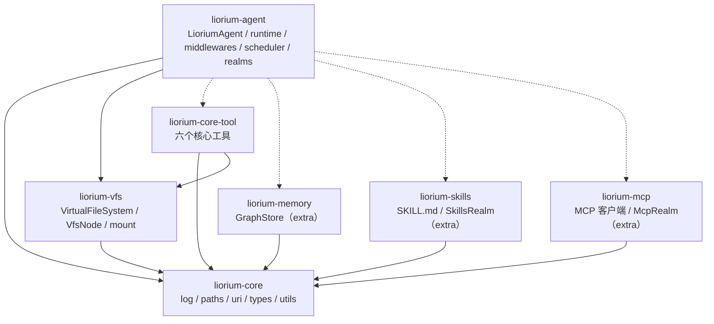
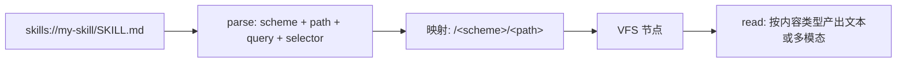

# Liorium Agent Core 架构决策记录

> 状态：草稿（2026-11-04）
> 范围：独立仓库 `liwusen/liorium-framework`，实现 `liorium.*` 包族（12 个可独立发布的包）。
> 本文是**唯一**的计划与决策记录。任何实现与本文冲突，以本文为准；要改结论，先改本文。

---

## 0. 一句话

把 Agent 运行时抽成一个可独立发布的框架 **Liorium**。
核心收益不是"更整洁"，而是三件事：**Agent 实例化**（多 Agent / Subagent 同一实现）、**能力可热重载且缓存可计量**、**能力可独立发包**。

### 非目标（明确不做）

| 不做 | 原因 |
|---|---|
| 兼容 hook 式插件系统（pluggy） | 核心只有 realm 一种扩展机制；宿主的插件层由宿主自己翻译成 realm |
| 权限 / 人工审批（HIL） | v1 不需要；将来由产品侧包一层工具包装，或引入图级中断 |
| Cordis 式框架能力（服务容器、依赖注入图、fork 作用域、reactive context、disposable 级联） | 不需要那么灵活；realm 系统实现预算 ≤ 400 行 |
| 一次性支持多个宿主 | 先服务一个真实宿主，接口保持克制 |
| 迁移脚本 | 数据格式冻结，新实现直接读旧数据；不写迁移 |

---

## 1. 已定决策

编号是稳定的，后续讨论请引用编号。

### A. 定位与边界

| # | 决策 | 一句话理由 |
|---|---|---|
| A1 | 消费者 = B：作者自己的第二个项目要能 `pip install` 后跑起来；不为开源 C 付代价 | 只有"别人真的会用"才逼出可替换的依赖；但稳定 API/文档/弃用策略太贵 |
| A2 | 核心**零插件依赖**；宿主自己的插件层留在宿主侧，翻译成 realm | 一个扩展机制胜过两个；`llm_request_pre` 这类"任意改前缀"的通道随之消失 |
| A3 | 7 个包，命名空间包 `liorium.*`：`core / vfs / memory / skills / mcp / core-tool / agent` | 一个 import 根；`liorium_memory` 这种下划线写法是历史包袱 |
| A4 | 依赖方向严格单向：`core` 是叶子；`vfs`/`memory`/`skills`/`mcp`/`core-tool` 互不依赖；`agent` 依赖它们且全部可选（extra） | 让"我只想要 VFS"这种需求成立 |
| A5 | `liorium-agent` 默认带 `core-tool`（六个核心工具），`memory/skills/mcp` 走 extra | `pip install liorium-agent` 开箱能干活 |

### B. 装配与生命周期

| # | 决策 | 一句话理由 |
|---|---|---|
| B1 | 一个 `LioriumAgent` 类，差异是三个正交维度：**身份**（name/根目录/记忆/checkpoint）、**关系**（parent / lifecycle_owner / accepts_external_turns）、**权限**（谁能中断/配置） | 顶层 Agent 与 Subagent 是**关系**差别，不是类别差别；否则会写出第二份 `SubagentManager`（现状已复制了 `core/message.py` 四个函数） |
| B2 | 装配 = `AgentSpec`（可序列化的默认装配）+ ports（实例覆盖）。**spec 只装能被读出来的东西**；模型实例/记忆实例/回调/websocket 一律走 ports | 纯声明装不下"运行时才发现的 MCP 工具"；纯注入等于把 208 行 rebuild 搬到产品代码 |
| B3 | **Agent 不读产品配置**（不 import 任何产品配置的加载器）；配置由宿主加载后构造 `AgentSpec` | 库要能独立发布，就不能绑死产品配置格式 |
| B4 | 分层生命周期：**身份不变 ⇒ 实例永不重建**，只 `apply(spec)` 原位替换可变部件（模型/提示/工具集/中间件/realm） | 现在 `/thinking` 翻个开关也要走完整重建并重跑 bootstrap，是纯浪费；热重载也只有在实例不重建时才有意义 |
| B5 | 生命周期语义收敛成 4 个显式操作，取代现在 55 处 `rebuild_runtime(reset_dialog=?, no_initial_chat=?)` 布尔组合 | 两个布尔在 20 多个路由里手写 = 语义丢失 |
| B6 | `apply()` 由 **spec 指纹 + 回合边界 reconcile** 触发（拉模式：宿主提供 `spec_provider()`，返回已算好的 spec 或 None） | 把 55 处调用收敛成 1 个机制；MCP 断线这类"忘了重建"的问题结构性消失 |
| B7 | reconcile 只重建指纹真正变化的部件；失败不静默（事件 + 继续用旧 spec 跑） | 与 B4 配套；"降级但可用" |

### C. realm（唯一扩展机制）

| # | 决策 | 一句话理由 |
|---|---|---|
| C1 | 一个能力 = **四件套**：工具 + VFS 挂载 + 状态 + `prompt_fragment()` | 只给工具不给用法说明，等于没给能力；用法说明必须随包发布 |
| C2 | 可组合 = ①`requires` 依赖（拓扑排序，成环报错）②声明序叠加 ③profile 语法糖（**v1 不做**）。**不做嵌套** | 嵌套立刻产生生命周期歧义（停父要不要停子），收益只是目录整齐 |
| C3 | **工具名冲突必须报错**（`failed`，带冲突详情），不允许静默跳过 | 现状 `compose_tools` 是 `continue`，等于"装了但没生效且无日志"，违背"不隐瞒错误" |
| C4 | 生命周期：`start/stop` 由库编排（先停旧 → 起新 → 失败回滚 → 回滚失败则 `failed`）。后台任务必须走 `ctx.spawn`，**禁止 `asyncio.create_task`** | 热重载要换掉"带长连接的能力"（直播、感知）；不托管的任务必然泄漏 |
| C5 | realm 起不来 ⇒ **降级但可用**（该 realm 标 `failed`、移除其工具与节点、事件可见），不是整体 not ready | 能力不是启动前提；现状对 subagent 模型就是这么降级的 |
| C6 | realm 状态存在**自己的 store**（`scope="agent"`，v1 只做这个），VFS 只出**投影节点**（`should_be_included_in_search=False`） | 状态生命周期 ≠ 对话生命周期；VFS 无持久化，当真相会丢数据 |
| C7 | realm **可以**改请求前缀（工具 schema / system prompt），但必须被 `CacheEpoch` 记账 | 禁止就比插件弱；允许而无账则无法解释"今天为什么慢" |
| C8 | 基座中间件链由库固定顺序，realm 只能**追加在外层**，不可重排 | `compact.py`/`build.py` 里"重试必须最内层""repair 必须永远打开"是正确性前提，不是风格 |

### D. VFS 与输入

| # | 决策 | 一句话理由 |
|---|---|---|
| D1 | VFS 是 Agent 的**读模型 / 操作界面**，不是状态存储；一切内容都是其它真相源的投影 | 它看起来像文件系统，所以最容易被拿来存状态，然后重启丢数据 |
| D2 | 所有权单位是**血缘根**：独立顶层 Agent 各自一棵 `VirtualFileSystem`；Subagent **共享父的实例** | 隔离靠实例（独立 Agent）与命名空间约定（子代理写 `/subagents/<name>/`），不靠权限检查 |
| D3 | 所有 `scheme://` 统一为**挂载点**（`skill memory artifact sourceCode img_source agent`）；`read` 只认 VFS 一种语言 | 现在 `read.py` 33KB 就是"六个工具的合订本"；realm 想加可读资源不该回头改库 |
| D4 | 需要 `mount_vfs(prefix, other_vfs, readonly)` + **环检测**（记 owner 链） | 父要读子代理的树；A 挂 B、B 挂 A 会无限递归 |
| D5 | `Context` **是一种消息**（Agent 的入站流里的一等公民），按到达时机物化成两种形态：**回合开始到达 ⇒ 并入该回合的 user 消息**；**回合进行中到达 ⇒ 作为一条独立的 user 消息插入到安全点**（当前 reasoning / tool 组之后）。原文另存独立 `context` channel（纯 JSON）供审计与前端 | 它本质是"用户这一侧的信息"，模型必须读得到；物化形态由时机决定，而不是被砍掉 |
| D6 | `Context` 只放**结论 + 指针**，过程留在 VFS | 上下文是不可逆资源（压缩后找不回）；现状 subagent 广播有把过程噪音灌进上下文的倾向 |
| D7 | **`inject()` 永不打断**（排队到安全点，物化成独立 user 消息）；**用户叫停 = `interrupt()` + 新的 `run()`**（两个回合）；被打断的半条消息**保留**，由 `tool_repair` 补占位 ToolResult | 库不把"停"和"改"合并成一个动作——那是宿主策略；不做 checkpoint 手术就没有删坏历史的风险 |
| D8 | VFS 内容 = **封闭三元联合** `Text | Image(bytes, mime) | Binary(bytes, mime)`；`read` 按内容类型分派，与 scheme 无关；图片绝不内联 base64 | `img_source` 移出核心后多模态责任落到 VFS；封闭联合让 `read` 只有三条输出路径 |

### E. 输出与缓存

| # | 决策 | 一句话理由 |
|---|---|---|
| E1 | 回合交付 = **单消费者 async 生成器** `run()`；不提供 `submit()` / 全局广播 | 恰好一次的终结事件、天然背压、中断语义都变成结构性保证，`_StreamState/_StreamFailed` 那套消失 |
| E2 | **没有** 通用 `notify()` 通道；需要对外报事的 realm 自己暴露 `events()` | YAGNI；`subagent/events.py` 那 60 行存在的病因（manager 被反复重建）已被 B4 治好 |
| E3 | Host 提供两个**单许可位**：执行许可（能否调模型）、输出许可（能否说话）。v1 各 1 位 | 物理约束（一个语音通道、一份配额）不属于 Agent 语义；"念完了没有"只有宿主知道 |
| E4 | `CacheEpoch` = 单一整数，覆盖"工具 schema + system prompt"指纹；**v1 仅观测记账，不参与任何决策**（不重排、不拆段、不预热） | 先把"缓存失效"变成可查的账，再谈优化 |
| E5 | system prompt 分段顺序**设计时固定**（身份 → 规则 → realm 片段 → 技能清单 → 尾注）；不实现任何"为缓存调整顺序"的逻辑 | 便宜的规则；但 v1 不做运行时优化 |

### F. 能力与迁移

| # | 决策 | 一句话理由 |
|---|---|---|
| F1 | 六个核心工具 = `read / write / edit / search / find / execute`；**工具集由 spec 决定，registry 零全局过滤** | 现状按 `MODEL_TYPE` / 直播模式 / `MD_BLOCK_ENABLED` / agent 名过滤，产品状态泄漏进注册表 |
| F2 | 技能清单**预载进 prompt**（技能是特殊情况）；`liorium-skills` 仍提供 `SkillsRealm`（挂载树 + `listSkills`） | 能力发现性优先于 token 成本；装/卸技能 ⇒ epoch +1，可接受 |
| F3 | v1 **不做权限系统**；`execute` 就是直接跑。既有实现若要保留审批，在产品侧包一层工具包装（schema 不变 ⇒ 不影响缓存） | 优先级问题，不是价值判断 |
| F4 | 迁移 = 独立仓库 + 先发版 + 后切换：`liorium` 独立开发、独立集成测试、独立发版（等 PyPI token）→ 既有实现依赖它 → 删除现有 Agent | 独立仓库让"冻结 `main`"这件事根本不需要发生 |
| F5 | **不写迁移脚本**；数据格式冻结，直接读旧 `checkpoint.db` / memory 库；子代理状态视为可丢弃 | 让"能不能换回去"永远等于 `git checkout main` |
| F6 | 测试是唯一可无损转移的资产：`test_compact_*`、`test_tool_call_repair`、`test_agent_scheduler`、`test_mm_bridge`、`test_subagent_manager`、`test_vfs_handler_ack` 要在新实现上跑绿 | 它们编码的是踩过的坑（前缀缓存、悬空 tool_call、429、压缩截断点） |
| F7 | **`start()` 绝不调模型**；首次引导 / 重跑启动流程都由宿主 `run(boot_message)`；`reset_dialog()` 是方法不是 spec 字段 | 现状每次启动都跑一次 bootstrap 模型调用并写历史；库不替宿主决定花不花这次调用 |

---

## 2. 包结构



实线 = 硬依赖；虚线 = 可选（extra）。

### 2.1 仓库组织（T1 已定）

- **uv workspace + src layout + hatchling 构建后端**；单一 `uv.lock`。

```
liorium-agent/
  pyproject.toml            # workspace 根，不是包
  uv.lock
  packages/
    liorium-core/{pyproject.toml, src/liorium/core/...}
    liorium-vfs/  liorium-memory/  liorium-skills/  liorium-mcp/
    liorium-core-tool/  liorium-agent/
  tests/                    # 跨包集成测试
```

- 包间引用用 `[tool.uv.sources] workspace = true`；本地改动即时生效。
- **命名空间包**：每个包只放 `src/liorium/<sub>/__init__.py`，**绝不放** `liorium/__init__.py`。
- 安装：`uv sync --all-packages --all-extras`；发布：`uv build --package <name>` → `uv publish`（`UV_PUBLISH_TOKEN`）。
- 既有实现本地联调：`scripts/dev-install-liorium.ps1` = `uv pip install --python <解释器>/Scripts/python.exe -e packages/*`，与从 PyPI 安装走同一路径。
- 理由：7 个包的版本一致性只有在"一个锁文件 + 一条 sync"下才不会出错；uv 只是开发期工具，不进运行时依赖，不改变宿主解释器的既有约定。

### 每个包的"非目标"

| 包 | 不做什么 |
|---|---|
| `liorium-core` | 不 import langchain / fastapi；不读任何配置文件；不做 IO |
| `liorium-vfs` | 不持久化；不认识 Agent；不 import langchain |
| `liorium-memory` | 不 import agent；不做对话管理 |
| `liorium-core-tool` | 不 import `liorium-agent`（工具需要 agent 能力时，拿 `liorium-core` 里声明的端口）；不做权限判断 |
| `liorium-agent` | 不认识前端 / 直播 / 语音 / 形象；不读产品配置；不写死路径 |

> 2026-11-06 变更：能力包（`liorium-core-tool` / `liorium-memory` / `liorium-skills` /
> `liorium-mcp`）允许 import `liorium.agent` 的 realm 契约；上表「`liorium-memory` 不 import
> agent」「`liorium-core-tool` 不 import `liorium-agent`」两行作废。

---

## 3. 核心契约

### 3.1 `AgentSpec`（可序列化，进指纹）

```python
@dataclass(frozen=True)
class AgentSpec:
    id: str                      # "main" / "subagent-research-1"
    inbox_dir: Path              # 该 Agent 的根（prompt 文件、checkpoint、realm 状态都在下面）
    model: str                   # "provider::model"
    prompt_sources: list[str]    # 文件路径，按序拼接
    realms: list[RealmSpec]      # 见下
    toolsets: dict[str, list[str]]   # 具名工具集（subagent 用）
    limits: Limits               # 压缩阈值、递归上限等
    boot: BootSpec | None        # 首次启动是否跑 bootstrap 回合

@dataclass(frozen=True)
class RealmSpec:
    id: str
    params: dict[str, Any]       # realm 自己的配置（进指纹）
    requires: list[str]
```

**不进 spec**：模型实例、记忆实例、VFS 实例、回调、websocket、时钟、许可位。

### 3.2 `LioriumAgent` 公共面

```python
class LioriumAgent:
    async def start(self) -> None
    async def close(self) -> None

    def run(self, text: str, *, context: Sequence[ContextItem] = (),
            origin: str = "user") -> AsyncIterator[Event]

    async def inject(self, items: Sequence[ContextItem]) -> None   # 运行中注入，不打断
    async def interrupt(self, *, reason: str = "") -> bool          # 取消在当前回合
    async def apply(self, spec: AgentSpec) -> ApplyResult
    def status(self) -> AgentStatus

    # 刻意不存在：invoke() / submit() / events() / notify()
```

- `run()` 的迭代结束 **就是** 回合结束的终结信号；错误以异常形式抛出（不做成 event）。
- 同一个 Agent 被并发 `run()` 时：排队（由 Agent 内部 scheduler 决定优先级），不抛忙。
- **`inject()` 永不打断**：排队到下一个安全点，物化成一条独立的 user 消息。它**不开启新回合**、不重新抢许可位。
- **用户中途叫停 = `interrupt()` + 一个新的 `run()`**（两个回合）。打断由宿主的策略决定，库不合并这两件事。

### 3.3 Realm 协议

```python
class Realm:
    id: str
    requires: list[str] = []
    state_scope: Literal["agent"] = "agent"     # "conversation" 留 v1.1+

    def tools(self) -> list[BaseTool]: ...
    def prompt_fragment(self) -> str: ...        # 只写跨工具的工作流，不重复工具描述
    def middleware(self) -> list: ...            # 只能追加在基座之外
    def mounts(self) -> dict[str, VfsMount]: ...  # scheme/prefix → 挂载

    async def start(self, ctx: RealmContext) -> None: ...
    async def stop(self, ctx: RealmContext) -> None: ...
```

`RealmContext` 提供：`ctx.vfs`（本血缘根的实例）、`ctx.state`（本 realm 的 store）、`ctx.spawn(coro)`（托管后台任务，返回句柄）、`ctx.log`。

### 3.4 Host 端口（T4，已定）

> **2026-11-08：整节已废弃**。本项目删除了 Host 机制（两个许可位、`SpecProvider`、
> `pending` / `streaming`），`run()` 返回的生成器成为唯一事件出口，调度改为
> `run(priority=..., flags=...)`（`INTERRUPTING` / `EXCLUSIVE` / `DROPPABLE`）。
> 现行设计见 [`../design/scheduler.md`](../design/scheduler.md)；下面保留为历史决策记录。

```python
class HostPort(Protocol):
    async def acquire_execution(self) -> None: ...
    def release_execution(self) -> None: ...

    async def acquire_output(self, *, turn_id: str) -> None: ...
    # 刻意没有 release_output：输出许可的释放由宿主自己驱动
    # （播放 ack / 阅读下限 / 断连 / 超时），Agent 不参与

    def now(self) -> float: ...
    def spec_provider(self) -> AgentSpec | None: ...   # 可选；返回已算好的 spec 或 None
```

- **`pending` / `streaming` 由宿主在自己的 `acquire_execution()` 实现里发出**（进入等待 1s 后发 `pending`，拿到后发 `streaming`）。库只负责 `await`，不认识"排队中"这个概念。
- 不做 `release_output`：Agent 的回合在 `done` 之后就结束了，而"是否播完"只有宿主知道；让 Agent 持有它只会制造第二套生命周期。
- `now()` 只为日志与时间戳；所有与播放/时限相关的判断都在宿主侧。

### 3.5 `run()` 事件协议（T3 已定，前端零改动）

依据：`frontend/app.js:2441-2474` 与 `frontend/libs/subagent-panel.js` 实际消费的 13 个 `type`。

| 归属 | type | 字段 |
|---|---|---|
| **Agent**（`run()` 产出） | `start` | `turn_id` |
| | `delta` | `content` |
| | `reasoning_delta` | `content` |
| | `tool_start` | `tool_name, args, call_id` |
| | `tool_result` | `tool_name, output, call_id` |
| | `compact_start` / `compact_delta` / `compact_done` | `content` / `ok` |
| | `done` | `turn_id` |
| **宿主**（前端桥 / 调度 / 许可位） | `pending` | `reason="waiting_lock"` |
| | `streaming` | — |
| | `interrupted` | — |
| | `error` | `message` |

- **终止方式用异常，不用事件**：正常 = 迭代结束；`TurnInterrupted` / `TurnError` 由宿主翻成 `interrupted` / `error` 帧。这样"恰好一次终结"是结构性的。
- **`done` 仍是一条事件**（不是靠迭代结束推断）：前端要用 `turn_id` 回报播放闸门的 ack。
- **`agent_id` 由宿主注入**：一次 `run()` 只有一个 Agent；宿主转发时打标（`main` / `subagent-<name>`），从而 `SubagentRealm.events()` 复用同一套前端渲染。

### 3.6 URI 归一化（T5 已定）



**规则**

1. **scheme 与挂载点同名，无翻译表**：`<scheme>://a/b` ≡ `/<scheme>/a/b`。
2. **名字取正确**（集合用复数，功能用自然名）：

   | 挂载点 | scheme | 提供者 |
   |---|---|---|
   | `/` | `agent://` | Agent 自身 |
   | `/skills` | `skills://` | `SkillsRealm` |
   | `/memories` | `memories://` | `MemoryRealm` |
   | `/artifacts` | `artifacts://` | 工具输出（OutputStore） |
   | `/code` | `code://` | 宿主注册（只读代码树） |
   | `/subagents` | `subagents://` | `SubagentRealm` |
   | `/realms` | `realms://` | 每个 realm 的投影 |
   | `/screen`、`/camera` | `screen://`、`camera://` | **产品侧**（既有实现） |

3. **解析器不认识任何具体 scheme**：只做 `^(?P<scheme>[a-zA-Z][\w+.-]*)://` → 前缀 `/<scheme>`。任何新挂载自动获得一个新的可用 scheme。
4. **裸路径 = 真实文件系统**（相对 `AgentSpec.workspace_root`，默认 `inbox_dir`）；`file://` 表示真实文件系统绝对路径；只有 `<scheme>://` 走 VFS。
5. **解析顺序沿用现状**：先剥 `?query`，再从右最长匹配 `selector`（`:50-100` / `:raw`），剩下的才是 path。
6. **mount 前缀是保留目录**，与已有文件/目录冲突时**报错**，不静默覆盖。
7. **`read` 的输出形态由节点内容类型决定，不由 scheme 决定**（见 §4.5）。

面向模型的文档变更：`skill://` → `skills://`、`sourceCode://` → `code://`、`img_source://` 拆成 `screen://` + `camera://`。`AGENT.md` / `TASK.md` / skill 文档同步修改。

### 3.7 数据格式冻结

| 数据 | 是否冻结 | 说明 |
|---|---|---|
| `checkpoint.db` | **冻结** | LangGraph `AsyncSqliteSaver` 表结构；必须能加载旧库并继续对话 |
| memory store | **冻结** | 必须能读旧库并继续读写 |
| `agents/<name>/*.md` | **冻结** | `AGENT.md / ROLE.md / COREMEMORY.md / TASK.md` 的语义 |
| 工具输出文本 | **冻结** | `↳ ack`、`artifact://<id>`、`[完整输出: ...]`、行选择器输出格式 |
| `subagents.json` | 不冻结 | 运行态，可丢弃 |

### 3.8 依赖与版本策略（T2 已定）

```toml
liorium-core         # 零第三方依赖（dataclasses + 标准库）
liorium-vfs          # 零第三方依赖
liorium-core-tool    # liorium-core, liorium-vfs, langchain-core
liorium-agent        # liorium-core, liorium-vfs, liorium-core-tool,
                    # langchain>=1.4,<1.5
                    # langchain-core>=1.6,<1.7
                    # langgraph>=1.2,<1.3
                    # langgraph-checkpoint-sqlite>=3.0,<4
                    # aiosqlite
extras              [memory] [skills] [mcp] [openai] [anthropic] [google] [all]
```

- **Python `>=3.11`**（CI 覆盖 3.11 / 3.12）。
- **langchain 系列用"次要版本上限"**，不用 `<2`。理由：`CompactMiddleware` 继承 `SummarizationMiddleware` 并调用其**私有方法**（`_find_safe_cutoff_point` / `_ensure_message_ids` / `_should_summarize`，见 `compact.py:274/588/604`），次要版本就可能改签名。代价 = 每次小版本要跑一次升级仪式（升 pin → `test_compact_*` 全绿 → 发版）。
- **`liorium-core` / `liorium-vfs` 零第三方依赖**：让"我只想要 VFS"真的成立。
- **模型实例走端口**：`AgentSpec.model` 只是不透明标签（进指纹/日志），真正的 `BaseChatModel` 由 `model_factory(spec.model)` 提供。`liorium-agent` 不依赖任何 provider SDK；装 `[openai]` 等 extra 才提供默认工厂。
- 开发期锁定在 `uv.lock`；发布的约束是上面这些范围。

### 3.9 启动与重置（T6 已定）

| 场景 | 谁做 | 做什么 | 会调模型吗 |
|---|---|---|---|
| `start()` | 库 | 建 VFS / 起 realm / 开 checkpoint；**checkpoint 无 system 消息则补一条** | **不会** |
| 首次引导 | **宿主** | 自己 `run(boot_message)` | 会（宿主决定） |
| `apply(spec)` | 库 | 只换部件 | 不会 |
| `/clear` | 库方法 `reset_dialog()` | 清空对话 + 重写 system 段 | 不会 |
| 重跑启动流程 | **宿主** | 再 `run(boot_message)` 一次 | 会 |

```python
BootSpec(message: str | None)   # 只是给宿主的引导语，库不自动执行
```

- `AgentSpec` 另有一个 `workspace_root`（默认 = `inbox_dir`），用于裸路径解析（§3.6 规则 4）。
- 旧代码的 `(reset_dialog, no_initial_chat)` 两个布尔 **取消**；对应语义见上表。
- `reset_dialog()` 是**方法**不是 spec 字段：它是对 checkpoint 的操作，不是配置；也不走 `apply()`（apply 只换部件，不删数据）。

### 3.10 使用形态（目标 API，非现状）

```python
from liorium.agent import LioriumAgent, AgentSpec, RealmSpec, BootSpec
from liorium.agent.realm import Realm, RealmContext
from liorium.agent.context import ContextItem
from liorium.vfs import VirtualFileSystem


class WeatherRealm(Realm):
    id = "weather"

    def tools(self):
        from langchain_core.tools import tool

        @tool
        async def get_weather(city: str) -> str:
            """查询城市当前天气（摄氏度）。"""
            return await fetch_weather(city)
        return [get_weather]

    def prompt_fragment(self) -> str:
        return "用户问穿衣/出行建议时，先查天气再给建议。"

    async def start(self, ctx: RealmContext) -> None:
        ctx.spawn(self._prefetch_hourly())     # 托管后台任务，禁止裸 create_task

    async def stop(self, ctx: RealmContext) -> None: ...


agent = LioriumAgent(
    spec=AgentSpec(
        id="main",
        inbox_dir=Path("agents/main"),
        workspace_root=Path("."),
        model="deepseek::chat",                 # 不透明标签，只进指纹/日志
        prompt_sources=["AGENT.md", "ROLE.md", "COREMEMORY.md"],
        realms=[RealmSpec(id="weather", params={})],
        toolsets={},
        limits=Limits(max_turns=300),
        boot=BootSpec(message="请执行启动流程"),
    ),
    model_factory=make_chat_model,              # 端口：宿主决定 provider
    memory=None,                                # 没装 [memory] 就是 None
    vfs=VirtualFileSystem(),
    host=SimpleHost(emit),
    realm_factories={"weather": WeatherRealm},
)

await agent.start()                             # 不调模型
async for ev in agent.run("今天出门要带伞吗？",
                          context=[ContextItem(source="memories:recall", text="用户住在上海")]):
    await emit(ev)                              # start / delta / tool_start / done

await agent.inject([ContextItem(source="trigger:desktop", text="开始下雨了")])
await agent.interrupt(reason="user_stop")       # 叫停 = interrupt + 新的 run()
await agent.close()


# Subagent：同一个类，共享父的 VFS / memory / 许可位
child = LioriumAgent(
    spec=AgentSpec(id="research-1", inbox_dir=..., model=..., realms=[...],
                   toolsets={"default": ["read", "search", "find"]}, limits=..., boot=None),
    model_factory=make_chat_model,
    vfs=agent.vfs, memory=agent.memory, host=agent.host, root_agent=agent,
)
```

---

## 4. 关键机制（实现要点）

### 4.1 基座中间件链（外 → 内）

```
realm 中间件（按声明序）
  → mm_bridge        把 artifact 引用还原成图片块
  → tool_repair      永不允许悬空 tool_call 到达模型
  → server_tools     provider 托管工具规格（可选）
  → compact          保命压缩（payload 与主请求逐字节一致）
  → model_retry      最内层，只重放模型请求
```

库拥有这条链的**顺序**；realm 只能往"最外层"追加。

### 4.2 spec 指纹与 reconcile

- 指纹 = `hash(canonical(spec))`，只覆盖结构（realm 列表/工具集/模型/prompt 来源/参数），**不覆盖 realm 内部状态**。
- 每个回合开始（拿许可之前）：若 `spec_provider()` 返回的 spec 指纹变化 → `apply()`。
- `apply()` 只重建变化的部件；失败 → 事件 + 沿用旧 spec。
- `CacheEpoch` 单整数：仅当"工具 schema 集合 + system prompt"变化时 +1。**只观测**。

### 4.3 Context 的两种物化形态

`Context` 是 Agent **入站流里的一种消息**（和 user 消息同级），不是"参数"。它按到达时机被物化成两种形态：

```
pending_context: ContextItem 队列（source / text / meta）

① 回合开始时到达        → 并入该回合的 user 消息（"1 + a + b"）
② 回合进行中到达        → 在安全点作为一条独立的 user 消息插入
                          （位置：当前 reasoning / tool 组之后，绝不拆散
                           AIMessage(tool_calls)+ToolMessage 组）
```

```
state.messages  ← 只有 system/user/ai/tool（含物化后的 context）
state.context   ← 原始 ContextItem + 指向物化消息的 message_id（纯 JSON，供审计与前端）
```

- **追加永远不重写历史前缀**，所以②对前缀缓存是安全的（只在尾部增长）。
- ②的安全点：模型流结束时、工具组完整结束时；**绝不**在 stream 中途插入。
- ②是否打断当前工作（像用户插话那样叫停）由 `ContextItem.interrupt` 决定，见 §7 待定。

来源标记（**格式一旦上线不可改**，改格式 = 全历史前缀失效）：

```
<context source="memory:recall" at="12:03">a</context>
<context source="subagent:research-1" at="12:05">已完成，结论见 agent://subagents/research-1/finalResult.md</context>
```

### 4.4 中断与注入

- **`inject()` 永不打断**。运行中注入 = 排队到下一个安全点 → 物化成一条独立 user 消息。
- **用户中途叫停 = `interrupt()` + 新的 `run()`**（两个回合）。库不把"停"和"改"合并成一个动作；是否合并由宿主策略决定。
- `interrupt()` 必须取消三层：模型流、工具执行（含子进程树）、本回合 `ctx.spawn` 出来的任务。
- **被打断的半条消息保留在历史里**（含可能悬空的 `AIMessage(tool_calls)`，由 `tool_repair` 补占位 ToolResult）。不做 checkpoint 手术。

### 4.5 VFS 内容模型（多模态）

`img_source` 移出核心后，多模态的责任落到 VFS 自己身上。内容类型是一个**封闭的三元联合**（`liorium-core` 零依赖，不用 PIL）：

```python
VfsContent = Text(str) | Image(data: bytes, mime: str) | Binary(data: bytes, mime: str)
```

`read` 只有三条输出路径，**按内容类型分派，与 scheme 无关**：

| 内容 | `read` 产出 |
|---|---|
| `Text` | 文本工具结果（可选行选择器 / `:raw` / 结构摘要） |
| `Image` | **多模态工具结果**：图片写入 OutputStore → 文本里只留 `artifacts://<id>` 引用 → 由 `mm_bridge` 在请求期还原成 image block |
| `Binary` | 文本说明（类型 + 大小 + `artifacts://` 引用），不内联 |

- **绝不把 base64 写进消息文本**（一张截图 ≈ 250 万 token；现有 `_store_and_summarize` 就是这么防的）。
- `search` / `find` 跳过非 `Text` 节点（`content_to_text` 返回 None + `should_be_included_in_search` 双保险）。
- 图片的**产生**在产品侧（`screen://` / `camera://` 的 realm 抓屏后构造 `Image` 节点）；库只负责搬运与渲染。

---

## 5. 阶段计划

### Phase 0：仓库与脚手架

- 新建 `liwusen/liorium-agent`：uv workspace 单仓多包（§2.1）、7 个 `pyproject`、命名空间包、CI（pytest + 架构守卫）。
- 架构守卫（AST 静态分析）：包间依赖方向；`__file__` 只许出现在 core 的锚点。
- 集成测试骨架：最小 CLI host + 可脚本化假模型 + 真实数据夹具（脱敏的 checkpoint / memory / `agents/*.md`）。

### Phase 1（v1.0）：证明骨架

**内部实现顺序**（自底向上，每步可独立跑绿）：

1. `liorium-core`：类型（`VfsContent` / `ContextItem` / `Event`）、uri 解析、canonical 指纹、log——零依赖，先写测试。
2. `liorium-vfs`：`VfsNode` / `VirtualFileSystem` / 读写锁 / `mount_vfs` + 环检测 / scheme 映射。
3. `liorium-core-tool`：`read`（三种内容类型 + 选择器）/ `write` / `edit` / `search` / `find` / `execute`——**全部只与 VFS 和端口打交道**。
4. `liorium-agent` 骨架：`AgentSpec` / 指纹 / `LioriumAgent.start-close` / `run()` 生成器 / 空中间件链——**先接假模型跑通"一轮空对话"**。
5. 基座中间件：`context_merge` → `mm_bridge` → `tool_repair` → `server_tools` → `compact` → `model_retry`，逐个接入并各配一组测试。
6. realm 系统：`requires` / 叠加 / `start-stop` / `ctx.spawn` / `ctx.state` / 冲突报错 / 失败降级。
7. `SubagentRealm`（子代理也是 `LioriumAgent`，共享父的 vfs/memory）。
8. spec 指纹 reconcile + `apply()` 差量替换 + `CacheEpoch` 记账。
9. 事件协议契约测试（金样），接真模型做一次端到端。

**不做**：`memory` / `skills` / `mcp` 三个包（契约先定、实现排后）、权限、`conversation` scope、profile、MCP 自动 reconcile、多 Agent 调度策略（宿主 semaphore）。

**验收（全部满足才算完）**

1. 真模型单轮对话；工具循环；压缩触发并正确写回。
2. 429 重试、用户中断、悬空 tool_call 修复。
3. Context 两种物化形态都正确：回合开始合并、运行中作为独立 user 消息追加在安全点（且不拆散 tool 组）。
4. 压缩切点在"运行中注入产生额外 user 消息"后仍然正确（专项用例）。
5. realm 热重载：改工具实现不升 epoch；改 schema 升 epoch 且工具立即生效。
6. 假模型 + 真实旧数据夹具下，能加载旧 `checkpoint.db` 继续对话。
7. F6 列出的旧测试在新实现上跑绿。
8. `run()` 事件序列与现状前端消费的序列等价（前端不改）。

### Phase 2（v1.1）：补齐能力包

`liorium-skills` / `liorium-memory` / `liorium-mcp` 三个包；MCP 的"宿主 mark dirty"接法；`conversation` scope；profile 语法糖；多 Agent 宿主示例（2 个 `LioriumAgent` + semaphore）。

### Phase 3：宿主切换（不在本仓库内）

依赖已发布的 `liorium` → 改调用点 → 删除宿主侧旧的 Agent 运行时 → 插件翻译层 → `requirements.txt` 更新。回滚 = `git checkout main`。

---

## 6. 风险与逃生门

| 风险 | 影响 | 应对 |
|---|---|---|
| `compact.py` 行为回归 | 最高：压缩不可逆，错了就永久丢信息 | 旧 `test_compact_*` 全量移植为首要规格；先用假模型锁住行为，再接真模型 |
| 事件协议漂移 | 高：前端要改 | Phase 1 就把事件表冻结并写契约测试（金样比对） |
| 前缀缓存命中率下降但无感 | 中：成本上升 | `CacheEpoch` + `cache_read` 记账；不做优化，但必须能查 |
| 无权限系统 | 中：安全回归 | 已知并接受；既有实现侧必要时用工具包装补 |
| realm churn（频繁热重载） | 中：缓存永不命中 | 指纹只在结构变化时变；CI 断言"同一指纹重复 apply 零变更" |

**逃生门**：若 Phase 1 明显超期，降级为"只抽 `liorium-core` + `liorium-vfs` + `liorium-core-tool` 三个包，Agent 层暂不重写"——仍然保住"VFS 成为核心机制"这一项最大收益。

---

## 7. 原待定项（T1–T6 已全部收口）

| # | 结论 | 落在哪 |
|---|---|---|
| T1 | uv workspace + src layout + hatchling | §2.1 |
| T2 | 零依赖叶子包；langchain 次要版本上限；模型走 `model_factory` | §3.8 |
| T3 | 事件协议 13 种；`interrupted/error` 用异常；`agent_id` 由宿主注入 | §3.5 |
| T4 | `acquire_execution/release_execution/acquire_output`；无 `release_output`；`pending/streaming` 宿主发 | §3.4 |
| T5 | scheme == 挂载点（名字用正确复数）；裸路径 = 真文件系统；多模态内容模型 | §3.6 / §4.5 |
| T6 | `start()` 不调模型；`reset_dialog()` 是方法不是字段；重跑启动 = 宿主再 `run()` | §3.9 |

---

## 8. 不变量（实现时自查；违反即视为跑偏）

1. `liorium` 任何包只依赖标准库、公开第三方库与 `liorium.*`。
2. 任何包不许读产品配置文件。
3. 基座中间件顺序不可被 realm 改变。
4. 不许出现裸 `asyncio.create_task`（一律 `ctx.spawn` / 宿主托管）。
5. 不许新增 LangChain 消息类型；`Context` 只存在于独立 channel。
6. 工具的 schema 变化必须伴随 `CacheEpoch` +1。
7. 工具名冲突必须报错。
8. `run()` 之外没有第二条 Agent 事件流。
9. VFS 里不放真相（只放投影）；realm 状态不放 checkpoint。
10. 每个 realm 能力包必须提供自己的 realm；只提供工具的能力包（`liorium-core-tool`）不算 realm 能力包。
