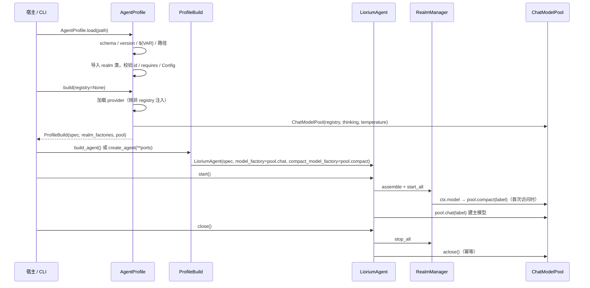

# Liorium Agent Profile（决策记录）

> 状态：已定稿（2026-11-14）；**已实现**（2026-11-15，Phase 0–3 全部落地）。
> 来源：与作者的逐条设计拷问（34 问，结论全部落在本文）。
> 入口代码：新增 `packages/liorium-profile`；同时修改 `liorium-agent` / `liorium-realm-base` /
> `liorium-provider-manager` / `liorium-memory` / `liorium-cli`。
> 实现证据与测试数字见 [`docs/design/ACCEPTANCE.md`](../design/ACCEPTANCE.md) 的「变更（十二）」。
> 本文是**唯一**依据：实现与本文冲突，以本文为准；要改结论，先改本文。

---

## 0. 一句话

一个 JSON（Pydantic 校验）描述「创建一个 Liorium Agent 的全部信息」：指向一份 provider 配置、
选模型与思考强度、列出要装的 realm 及其配置。`liorium.profile` 把它编译成
`AgentSpec` + realm 工厂表 + 模型池；宿主既可以直接拿到三件套，也可以拿到一个可直接
`start()` 的 `LioriumAgent`。

```python
from liorium.profile import AgentProfile

profile = AgentProfile.load("~/.liorium/profile.json")

agent = profile.build_agent()          # 未 start；模型池的关闭已挂到 agent.close()
await agent.start()
...
await agent.close()                    # worker → realms → checkpoint → 模型池 aclose
```

### 非目标（明确不做）

| 不做 | 原因 |
|---|---|
| profile 继承 / `extends` | 正是旧 `Profile` 合并语义带来的歧义；复用改由 `setup profile init --template` 生成 |
| `{{NAME}}` 服务引用 / `RealmSpec.resources` / bindings | realm 改成自组装后不再需要；对象不进 spec 指纹 |
| 内联 system prompt | `AgentSpec.prompt_sources` 只有文件；内联要改 `runtime/prompt.py` 的固定拼接 |
| 权限 / 沙箱 | profile 是**受信任的本地代码配置**：`load()` 会 eager import realm 类 |
| 多 Agent 编排 | 一个 profile = 一个顶层 Agent；子代理仍由 `subagents` realm 管 |
| 宿主扩展段（`host` 命名空间） | UI 偏好留在薄 `config.json`；profile 严格、只描述 Agent |

---

## 1. 决策表（编号稳定，后续讨论请引用）

### A. 定位

| # | 决策 | 一句话理由 |
|---|---|---|
| A1 | Agent Profile 是**装配配方层**：编译出 `{AgentSpec, realm_factories, model_factory, compact_model_factory}`；`AgentSpec` 仍是运行期唯一真相 | 指纹 / `apply()` / `RealmManager` 全部不动，改动可增量落地 |
| A2 | **删除**旧 `liorium.agent.Profile` 与 `AgentSpec.with_profile()`，公开 API 只剩 `AgentProfile` | 两个 "Profile" 是长期创可贴；仓库内只有 1 个测试文件 + 3 处文档引用 |
| A3 | 新包 `liorium-profile`（模块 `liorium.profile`），依赖 `liorium-agent` + `liorium-provider-manager` + `pydantic` | agent 继续只认 `model_factory` 回调，永远不知道 provider 存在 |
| A4 | v1 不做 `extends`；复用靠 `setup profile init --template` | 合并语义是当年删旧 `Profile` 的原因，不请回来 |
| A5 | profile 只管 Agent 装配；`config.json` 保留，退化为 `{version, ui:{color, hide_reasoning}}` | UI 偏好不是 Agent 语义；也避免库 schema 背 UI 概念 |

### B. Profile 内容

| # | 决策 | 一句话理由 |
|---|---|---|
| B1 | 顶层字段：`version / id / provider_file / model / thinking / temperature / workspace / inbox / prompt / boot / limits / toolsets / realms` | 覆盖 `AgentSpec` 全部可序列化字段 + 模型策略 |
| B2 | `realms` 是**保序数组**，每项 `{id, source, config}`；`source` 统一字符串：`pkg.mod:Class` 或 `./file.py:Class` | 紧凑、与 Python 生态一致；顺序即声明序（`requires` 仍由类声明，拓扑排序不变） |
| B3 | 内置 realm（`subagents`）写 `{"id": "subagents"}`，**省略 source**；load 时白名单校验 | realm 列表仍是完整真相；内置 realm 的工厂由 Agent 自己注册 |
| B4 | 不提供内置别名表（不再有 `core/memory/...` 短名） | 别名是第二套硬编码契约；类路径只多写几个字符 |
| B5 | `prompt` 只支持文件列表（相对 `inbox`），直接映射 `AgentSpec.prompt_sources` | 零改动、拼接顺序不变；CLI 仍自动创建缺失的 `AGENT.md` |
| B6 | `model` 在 JSON 里可为 `null`（表示"未配置"），但 `build()` 时为空报错；`thinking` 默认 `medium`，`temperature` 默认 `0.3` | 新装用户还没有 provider；"必填"落在 build 边界而不是 JSON 边界 |
| B7 | `limits` 与 `AgentSpec.limits` 一一对应（缺省用 `Limits` 默认值）；`toolsets` 原样映射 | 不发明第二套阈值名字 |

### C. realm 自组装（本轮最大的架构变更）

| # | 决策 | 一句话理由 |
|---|---|---|
| C1 | **所有服务在 realm 内部按 config 构造**：memory 的 embedder / vectors / entity_vectors / extractor 不再由宿主注入 | 「所有类在 Realm 内部组装，所有配置统一由 Realm Config 传入」 |
| C2 | 删除 `{{NAME}}` 引用、`RealmSpec.resources`、bindings | C1 之后它们没有存在意义；对象永远不进 spec |
| C3 | `RealmContext` 新增 **aux 模型端口**：`ctx.model`（property，背后是零参工厂，每次访问取当前 aux 模型） | realm 启动早于模型构建；`apply()` 又不会重启 realm，固定实例必然过期 |
| C4 | `ctx.model` 是 **aux 模型**（复用 `compact_model_factory`：不思考、无工具）；realm **不得 close** 它 | 抽取类调用按现有语义就不该带思考；传输层归 pool 所有 |
| C5 | realm **可选**声明 `Config`（Pydantic `BaseModel` 类属性）；`load()` 用它对 `config` 做校验 + 填默认，未知字段报错；未声明的原样透传 | 严格度从顶层延续到里层；第三方 realm 不必依赖 pydantic |
| C6 | `RealmSpec.params` 重命名为 `config`；`params` 保留只读别名（`RealmSpec` 与 `RealmContext` 上各一个） | 与新概念对齐，同时避免一次性改遍所有 realm 与测试 |

### D. 加载与校验

| # | 决策 | 一句话理由 |
|---|---|---|
| D1 | `load()` **eager 导入 + 校验**：source 可导入、取到可调用对象、类 `id` 与条目一致、`requires` 都在本 profile 内、`Config` 通过；任何一步失败 = 整个 load 失败 | 配置错 ≠ 运行期故障；运行期 `start()` 失败仍按既有 C5 降级 |
| D2 | 顶层 `version: 1` **必填**，Pydantic `extra="forbid"`，错误消息带 JSON 路径（`realms[1].config.vectors`） | profile 会执行代码，拼错的键必须炸；前向兼容靠 version |
| D3 | 路径规则：`~` 展开 + `${VAR}` 插值（未定义变量报错）；`provider_file` / realm 文件路径 / `prompt` 相对 profile 目录；`workspace` 默认**启动时 cwd**；`inbox` 相对 `workspace` | 全局 `~/.liorium/profile.json` 也能用；CLI 现有「workspace=cwd，inbox=workspace/.liorium-cli/agent」不破 |
| D4 | 文件型 realm 按 `(绝对路径, mtime_ns, size)` 缓存：没改复用同一模块对象，改了重新执行并替换 `sys.modules` 条目；**不加 `sys.path`**，单文件自包含 | 编辑代码后重载即生效，又不制造重复模块；相对导入明确不支持 |
| D5 | 模块名：`liorium_profile_realm_<stem>_<sha1(abs)[:8]>`；source 用 `rsplit(":", 1)` 切分（Windows `C:\x.py:Cls` 可用），属性支持点号链（`pkg.mod:Outer.Inner`） | 两种平台都不歧义；嵌套类免费支持 |
| D6 | `api_key` 支持 `${ENV}` 或明文，**默认明文**；profile 写盘 0600；明文 key 存在时打印"别提交仓库"提示 | 作者选择；代价见 §9 |
| D7 | `load()` 只校验 profile 与 realm；**provider 文件在 `build()` 才加载**（`registry=` 覆盖优先） | 否则 `build(registry=...)` 的测试/共享用法没有意义 |

### E. Provider 与模型生命周期

| # | 决策 | 一句话理由 |
|---|---|---|
| E1 | `provider_file` 指向 `providers.json`（相对 profile 目录）；`build(registry=...)` 可注入已加载的 registry 覆盖文件 | profile 自己解析，但宿主（测试 / 多 Agent 共享）仍可接管 |
| E2 | 新增 `liorium.provider.ChatModelPool`：`__call__(label, *, purpose)`、`.chat` / `.compact` 两个绑定可调用对象、幂等 `aclose()`；内部按 `(label, intensity, purpose)` 缓存，用 `close_chat_model` 关 | "谁造谁关"：只有 pool 知道哪些客户端是私有的 |
| E3 | `LioriumAgent.close()` 对 `model_factory` / `compact_model_factory` 调 `getattr(f, "aclose")`（去重、幂等）；**不**对模型实例做鸭子类型关闭 | 修掉「close 不关客户端」的 bug，同时不重蹈「关掉 langchain 共享客户端」的坑 |
| E4 | CLI 删除自己的 `_model_cache` / `_build_model`，改用 pool；`/thinking` 改 pool 的 `thinking` 后再 `apply(force=True)` | 一处所有权，`apply()` 换下来的旧模型也由 pool 兜住 |

### F. 出口 API

| # | 决策 | 一句话理由 |
|---|---|---|
| F1 | `profile.build(*, registry=None, model=None) -> ProfileBuild`；`ProfileBuild{profile, spec, realm_factories, registry, pool}` + `create_agent(**ports)` + `close()`（只关 pool，幂等） | 分层干净、好测；"Agent 由宿主创建"的既有约定不变；入参优先级见 §3.4 |
| F2 | `profile.build_agent(**ports) -> LioriumAgent`（未 start）是 F1 的便利封装 | 关闭责任已由 E3 挂到 Agent，裸 Agent 不再漏客户端 |
| F3 | `AgentProfile.load(path)` 与 `AgentProfile.from_dict(raw, *, base_dir, env)` 两个入口 | 后者给测试与"配置存在数据库里"的宿主用 |

### G. CLI

| # | 决策 | 一句话理由 |
|---|---|---|
| G1 | profile 取代 `config.json` 的**装配部分**；`config.json` 只剩 `{version, ui:{color, hide_reasoning}}` | 单一真相（Agent 看 profile，显示偏好看 config） |
| G2 | 默认 `~/.liorium/profile.json`；cwd 的 `.liorium/profile.json` 优先；`--profile PATH` 指任意文件 | 与现有 `providers.json`「先看当前目录」的规则一致 |
| G3 | 启动时不存在则生成默认 profile；旧 `config.json` 有装配字段时**自动迁移一次** + `config.json.bak` + 提示 | 升级不丢设置，可回退 |
| G4 | 管理命令挂在 setup 下：`liorium-cli setup profile show|path|init|validate|edit|migrate` | 与 `setup providers` / `setup memory` 同一入口 |
| G5 | 保留临时覆盖 flag：`--profile / --workspace / --inbox / --model / --thinking / --no-thinking / --temperature / --no-<realm> / --hide-reasoning / -p / --json / --list-models`；**flag 绝不写回 profile**；结构性设置（memory dir、skills dir、`--tools` 子集）只能改 profile；目录类 flag（`--models-dev` / `--refresh-models`）不变 | 高频操作要顺手，配置归属要唯一 |
| G6 | `setup profile show` 填好默认值再打印（密钥打码）；`validate` 默认走完整 `load()`（含导入 realm，与运行期一致），`--schema-only` 只查 JSON，`--provider` 额外校验 provider 文件 | 与 `setup show` 的既有体验一致；"校验通过"必须等价于"能 load" |
| G7 | `/model`、`/thinking`：改 pool 参数 + 用当前 profile/overrides 重新 `build()` 出 spec，再 `agent.apply(force=True)`；`/reload` 重新读 profile 文件（mtime）后同样走 `apply` | 复用既有热切换机制 |
| G8 | profile 的 `id` / `inbox` 是 Agent 身份（`apply()` 拒绝改变）；`/reload` 检测到这两项变化时报错并要求重启 | `agent.py:787-790` 的既有约束，不绕过 |

---

## 2. Schema

### 2.1 完整示例

```json
{
  "version": 1,
  "id": "cli",
  "provider_file": "providers.json",
  "model": "Go::deepseek-v4.1-flash",
  "thinking": "medium",
  "temperature": 0.3,
  "workspace": null,
  "inbox": ".liorium-cli/agent",
  "prompt": ["AGENT.md"],
  "boot": {"message": null},
  "limits": {
    "max_turns": 500,
    "context_window": 1048576,
    "compact_threshold_ratio": 0.8,
    "max_subagent_depth": 2
  },
  "toolsets": {
    "default": ["read", "write", "edit", "search", "find", "execute"]
  },
  "realms": [
    {"id": "core", "source": "liorium.core_tool_realm:CoreToolRealm"},
    {
      "id": "memory",
      "source": "liorium.memory:MemoryRealm",
      "config": {
        "dir": "memory",
        "vectors": true,
        "embed": {
          "model": "text-embedding-3-small",
          "base_url": "",
          "api_key": "${MEMORY_EMBED_KEY}"
        },
        "extraction": true
      }
    },
    {
      "id": "skills",
      "source": "liorium.skills:SkillsRealm",
      "config": {"skills_dir": "skill.d"}
    },
    {"id": "todo", "source": "liorium.todo_realm:TodoRealm"},
    {"id": "subagents"}
  ]
}
```

> 类路径沿用 CLI 默认模板（实现后落在 `cli/profile.py` 的 `CORE_REALM` / `MEMORY_REALM` /
> `SKILLS_REALM` / `TODO_REALM` / `SUBAGENTS_REALM` 常量），
> 属性可以写在包的 re-export 上（`liorium.memory:MemoryRealm`）。

### 2.2 字段语义

| 字段 | 类型 | 默认 | 说明 |
|---|---|---|---|
| `version` | `1` | — | 必填；以后改版用它区分 |
| `id` | `str \| null` | 文件名 stem | `AgentSpec.id`；**身份**，`apply()` 不可变。`from_dict()` 没有文件名，必须显式给 `id` 或 `default_id=`，否则报错。CLI 生成的默认值显式写 `"cli"`（沿用现状） |
| `provider_file` | `str \| null` | `null` | 相对 profile 目录；与 `build(registry=...)` 至少给一个 |
| `model` | `str \| null` | `null` | `Provider::model` 标签；库层 `build()` 为空报错。CLI 启动时 `null` ⇒ `registry.default_label()`（= `main_model`，旧行为），再作为 `build(model=...)` 传入；见 §3.4 |
| `thinking` | `off\|low\|medium\|high` | `medium` | 只影响 chat 调用；aux / compact 永远不思考 |
| `temperature` | `float` | `0.3` | 思考开启时不发送 |
| `workspace` | `str \| null` | 启动时 cwd | 裸路径基准（`execute` 的 cwd） |
| `inbox` | `str \| null` | `<workspace>/.liorium/agent` | Agent 根；**身份**，`apply()` 不可变；CLI 生成的默认值写 `.liorium-cli/agent` |
| `prompt` | `list[str]` | `[]` | 相对 `inbox`；按序拼接。CLI 生成的默认 profile 写 `["AGENT.md"]`，文件缺失时用 `DEFAULT_SYSTEM_PROMPT` 创建；`--system` 本次替换成单文件 |
| `boot` | `{message}` | `{message: null}` | 库不自动执行，宿主自己 `push()` |
| `limits` | 对象 | `Limits()` 默认 | 与 `AgentSpec.limits` 一一对应；省略 `context_window` 时从 provider 的模型元数据自动填（等价于今天 CLI 的 `resolved.context_window`，否则压缩阈值会退化） |
| `toolsets` | `dict[str, list[str]]` | `{}` | 由 realm 解释；`"default"` 目前归 `core` realm |
| `realms` | 数组 | `[]` | 保序；id 不得重复 |

`realms[]`：

| 字段 | 类型 | 说明 |
|---|---|---|
| `id` | `str` | 必填；与类的 `id` 类属性一致（类没声明 id 时由工厂返回的实例补） |
| `source` | `str \| null` | `pkg.mod:Class` / `./file.py:Class`；`null` 仅限内置白名单（当前 `subagents`） |
| `config` | 对象 | 交给 realm；有 `Config` 的用其校验并填默认，否则原样透传 |

### 2.3 路径基准

| 字段 / 内容 | 基准 | 说明 |
|---|---|---|
| `provider_file` | profile 目录 | 记绝对路径可完全忽略基准 |
| realm `source` 里的文件路径 | profile 目录 | `.py` 结尾才当文件 |
| `prompt[]` | `inbox` | 与 `AgentSpec.prompt_sources` 一致 |
| `workspace` | —（默认 cwd） | 写相对值时相对 profile 目录 |
| `inbox` | `workspace` | 同样可写绝对路径 |
| realm `config` 里的路径 | 由 realm 定义（约定：相对 `inbox`） | profile 只做 `~` / `${VAR}` 展开，不猜 realm 语义 |

> `${VAR}` 的转义：`$$` 表示一个字面 `$`（`$${HOME}` → `${HOME}`）；未定义的变量直接报错，不静默留空。
>
> 展开**作用于整个文档的所有字符串值**（键不动），在 Pydantic 校验之前完成；`realms[].config`
> 里的字符串同样展开，但 profile **不**把其中的路径解析成绝对路径（那是 realm 自己的语义）。

---

## 3. 运行时映射与时序

### 3.1 字段映射

| Profile | 运行时 |
|---|---|
| `id` | `AgentSpec.id` |
| `inbox` / `workspace` | `AgentSpec.inbox_dir` / `workspace_root` |
| `model` / `thinking` / `temperature` | `AgentSpec.model`（标签）+ `ChatModelPool` 构造参数 |
| `prompt` | `AgentSpec.prompt_sources` |
| `limits` / `toolsets` / `boot` | 同名 `AgentSpec` 字段 |
| `realms[].id` / `.config` | `RealmSpec(id, config)` |
| `realms[].source` | `realm_factories[id] = 类或工厂` |
| `provider_file` | `ProviderRegistry` → `ChatModelPool` |

补充：

- `limits.context_window` 未**显式**给出时，`build()` 用 `registry.resolve(label).context_window`
  填（等价今天 CLI 的 `_build_spec`）；"显式"靠 `limits.model_fields_set` 判断，写 `0`
  表示明确的未知，不再被 provider 元数据覆盖。
- 模型标签来源、provider 解析顺序见 §3.4 / §3.5。

### 3.2 时序



### 3.3 生命周期约束（沿用现状，不新造）

- `start()` 不调模型；
- `apply()` 拒绝改 `id` / `inbox_dir`；
- realm 起不来 ⇒ 该 realm `failed`，其它照常；
- `apply()` 改 `realms` 时会 stop_all → assemble → start_all，realm 状态重新落盘。

### 3.4 build / create_agent 的入参解析（先到先得）

```python
build = profile.build(registry=None, model=None)   # 两个参数都可选
agent = build.create_agent()                       # 未 start
```

| 项 | 顺序 |
|---|---|
| 模型标签 | `build(model=...)` > `profile.model` > `registry.default_label()`（= `providers.json` 的 `main_model`，与今天 `_resolve_initial` 一致） |
| provider registry | `build(registry=...)` > `profile.provider_file`（相对 profile 目录） |
| `limits.context_window` | JSON 显式给出 > `registry.resolve(label).context_window` > `0`（未知） |
| `workspace` | `profile.workspace` > 启动时 cwd |
| `inbox` | `profile.inbox`（相对 workspace） > `<workspace>/.liorium/agent` |
| `id` | `profile.id` > `load()` 时的文件名 stem > `from_dict(default_id=...)` |

- 三处都拿不到模型标签（参数 / profile 字段 / registry 默认）⇒ `ProfileError`。CLI 因此完全保留
  "`config.json.model` 为空 ⇒ 用 `main_model`"的旧行为，不会把新用户挡在门口。
- `create_agent(**ports)` 只转发 `LioriumAgent` 的宿主端口：
  `vfs / memory / artifacts / checkpoint_path / thread_id / batch_window / env_interval /
  system_prompt_override / tool_names / root_agent`。
  `spec / model_factory / compact_model_factory / realm_factories` 由 build 决定，
  传了直接 `TypeError`（不静默覆盖）。
- `ProfileBuild.close()` 只 `await pool.aclose()`，不碰 agent，幂等。推荐顺序：
  `agent.close()`（内部已关 pool，E3）→ `build.close()`（兜底）。先 close build 再建 agent
  会拿到已关闭的 pool，属于用法错误（文档写清，不额外防护）。
- `/model`、`/thinking`、`/reload` 复用同一个 pool：`/thinking` 改 `pool.thinking`；
  `/model` 用新标签 `build(model=...)` 重建 spec；两者最后都 `agent.apply(force=True)`（G7）。

### 3.5 CLI 的 provider 解析

CLI 每次启动**自己**加载 registry，再以 `build(registry=...)` 传入，因此 profile 里的
`provider_file` 不是唯一入口（共享 / 临时切换都靠它覆盖）：

| 顺序 | 来源 |
|---|---|
| 1 | `--config PATH`（沿用旧 flag 名，语义 = 本次的 `provider_file`） |
| 2 | `LIORIUM_PROVIDER_CONFIG` 环境变量 |
| 3 | `profile.provider_file`（相对 profile 目录；文件不存在 ⇒ 报错，不静默回退） |
| 4 | `providers.json` 的旧搜索顺序（`./providers.json` → `~/.liorium/providers.json`） |

找不到任何 provider 文件 ⇒ 进入未配置 REPL（与今天一致），不阻塞启动。
`setup profile init` 与自动迁移把**当时解析到的绝对路径**写进 `provider_file`：
既满足"profile 自带 provider 指向"，又让 `./providers.json` 的老用户升级后行为不变。

---

## 4. realm 自组装（以 Memory 为例）

### 4.1 今天

`MemoryRealm.__init__(spec, *, store, embedder, vectors, entity_vectors, extractor, search_config)`；
CLI 用 `_memory_services()` + `_wrap_memory_factory()` 把服务闭包注入
（`cli/session.py:316-359`），并据此决定"向量 / 抽取能不能开"。
`memory/realm.py:15` 明确写着「本包不读产品配置，也就不自己造 API key」。

### 4.2 之后

```python
class MemoryRealm:
    id = "memory"

    class Config(BaseModel):
        model_config = ConfigDict(extra="forbid")
        dir: str | None = None                  # 相对 ctx.inbox_dir；同时给 db_path/content_dir 则报错
        db_path: str | None = None              # 兼容旧宿主：默认 <dir>/memory.sqlite
        content_dir: str | None = None          # 兼容旧宿主：默认 <dir>/content
        vectors: bool = True
        embed: EmbedConfig | None = None        # model / base_url / api_key（不跟随主 provider）
        extraction: bool = True
        list_limit: int = 200
        keyword_index: bool = True

    def __init__(self, spec=None): ...          # 只读 spec.config
    async def start(self, ctx):
        store = self._open_store(ctx)
        embedder = vectors = None
        if self.config.vectors and self.config.embed:
            embedder, vectors = self._build_semantic()     # 本包内延迟 import
        extractor = LlmExtractor(chat=self._chat_from(ctx)) if ... else None
```

规则：

- **配置驱动**：开不开向量、抽取、用什么模型 / 端点 / key，全部来自 `config`；
- **能力缺失降级**：`nano-vectordb` / `numpy` 没装或 `config.embed` 缺失 ⇒ 只跑关键词检索 + 一条告警，不影响 realm 启动；
- **模型调用走 `ctx.model`**：`async def chat(system, user)` 由 `ctx.model.ainvoke` 包装；`ctx.model is None`（独立使用 / 测试）⇒ 关闭抽取；
- **不 close `ctx.model`**：所有权在 pool。
- **embedding 凭据必须显式**：`OpenAICompatibleEmbeddings` 既不读环境变量、也看不到 registry
  （`memory/embeddings.py:1-3` 的承诺）；`embed.api_key` 为空 ⇒ 不建向量、只跑关键词 + 一条告警。
  "跟随主 provider" 在自组装后不存在：迁移时把当时 provider 的 `base_url` / `api_key`
  写进 profile（明文、0600），新装用户自己填或写 `${VAR}`。
- **`dir` 只是目录语义**：`db_path = dir/memory.sqlite`、`content_dir = dir/content`、
  向量索引在 `dir/index/`。为兼容旧宿主，`db_path` / `content_dir` 仍可单独给；
  与 `dir` 同时给（或彼此不一致）⇒ 构建期报错，不做优先级猜测。

`EmbedConfig` = `model: str`、`base_url: str = "https://api.openai.com/v1"`、`api_key: str`，
同样 `extra="forbid"`。

`Config` 的书写约定（第三方 realm 也照此）：

- 继承 `pydantic.BaseModel`，`model_config = ConfigDict(extra="forbid")`；
- 所有字段给默认值（`load()` 会用它填默认，所以"最少配置"必须能通过校验）；
- 路径类字段写相对 `inbox` 的值，由 realm 在 `start()` 里用 `ctx.inbox_dir` 解析；
- 不在 `Config` 里放对象、回调、连接。需要模型就用 `ctx.model`。

其余能力包：

| realm | Config 字段 | 备注 |
|---|---|---|
| `core` | 无 | 工具子集仍由 `AgentSpec.toolsets["default"]` 决定 |
| `skills` | `skills_dir: str \| None` | 相对 `inbox`，默认 `skill.d` |
| `todo` | 无 | 节奏用它自己的默认值（每 50 回合） |
| `subagents` | 无 | 工厂由 Agent 注册 |

---

## 5. 模型生命周期

### 5.1 问题

`LioriumAgent.close()` 不关模型客户端；而模型能不能关只有造它的层知道
（`close_chat_model` 只关调用方显式注入的私有客户端；langchain 的默认客户端在模块级
`lru_cache` 里，关掉会让同 base_url 的所有模型永久不可用）。

### 5.2 方案：工厂对象自带 `aclose()`

```python
# packages/liorium-provider-manager/src/liorium/provider/pool.py
class ChatModelPool:
    def __init__(self, registry, *, thinking="medium", temperature=0.3): ...

    thinking: str          # 可变：/thinking 改它
    temperature: float

    @property
    def chat(self) -> ModelFactoryPort: ...      # __call__(label) + aclose()
    @property
    def compact(self) -> ModelFactoryPort: ...

    async def aclose(self) -> None: ...          # 幂等；逐个 close_chat_model
```

Agent 侧只加一件事：

```python
async def close(self) -> None:
    ...
    finally:
        for factory in {self.model_factory, self.compact_model_factory} - {None}:
            aclose = getattr(factory, "aclose", None)
            if aclose is not None:
                await aclose()
```

- 裸函数工厂没有 `aclose` ⇒ 行为不变；
- 构建失败 / `apply()` 换下来的模型都在 pool 里，一次关干净；
- CLI 的 `_model_cache` 删除，行为不变。

---

## 6. 改动清单

### 6.1 `liorium-agent`

| 文件 | 改动 |
|---|---|
| `spec.py` | 删 `Profile`；`RealmSpec.params` → `config`（+ `params` 只读别名）；指纹用 `config`；删 `AgentSpec.with_profile` |
| `agent.py` | `close()` 调工厂 `aclose`；`realms.configure(...)` 三处（构造 / apply / rollback）传 `aux_model_factory`；aux = `(compact_model_factory or model_factory)(spec.model)` |
| `realm/manager.py` | 存 `aux_model_factory`，建 `RealmContext` 时注入 |
| `realm/base.py` | re-export `RealmContext` 即可（字段在 realm-base） |
| `__init__.py` | 去掉 `Profile` 导出 |
| `tests/test_profile.py` | 删除；新增 `test_realm_config.py` / `test_model_close.py` / `test_ctx_model.py` |

### 6.2 `liorium-realm-base`

- `RealmContext` 加字段 `model_factory: Callable[[], Any] | None = None` 与 property `model`；
- 加 `config` property（`params` 别名）；
- README / docstring 写清三条：aux 语义、不要 close、独立使用时为 `None`。

### 6.3 `liorium-provider-manager`

- 新增 `pool.py`（`ChatModelPool` / `ModelFactoryPort`）；
- `__init__.py` 导出；
- README 增加"模型池与关闭"一节；
- 测试：缓存键、幂等 aclose、shared 客户端不关、`.chat` / `.compact` 的 purpose 传递。

### 6.4 `liorium-memory`

- `realm.py`：`Config` 模型 + 自组装（embedder / vectors / entity_vectors / extractor）；
- 保留 `__init__` 的服务 kwargs（测试与宿主自定义仍可用），但 profile 路径不再用它们；
- 文档里删掉"宿主注入"的表述，改成"config 驱动 + 可选注入覆盖"；
- 测试：config 驱动的向量 / 抽取、extras 缺失降级、`ctx.model` 包装、无 `ctx.model` 时关闭抽取。

### 6.5 新包 `liorium-profile`

```
packages/liorium-profile/
├── pyproject.toml            # liorium-agent / liorium-provider-manager / pydantic
├── README.md
├── src/liorium/profile/
│   ├── __init__.py           # AgentProfile / ProfileBuild / ProfileError
│   ├── model.py              # Pydantic schema（version / realms / limits / …）
│   ├── loader.py             # 路径 / ${VAR} / source 解析 / mtime 缓存 / Config 校验
│   ├── build.py              # ProfileBuild：spec + factories + pool + create_agent
│   └── errors.py             # ProfileError 及子类（消息带 JSON 路径）
└── tests/
    ├── test_profile_schema.py
    ├── test_profile_loader.py
    ├── test_profile_sources.py
    ├── test_profile_build.py
    └── test_profile_lifecycle.py
```

根 `pyproject.toml`：

- `[tool.hatch.build.targets.wheel] force-include` 增加
  `"packages/liorium-profile/src/liorium/profile" = "liorium/profile"`；
- `[dependency-groups].dev` 与 `[tool.uv.sources]` 增加 `liorium-profile`。

`tests/test_architecture.py`：`LIORIUM_ALLOWED` 增加
`"liorium-profile": {"liorium.agent", "liorium.provider", "liorium.realm_base", "liorium.core", "liorium.vfs"}`。

`tests/test_distribution.py`：

- 硬编码的 `12` 改成 `13`：`tests/test_distribution.py` 有 3 处（第 1、5 行 docstring + 第 93 行断言），
  `scripts/check_wheel.py` 有 2 处 docstring（它的断言是动态的，不用改）；
- 新包 `__version__ = "0.1.1"`，自己的 `pyproject.toml` 也写 `0.1.1`（版本漂移守卫）；
- 依赖 `pydantic` 根项目已声明（`pyproject.toml` 基础依赖），无需新增；
- `scripts/check_wheel.py` 动态扫描模块目录，加完 `force-include` 即自动覆盖。

### 6.6 `liorium-cli`

| 文件 | 改动 |
|---|---|
| `config.py` | `DEFAULT_CONFIG` 只剩 `{version, ui}`；`KEYS` 只剩 `ui.*`；新增 `migrate_to_profile()`（映射 + `.bak` + 改写成 UI-only） |
| `session.py` | 删 `_realm_specs` / `_load_capabilities` / `_memory_services` / `_wrap_memory_factory` / `_build_spec` / `_build_model` / `_model_cache`；`start()` 改为 `AgentProfile.load` → `build` → `create_agent`；`/model` `/thinking` 改 pool + rebuild spec + `apply(force=True)`；`/reload` 重读 profile |
| `app.py` | 新增 `--profile`；删 `--tools` / `--no-core-tools` / `--memory-dir` / `--skills-dir`；其余 flag 转 overrides |
| `setup.py` | 新增 `profile show\|path\|init\|validate\|edit\|migrate` |
| `providers.py` | 不变（provider 的搜索 / 向导 / key 仍归它） |
| 测试 | 默认 profile 生成、迁移映射、cwd/home/`--profile` 优先级、flag 不写回、`setup profile` 各命令、`/reload` 身份变化报错 |

#### 6.6.1 flag / env 的去留

保留（只影响本次运行，绝不写回 profile）：

| flag | 语义 |
|---|---|
| `--profile PATH` | 指定 profile（新增） |
| `--config PATH` | 本次的 provider 文件（覆盖 `profile.provider_file`，见 §3.5） |
| `--provider` / `--model` / `--api-format` | 拼出本次 `build(model=...)` 的标签 / registry 覆盖 |
| `--workspace` / `--inbox` | 覆盖 spec 的两个身份字段（`/reload` 变化时报错要求重启） |
| `--system FILE` | 本次把 `prompt` 换成这一个文件 |
| `--thinking` / `--no-thinking` / `--temperature` | 覆盖 pool 参数 |
| `--max-turns N` | 覆盖 `limits.max_turns` |
| `--no-memory` / `--no-skills` / `--no-todo` / `--no-subagents` | 本次不装配对应 realm（`--no-<realm>`） |
| `--json` / `--no-color` / `--hide-reasoning` / `-p` / `--list-models` / `--env-file` / `--no-env` / `--models-dev` / `--models-dev-cache` / `--refresh-models` | 不变 |

删除（结构性设置只能改 profile）：

| 删除项 | 新位置 |
|---|---|
| `--tools` / `--no-core-tools` | `toolsets.default` / realms 数组里的 core 条目 |
| `--memory-dir` / `--skills-dir` | `realms[memory].config.dir` / `realms[skills].config.skills_dir` |
| `--embed-model` / `--embed-base-url` / `--embed-key` / `--no-vectors` / `--no-extraction` | `realms[memory].config.embed.*` / `.vectors` / `.extraction` |

对应的环境变量（`LIORIUM_TOOLS`、`LIORIUM_NO_CORE_TOOLS`、`LIORIUM_MEMORY_DIR`、
`LIORIUM_SKILLS_DIR`、`LIORIUM_EMBED_MODEL` / `_BASE_URL` / `_KEY`、`LIORIUM_NO_VECTORS`、
`LIORIUM_NO_EXTRACTION`）不再读取；需要环境变量时在 profile 里写 `${VAR}`。

#### 6.6.2 `config.json` → profile 迁移映射

| 旧键 | 新位置 |
|---|---|
| `model` / `thinking` / `workspace` / `inbox` | 同名 profile 字段（`null` 原样保留） |
| `memory.enabled` | `false` ⇒ 不生成 memory 条目 |
| `memory.dir` | `realms[memory].config.dir`（`null` ⇒ 省略） |
| `memory.embed_model` | `realms[memory].config.embed.model`（空 ⇒ `embed: null`） |
| `memory.embed_base_url` / `embed_key` | `embed.base_url` / `embed.api_key`；为空时用**当前解析出的 provider** 的值补全（等价旧行为） |
| `memory.vectors` / `memory.extraction` | `config.vectors` / `config.extraction` |
| `skills.enabled` / `skills.dir` | `false` ⇒ 不生成条目；否则 `config.skills_dir` |
| `todo.enabled` | `false` ⇒ 不生成 todo 条目 |
| `subagents.enabled` | `false` ⇒ 不生成 `{"id":"subagents"}` |
| `ui.color` / `ui.hide_reasoning` | 留在 `config.json`（profile 不接管） |

默认模板固定生成 `core` / `skills` / `todo` / `subagents` / `memory` 五条（上表只描述"删条目"的例外）。

迁移动作（只在 profile 不存在时执行一次）：

1. 把原 `config.json` 原样复制成 `config.json.bak`；
2. 生成 profile：`version: 1`、`id: "cli"`、`prompt: ["AGENT.md"]`、
   `provider_file` = 当前 provider 文件的**绝对路径**；
3. 把 `config.json` 重写成 `{version: 1, ui: {color, hide_reasoning}}`；
4. 打印迁移摘要、备份路径与"之后改 profile"的提示。

`setup profile migrate` 手动触发同一函数；profile 已存在时只打印"已存在，跳过"并返回非零退出码。

### 6.7 文档

| 文件 | 改动 |
|---|---|
| `docs/ARCHITECTURE.md` | 模块地图加 `profile.py`；§4 写明 realm 自组装 + `ctx.model`；删 `Profile` 段落 |
| `docs/API.md` | 删 `Profile` / `with_profile`；新增 `AgentProfile` / `ProfileBuild` / `ChatModelPool` / `RealmContext.model` |
| `docs/README.md` | feature 表把 `profile` 换成新包说明 |
| `docs/EXTENDING.md` | 新增"realm 自组装 + Config 模型 + ctx.model"写法 |
| `docs/design/ACCEPTANCE.md` | 第 6 项（profile 语法糖）替换为 Agent Profile 验收 |
| 各包 README | agent / realm-base / provider / memory / cli 同步 |

---

## 7. 分阶段落地

### Phase 0：底层契约（不改 CLI，测试全绿）

1. `RealmSpec.params` → `config`（+别名）、删 `Profile` / `with_profile`、更新引用与测试；
2. `RealmContext.model` + `RealmManager` / `Agent` 注入 aux 工厂；
3. `LioriumAgent.close()` 调工厂 `aclose`；
4. `ChatModelPool` + provider 测试；
5. `MemoryRealm.Config` 自组装 + 测试。

验收：`uv run pytest packages/liorium-agent packages/liorium-realm-base packages/liorium-provider-manager packages/liorium-memory -q`

### Phase 1：`liorium-profile`

6. 包骨架 / `pyproject.toml`（`0.1.1`）/ 根 `force-include` / `test_distribution.py` 的 12→13 / 架构守卫；
7. schema + loader（路径 / `${VAR}` / source / mtime / Config）+ build；
8. 单元测试与 README。

验收：`uv run pytest packages/liorium-profile -q`

### Phase 2：CLI

9. `config.py` 瘦身 + 迁移；
10. `session.py` 改由 ProfileBuild 装配，删旧接线；
11. `app.py` flag 面调整；
12. `setup profile` 子命令；
13. CLI 测试。

验收：`uv run liorium-cli setup profile show` / `uv run liorium-cli -p "你好"` /
`uv run pytest packages/liorium-cli -q`

### Phase 3：收尾

14. 文档同步（§6.7）；
15. `uv run pytest -q`（全量，含 `tests/test_architecture.py` / `tests/test_distribution.py`）；
16. 手工验收：新装（无任何配置）→ 生成默认 profile → 未配置 REPL；老配置 → 自动迁移；
17. 更新 `docs/design/ACCEPTANCE.md` 勾选。

---

## 8. 验收用例

### 8.1 schema / loader

- `version` 缺失 / 非 1 → 报错；
- 未知字段（顶层 / realm / config 内）→ 报错且路径可读；
- `realms` id 重复 → 报错；
- source：`pkg.mod:Class`、`./a.py:Class`、`C:\x.py:Class`、`pkg.mod:Outer.Inner` 全部解析正确；
- 声明了 `Config` 的 realm：默认值填充 + 未知字段报错；未声明：原样透传；
- `${VAR}`：已定义展开、未定义报错；`~` 展开；
- `provider_file` 缺失且未传 `registry` → `build()` 报错（`load()` 不报）；
- 文件 realm：mtime 不变复用同一类对象；改动后重新执行得到新类；`sys.path` 不被污染；
- 内置 realm：`{"id":"subagents"}` 通过；其它 id 省略 source → 报错；
- `requires` 指向 profile 内不存在的 realm → `load()` 报错；
- `id` 缺失：`load()` 用文件名 stem；`from_dict()` 未给 `default_id` → 报错；
- `$$` 转义成字面 `$`；`${UNSET}` 报错且消息带 JSON 路径；
- `realms[].config` 里的字符串也展开 `${VAR}`，但路径不被 profile 解析。

### 8.2 build / 生命周期

- `build()` 产生的 spec 与手写等价：`id/inbox/model/prompt_sources/realms/limits/toolsets` 逐项断言；
- 指纹稳定：同一 profile 两次 build 指纹相同；改 `config` 指纹变化；
- `registry=` 覆盖：不读 `provider_file` 也能 build；registry 缺失 + 无文件 → 报错；
- `build_agent()` 后 `agent.close()`：pool 内每个模型被关**恰好一次**（用假客户端计数）；
- 共享 pool 被两个 bound factory 调用时 `aclose` 幂等；
- `apply()` 换模型后 `ctx.model` 返回新实例（realm 内断言）；
- `apply()` 改 `id` / `inbox` 抛 `SpecError`；
- 独立使用 realm（`RealmContext.model is None`）时 memory 抽取自动关闭；
- `model=None` 且 profile 未写 `model`：registry 有 `main_model` ⇒ spec.model 取它；registry 也没有 ⇒ `ProfileError`；
- 显式 `limits.context_window: 0` + registry 已知窗口 ⇒ 仍为 `0`（不被元数据覆盖）；
- `create_agent(spec=...)` / `create_agent(model_factory=...)` ⇒ `TypeError`；
- 迁移得到的 profile 能直接 `load()` + `build()`（与迁移前的行为逐项对照）。

### 8.3 CLI

- 无配置启动：生成 `~/.liorium/profile.json` 与 UI-only `config.json`，进入未配置 REPL；
- 旧 `config.json` 迁移：字段逐个映射正确、`config.json.bak` 存在、`config.json` 变 UI-only；
- 优先级：`--profile` > cwd `.liorium/profile.json` > `~/.liorium/profile.json`；
- flag 覆盖只影响本次运行，profile 文件 mtime/内容不变；
- `setup profile show` 打码密钥、填默认值；`validate` 对坏文件给出 JSON 路径；
- `/reload` 改 realms 生效；改 `id` / `inbox` 报错要求重启。

### 8.4 架构与发布守卫

- `liorium-profile` 依赖方向在白名单内；
- 无裸 `asyncio.create_task`（`RealmContext.model` 不引入任务）；
- 源码无 `pluggy`；
- `tests/test_distribution.py` 全绿：13 个模块的 `force-include`、版本一致、根项目依赖覆盖成员包；
- `scripts/check_wheel.py` 在 `uv build` 产物上通过（wheel 里真的有 `liorium/profile/__init__.py`）。

---

## 9. 风险与已接受的代价

| 风险 | 处理 |
|---|---|
| **`load()` 会执行本地代码**（eager import） | 文档写明 profile 是受信任配置；`setup profile validate --schema-only` 提供"只查结构、不执行"的模式 |
| **密钥进 profile** | 支持 `${ENV}`；明文时写盘 0600 + 提示；文档建议团队共享用环境变量 |
| **key 轮换触发 realm 重建**（进指纹） | 接受：轮换是低频操作；重建会 stop/start realm 并重开 sqlite，数据不丢 |
| **`ctx.model` 让 realm 能花 token** | v1 不限预算；文档要求 realm 只在必要时调用；后续可加 aux 预算（记入未决） |
| **公开 API 破坏** | 删 `Profile`、`params→config`、删 CLI 结构性 flag。仓库是 alpha（0.1.1），在 release notes 写明 |
| **`apply()` 不重启 realm** | realm 内用 `ctx.model`（property）拿模型；`config` 变化会因 realms 指纹变化触发 stop/start |
| **两个 JSON + 一个 UI 文件** | 职责写进 §1 A5 / G1；`setup path` 打印全部位置 |
| **profile 里 `source` 指向的文件没有包上下文** | 明确"单文件自包含，不支持相对导入"；复杂 realm 用 `pkg.mod:Class` |
| **embedding 凭据写进 profile**（不再跟随主 provider） | 旧的 `--embed-*` 用户迁移时自动补全一次；之后轮换要同时改两处。文档写清，后续可加"凭据引用"（§10） |
| **结构性 env 变量不再读取**（`LIORIUM_TOOLS` / `LIORIUM_MEMORY_DIR` / `LIORIUM_EMBED_*` …） | 迁移只覆盖 `config.json`；release notes 列出，需要时在 profile 里写 `${VAR}` |
| **`--no-core-tools` 删除** | 结构性开关；临时关闭用 `/realm disable core`，长期改 profile |

---

## 10. 未决（后续版本）

1. `extends` / 模板库（v1 只用 `init --template`）；
2. 内联 system prompt；
3. aux 模型调用预算（`ctx.model` 的成本上限）；
4. `realms[].enabled` 字段（现在靠"删掉条目"或 CLI `--no-<realm>`）；
5. 多 profile 目录（`~/.liorium/profiles/` + default 指针）；
6. 在 profile 里声明 MCP servers（现在只有 `mcp` realm 的 config 能带）；
7. 凭据引用（`embed: {"api_key": {"provider": "Go"}}` 之类，免去 profile 与 `providers.json` 两份 key）。
