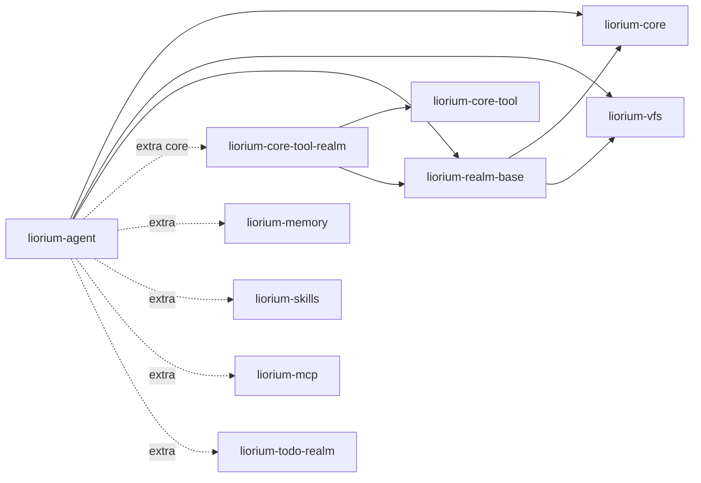

# liorium-agent

Liorium Agent 运行时：一个 `LioriumAgent` 类 + realm 系统 + 固定顺序的基座中间件 +
单执行位调度 + checkpoint。Agent 之间只有三个正交维度的差别（身份 / 关系 / 权限），
生命周期收敛成 `start` / `close` / `run` / `apply`（+ `reset_dialog`）。

## 职责

- **装配与热重载**：`AgentSpec`（可序列化）+ ports（实例覆盖）→ `apply()` 按部件指纹
  差量替换；失败保留旧部件（降级但可用）；
- **回合循环**：`run()` 单消费者 async 生成器（**唯一**事件出口，只产出这一条消息的事件）；
  `inject()` 永不打断；叫停 = `interrupt()` + 新 `run()`；事件只有 9 种，终止用异常；
- **realm**：唯一扩展机制（工具 + VFS 挂载 + 状态 + `prompt_fragment()`）；契约与写作 API
  在 `liorium-realm-base`（本包依赖并 re-export），本包只负责装配：`requires` 拓扑排序、
  工具名冲突报错、起不来就 `failed` 降级；
- **第五拍**：`RealmManager.context_for_turn(TurnInfo)` 按 `context_every` / `context_first`
  问运行中的 realm；返回非空的排进 `ContextChannel`，在安全点物化成独立 `<context>` 消息
  （返回空不消费周期）；`ctx.inject()` 是 realm 自己的推送入口；
- **回合边界 reconcile**：realm 自报 `dirty()` 就重挂载/重取工具/重建运行时；spec 变更走显式
  `apply()`（2026-11-08 删掉 `spec_provider()` 拉模式）；
- **中间件链**：`context_merge → mm_bridge → tool_repair → server_tools → compact →
  model_retry`，顺序由库固定，realm 只能加外层；
- **checkpoint**：`AsyncSqliteSaver`（默认 `<inbox>/checkpoint.db`，表结构冻结，
  能加载旧库继续对话）；realm 状态不放 checkpoint；
- **调度**：同一 Agent 内 `TurnScheduler` 单执行位（调用级优先级 + FIFO + `FLAG` 三个标志，
  不抛忙）；跨 Agent 的并发由调用方自己用 semaphore 包住 `run()`。

## 公开面

`from liorium.agent import ...`（都在 `liorium.agent.__all__`）：

| 分组 | 名字 |
|---|---|
| 装配 | `AgentSpec`、`RealmSpec`、`Limits`、`BootSpec`、`Profile` |
| 运行时 | `LioriumAgent`、`ContextChannel` |
| realm | `Realm`、`BaseRealm`、`RealmContext`、`TurnInfo`、`realm_tool`、`RealmManager`、`SubagentRealm` |
| 调度 | `FLAG`、`DEFAULT_FLAGS`（`INTERRUPTING` / `EXCLUSIVE` / `DROPPABLE`；`TurnDropped` 在 `liorium.core.errors`） |
| 状态 | `AgentStatus`、`ApplyResult`、`CacheEpoch`、`RealmStatus` |

子模块导出（不在顶层 `__all__`）：`liorium.agent.realm.JsonStateStore`、
`RealmTaskScope`、`RealmRecord`、`RealmFactory`；`liorium.agent.runtime` 下的
`CheckpointStore`、`OutputStore`、`wrap_tools`、`build_chain` 等实现者接口。
完整签名见 [API](../../docs/API.md)。

## 最小示例

```python
import asyncio
from pathlib import Path

from liorium.agent import AgentSpec, Limits, LioriumAgent


def make_chat_model(label: str):
    from langchain_openai import ChatOpenAI

    _provider, model = label.split("::", 1)
    return ChatOpenAI(model=model, temperature=0.3)


async def main() -> None:
    inbox = Path("agents/main")
    inbox.mkdir(parents=True, exist_ok=True)
    (inbox / "AGENT.md").write_text("你是 Liorium。", encoding="utf-8")

    agent = LioriumAgent(
        spec=AgentSpec(
            id="main",
            inbox_dir=inbox,
            model="deepseek::chat",
            prompt_sources=("AGENT.md",),
            limits=Limits(context_window=128_000, max_turns=200),
        ),
        model_factory=make_chat_model,
    )
    await agent.start()          # 不调模型
    try:
        async for event in agent.run("今天出门要带伞吗？"):
            print(event.to_dict())    # start / delta / tool_start / tool_result / done
    finally:
        await agent.close()


asyncio.run(main())
```

离线跑（假模型）的完整版本见 [GUIDE](../../docs/GUIDE.md)。

调度参数按次给（`priority` 越大越优先；`flags` 见 `FLAG`）：

```python
from liorium.agent import FLAG

async for event in agent.run("先回答我", priority=5, flags=FLAG.INTERRUPTING):
    ...        # 可以抢占正在跑的低优先级回合（被抢占方收到 TurnInterrupted）
```

## 依赖方向



- 依赖 `liorium-core` / `liorium-vfs` / `liorium-realm-base` + `langchain` / `langgraph`；
  **不依赖 `liorium-core-tool`**（2026-11-08）：六个核心工具由 `liorium-core-tool-realm` 的
  `CoreToolRealm` 装配，`Agent._prepare_runtime()` 只做 `tools = realms.tools()`；
- `BaseRealm` / `RealmContext` / `JsonStateStore` / `@realm_tool` 的实体在
  `liorium-realm-base`（2026-11-07 搬出，只依赖 core + vfs，模块级不碰 langchain）；
  `from liorium.agent import BaseRealm` 仍可用，是同一个对象；
- realm 能力包是可选 extra（`[core]` / `[memory]` / `[skills]` / `[mcp]` / `[todo]`），`agent`
  **不**在导入期依赖它们；`liorium-todo-realm` 连 `liorium.agent` 都不 import；
- 能力包（含 `liorium-core-tool`）**可以** import `liorium.agent` 的 realm 契约；写 realm 时
  更推荐轻量的 `liorium.realm_base`（2026-11-06 起允许，2026-11-07 起有更轻的入口）；
  能力包之间仍然互不依赖，只借 `liorium.vfs` 的挂载面。

## 测试

```powershell
# 本包
.\.venv\Scripts\python.exe -m pytest -q -p no:cacheprovider packages/liorium-agent/tests

# 跨包契约（事件金样、架构守卫、reconcile、v1.1 集成）
.\.venv\Scripts\python.exe -m pytest -q -p no:cacheprovider tests
```

重点覆盖：回合循环与事件翻译（`test_turn_loop.py` / `test_stream_translation.py`）、
压缩（`test_compact_*.py`）、悬空 tool_call 修复（`test_tool_call_repair.py`）、
realm 装配与 conversation scope（`test_realm_manager.py` / `test_realm_v11.py`）、
checkpoint 兼容旧库（`test_checkpoint.py`）、子代理（`test_subagent_realm.py`）、
子代理状态持久化与重启续聊（`test_subagent_state.py`）。

## 子代理的状态

`SubagentRealm` 自己 `state_scope="agent"`、`instance_scope="tree"`，并把状态拆成两处
（详见 [design/subagent-state.md](../../docs/design/subagent-state.md)）：

```
<inbox>/realm_state/subagents.json                  # 名册：名称 / 工具集 / 状态 / 时间戳
<inbox>/subagents/<name>/TASK.md                    # 任务说明
<inbox>/subagents/<name>/output.md                  # 本次转录
<inbox>/subagents/<name>/finalResult.md             # 最终结果
<inbox>/subagents/<name>/checkpoint.db        # 子代理自己的对话
```

先写正文、后写名册；重开进程后名册与 `subagents://` 投影都会回来，上次在跑的标
`interrupted`，再次 `invokeSubagent` 会接着它自己的 checkpoint 继续对话。
