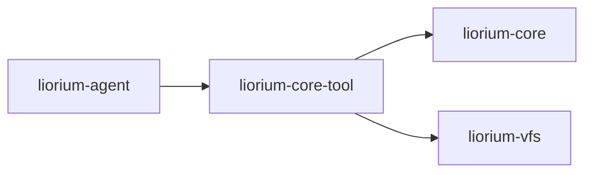

# liorium-core-tool

六个核心工具：`read` / `write` / `edit` / `search` / `find` / `execute`。
工具层只与 `VirtualFileSystem` 和 `liorium.core` 声明的端口打交道：不做权限判断、
不读产品配置；允许 import `liorium.agent`（2026-11-06 起），但工具本身不需要它。

> **装配在隔壁包**（2026-11-08）：Agent 不再自动挂这六个工具。要把它们接进 Agent，
> 用 `liorium-core-tool-realm`（`RealmSpec(id="core")` + `CoreToolRealm`）；本包只提供
> 工具实现与 `ToolRuntime`。

## 职责

- **一个 `read` 吃下全部读取面**：裸路径 / `file://` / `<scheme>://`（`agent://` /
  `skills://` / `memories://` / `artifacts://` / `code://` …）、目录列举、行选择器、
  结构摘要、图片多模态、二进制说明；
- **写与编辑**：`write` 覆盖式写、`edit` 恰好一处替换（保留 CRLF）；只读挂载**抛错**；
- **检索**：`search`（正则，输出 `路径:行号: 内容`）、`find`（glob，目录带 `/` 后缀）；
- **执行**：`execute` 跑 shell 命令，超时杀整个进程树，首行披露 `[Shell: ...]`，其后
  `stdout` / `[stderr]` / `[exit code: N]`；Windows 上含换行的命令自动走 PowerShell
  （`cmd.exe` 会在第一个换行处截断，后续内容静默丢失）；
- **编码嗅探**：真实文件经 `sniff.sniff_text` 判定 —— UTF-16 / GB18030 文本照常读出
  （非 UTF-8 时首行 `[编码: ...]`），`类型:` 与内容判定一致；
- **路径解析**：`ToolRuntime.resolve_path()` 统一「裸路径 = 真实文件系统（相对
  workspace_root）/ `<scheme>://` = VFS」，并归一化 Windows 的 `\\?\` 前缀；
- **输出不截断**：长输出的截断与 artifact 引用由 Agent 的 `OutputStore` 包装层负责。

## 公开面

`from liorium.core_tool import CORE_TOOL_NAMES, ResolvedPath, ToolRuntime, build_core_tools, build_read_tool`
（都在 `liorium.core_tool.__all__`）。

| 名字 | 说明 |
|---|---|
| `CORE_TOOL_NAMES` | `("read", "write", "edit", "search", "find", "execute")`，顺序固定 |
| `ToolRuntime` | 六个工具共享的运行时：`vfs`、`workspace_root`、`artifacts`（`ArtifactStore`）、`max_output_chars`、`default_timeout`、`process_runner`，以及文件/VFS/进程 helper |
| `ResolvedPath` | `uri` / `is_vfs` / `path` / `display` / `scheme` |
| `build_core_tools` | `build_core_tools(runtime, *, names=None)`；未知工具名抛 `ValueError` |
| `build_read_tool` | 单独装配 `read`（工具名恒为 `read`） |

六个工具的入参与返回见 [API](../../docs/API.md)。

## 最小示例

```python
import asyncio
from pathlib import Path
from typing import Any, Mapping

from liorium.core_tool import CORE_TOOL_NAMES, ToolRuntime, build_core_tools
from liorium.vfs import VirtualFileSystem


class MemoryArtifacts:
    """最小的 ArtifactStore 实现（真实宿主用 liorium-agent 的 OutputStore）。"""

    def __init__(self) -> None:
        self.items: dict[str, str] = {}

    def put(self, text: str, *, tool_name: str = "", metadata: Mapping[str, Any] | None = None) -> str:
        artifact_id = f"a{len(self.items) + 1}"
        self.items[artifact_id] = text
        return artifact_id

    def put_multimodal(self, payload: Mapping[str, Any], *, tool_name: str = "") -> str:
        return self.put(str(payload), tool_name=tool_name)

    def get(self, artifact_id: str) -> Any:
        return self.items.get(artifact_id)

    def summary(self, artifact_id: str) -> str:
        return f"[完整输出: artifact://{artifact_id}]"

    def exists(self, artifact_id: str) -> bool:
        return artifact_id in self.items


async def main() -> None:
    workspace = Path(".liorium-core-tool-demo")
    workspace.mkdir(exist_ok=True)
    (workspace / "notes.txt").write_text("第一行\n第二行\n", encoding="utf-8")

    runtime = ToolRuntime(
        vfs=VirtualFileSystem(owner_id="demo"),
        workspace_root=workspace,
        artifacts=MemoryArtifacts(),
    )
    tools = {tool.name: tool for tool in build_core_tools(runtime)}
    print("工具:", CORE_TOOL_NAMES)
    print(await tools["read"].ainvoke({"uri": "notes.txt"}))
    print(await tools["find"].ainvoke({"pattern": "*.txt"}))


asyncio.run(main())
```

```text
工具: ('read', 'write', 'edit', 'search', 'find', 'execute')
第一行
第二行

notes.txt
```

在 Agent 里不需要手动构造 `ToolRuntime`：`LioriumAgent` 会用 `spec` 的
`effective_workspace_root`、`limits.max_tool_output_chars` 和 `artifacts` 建好它。

## 依赖方向



- 依赖 `liorium-core`、`liorium-vfs`、`langchain-core`；
- **允许** import `liorium.agent`（2026-11-06 起）；当前没有使用——工具只需要 `liorium.core` 的端口和 `liorium.vfs` 的挂载面；
- 工具名冲突由上层（`RealmManager` / `LioriumAgent`）报 `ToolNameConflictError`，
  本包不做注册表。

## 测试

```powershell
.\.venv\Scripts\python.exe -m pytest -q -p no:cacheprovider packages/liorium-core-tool/tests
```

覆盖：`read` 的全部后端与选择器（`test_read.py`）、`write`/`edit` 的逐字文案与
唯一匹配（`test_write_edit.py`）、`search`/`find`（`test_search_find.py`）、
`execute` 的超时与进程树（`test_execute.py`）、路径解析与 ACK（`test_runtime.py`）。
