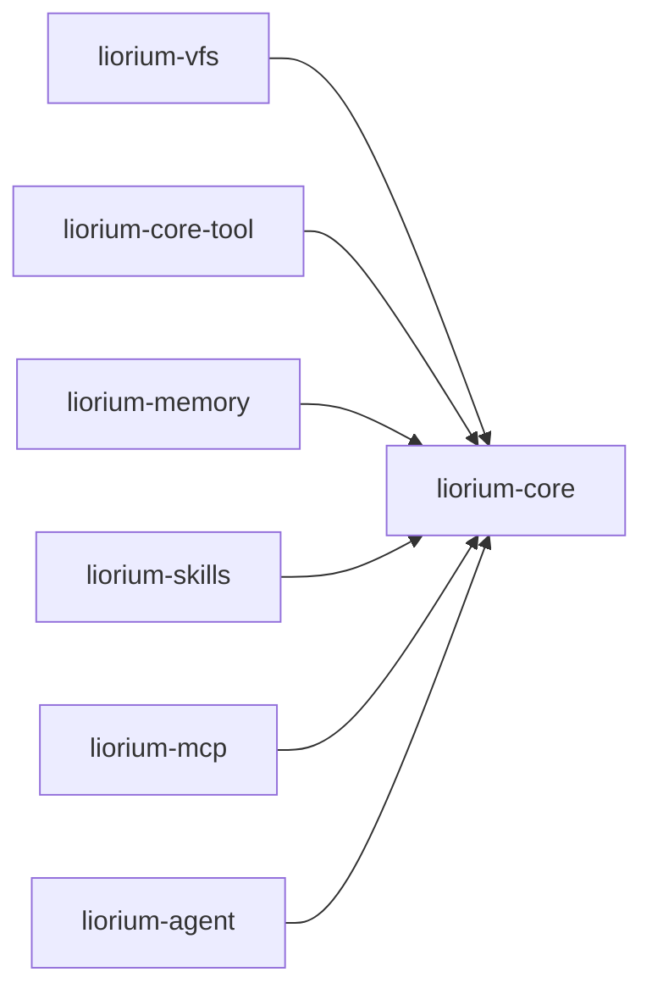

# liorium-core

Liorium 的叶子包：**零第三方依赖**（只用标准库），不做任何 IO，不读任何配置。
它定义所有包共享的类型、URI 规则、结构指纹、日志与异常——是依赖图的终点。

## 职责

- **内容模型**：`Text` / `Image` / `Binary` 的封闭三元联合 `VfsContent`；
- **事件协议**：`Event` 与 9 种 Agent 事件的冻结常量（`run()` 是唯一出口，没有宿主事件）；
- **Context**：`ContextItem` 与物化文本块（`<context source="…" at="HH:MM">…</context>`）；
- **URI**：`<scheme>://a/b` ≡ `/<scheme>/a/b`、行选择器解析（`:50-100` / `:-3` / `:raw`）；
- **指纹**：canonical JSON + sha256（`apply()` 差量、`CacheEpoch` 都依赖它）；
- **日志 / 异常 / 路径锚点**，以及工具需要的端口协议（`liorium.core.ports`）。

## 公开面

`from liorium.core import ...`（下面的名字都在 `liorium.core.__all__` 里）：

| 模块 | 主要名字 | 说明 |
|---|---|---|
| `types` | `Text`、`Image`、`Binary`、`VfsContent`、`content_to_text`、`content_size`、`content_kind` | 内容模型与投影 helper |
| `types` | `ContextItem`、`render_context_block` | 注入上下文与物化文本 |
| `types` | `Event`、`AGENT_EVENT_TYPES`、`ALL_EVENT_TYPES`、`ev_*` | 事件协议（`run()` 是唯一出口） |
| `uri` | `parse`、`ParsedUri`、`vfs_uri` | URI 解析；`vfs_path()` 映射到 VFS |
| `canonical` | `canonicalize`、`fingerprint`、`short_fingerprint` | 结构指纹 |
| `log` | `configure`、`get_logger` | `liorium.*` 命名空间日志 |
| `errors` | `LioriumError` 及具体异常 | 见 [API](../../docs/API.md) |

子模块里还有 `liorium.core.ports`（`ArtifactStore` / `ProcessRunner` / `Clock` 三个
`Protocol`）与 `liorium.core.paths`（`ensure_dir` / `resolve_workspace_path` /
`resolve_file_uri`）；它们不在包的 `__all__` 里，属于实现者接口。

## 最小示例

```python
from liorium.core import Event, fingerprint, parse

uri = parse("skills://demo/SKILL.md:1-20")
print(uri.scheme, "|", uri.path, "|", uri.selector, "|", uri.selector_lines, "|", uri.is_vfs)
print(uri.vfs_path())                 # /skills/demo/SKILL.md

print(parse("notes.txt:42").scheme)   # file（裸路径 = 真实文件系统）
print(parse("notes.txt:42").selector_lines)   # (42, 42)

print(fingerprint({"b": 2, "a": 1})[:12])
print(Event("delta", {"content": "hi"}).to_dict())
```

```text
skills | demo/SKILL.md | :1-20 | (1, 20) | True
/skills/demo/SKILL.md
file
(42, 42)
43258cff783f
{'type': 'delta', 'content': 'hi'}
```

## 依赖方向



- 只依赖标准库；`liorium-core` **不 import** `liorium-vfs` / `liorium-agent` / langchain；
- 其他包都依赖它，所以这里加任何第三方依赖都会拖累全仓库（架构守卫会拦）；
- 不可序列化对象（模型、回调、连接）**不能**进指纹：`canonicalize()` 会抛 `TypeError`，
  而不是用 `repr()` 兜底。

## 测试

```powershell
.\.venv\Scripts\python.exe -m pytest -q -p no:cacheprovider packages/liorium-core/tests
```

覆盖：URI 解析与选择器（`test_uri.py`）、类型与事件契约（`test_types.py`）、
指纹稳定性（`test_canonical.py`）。
