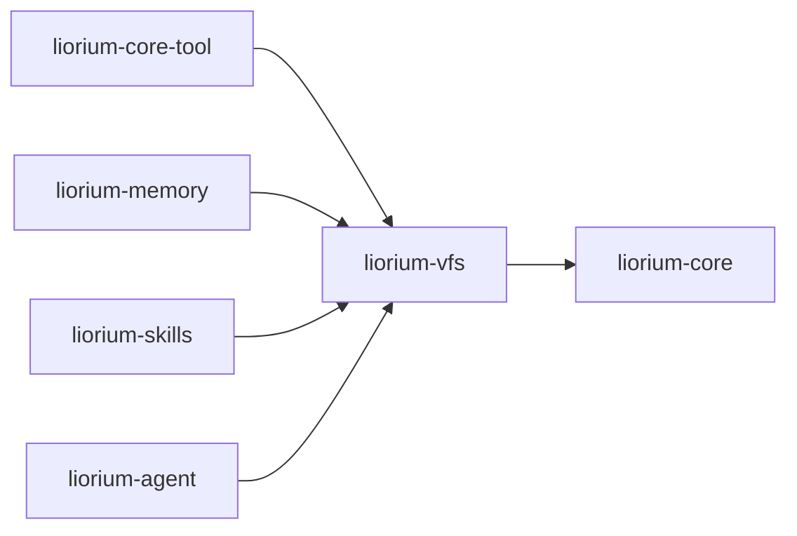

# liorium-vfs

Liorium 的**读模型 / 操作界面**：`VirtualFileSystem` / `VfsNode` / `VfsMount`。
零第三方依赖（只依赖 `liorium-core` 与标准库），不持久化、不认识 Agent、不 import langchain。

## 职责

- **树 + 挂载**：`mount_vfs(prefix, other, readonly)` 带 owner 链**环检测**；
  挂载前缀与已有节点冲突直接报错，不静默覆盖；
- **懒加载投影**：节点内容可以由 `provider` 现算，目录可以用
  `child_provider` / `children_provider` 按需展开（投影不缓存，因为真相源可能在 VFS 之外变化）；
- **内容模型**：`liorium.core.types.VfsContent` 三元联合；`search` / `find` 只走 `Text`；
- **写协议**：`write_handler` / `edit_handler` / `create_handler` 把写入交给 realm，
  返回值走 ACK 通道（`↳ ack`）；
- **并发**：读写都走写者优先的 `AsyncRWLock`（`liorium.vfs.locks`）。

## 公开面

`from liorium.vfs import VirtualFileSystem, VfsNode, VfsMount`（三者都在 `liorium.vfs.__all__`）。

| 名字 | 关键成员 |
|---|---|
| `VirtualFileSystem` | `resolve` / `exists` / `read` / `read_text` / `stat` / `list` / `walk` / `find` / `write` / `write_async` / `edit` / `mkdir` / `remove` / `mount` / `mount_vfs` / `mount_node` / `unmount` / `mounts` / `dump_tree` |
| `VfsNode` | `name`、`is_directory`、`content`、`children`、`mount`、`provider`、`write_handler`、`edit_handler`、`create_handler`、`child_provider`、`children_provider`、`should_be_included_in_search`、`writable`、`readonly`、`description`、`meta` |
| `VfsMount` | `prefix`、`vfs` / `node`（二选一）、`readonly`、`description` |

完整签名见 [API](../../docs/API.md)。

## 最小示例

```python
import asyncio

from liorium.core.types import Text
from liorium.vfs import VirtualFileSystem, VfsMount, VfsNode


async def main() -> None:
    fs = VirtualFileSystem(owner_id="demo")
    await fs.write("/notes/a.md", Text("hello"))
    print(await fs.read_text("/notes/a.md"))

    skills = VirtualFileSystem(owner_id="skills")
    skills.root.add_child(VfsNode(name="demo", is_directory=True, description="示例技能"))
    fs.mount(VfsMount(prefix="/skills", vfs=skills, readonly=True))
    print([node.name for node in await fs.list("/skills")])
    try:
        await fs.write("/skills/x.md", Text("no"))
    except Exception as exc:
        print(type(exc).__name__, exc)


asyncio.run(main())
```

```text
hello
['demo']
VfsReadOnlyError /skills/x.md 位于只读挂载 'skills' 下
```

## 依赖方向



- `liorium-vfs` 只依赖 `liorium-core` + 标准库；
- 能力包依赖它，是因为 `Realm.mounts()` 的返回类型是 `VfsMount`；
- **VFS 里不放真相**：节点要么是显式 `VfsContent`，要么是从 realm store 现算的投影；
  realm 状态投影必须 `should_be_included_in_search=False`。

## 测试

```powershell
.\.venv\Scripts\python.exe -m pytest -q -p no:cacheprovider packages/liorium-vfs/tests
```

覆盖：挂载/环检测/只读、选择器与路径归一化、handler 与 ACK、懒加载投影与分页
（`packages/liorium-vfs/tests/test_vfs.py`）。
